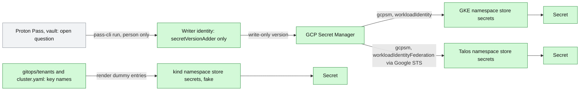

# RFC 0020: Back the ESO store secrets with GCP Secret Manager

## Summary

Every namespace reads secrets through the External Secrets Operator (ESO) store `secrets`, whose backend is still open. This RFC proposes that backend for Talos, GKE and kind: one write per value change whatever the number of clusters (with shared secret names), no ciphertext in Git and an offline kind.

| Decision | Why | Cost | Reversible |
| --- | --- | --- | --- |
| GCP Secret Manager backs the store `secrets` on Talos and GKE | One write per value with shared names, no ciphertext in Git | GCP needed at refresh time | yes: render another store provider, re-seed from Proton Pass |
| The ESO fake provider with dummy values backs it on kind | Offline, no credential or person | Two store providers to template | yes: render another store provider |
| Proton Pass is the only human source; a person-run path adds versions | Agents do not use the writer identity | The `pass-cli` session stays an agent read path | open, see [open questions](#open-questions) |
| Keyless access: one principal per namespace, prefix-conditioned IAM and one workload identity pool per Talos cluster | No secret zero; O(namespaces) bindings | Key lists in `infra`; the Talos signing key becomes an off-cluster credential | open, see [open questions](#open-questions) |
| Only the platform creates stores: tenants cannot create `SecretStore` or `PushSecret` | A tenant store could fight the platform one (ADR-0016) | Extends the ADR-0009 blacklist | open, see [open questions](#open-questions) |

<!-- readability: allow-code R2 -->

## Context

| Constraint | Consequence for the backend |
| --- | --- |
| `gsuquet/infra` and `gsuquet/gitops` are public. | Anything committed is public forever, ciphertext included: a key leaked in ten years opens every old ciphertext in the history. |
| Agents write the code but must never read or write a value; they run as the owner's OS user. | Agent rules are rules, not controls. A real control is an identity that agents do not hold. |
| N clusters: kind (many, ephemeral), Talos on Raspberry Pis and local servers, GKE. | The cost of one secret change must not grow with N, or must stay small. |
| kind is ephemeral and must work offline. | kind cannot depend on a credential, a network or a person at the keyboard. |
| Each cluster runs its own Argo CD on rendered manifests (ADR-0004, ADR-0005). | No value can go through the render step or the Argo CD repository server. |
| IaC (OpenTofu, RFC 0022) installs only the cluster, Gateway API CRDs, Cilium and Argo CD (ADR-0015). | The backend credential, if any, is created without a value in state, or not needed. |
| The owner's human store is Proton Pass; IaC credentials already come from `pass-cli run` with `pass://` references (`landing-zone/cloudflare/pass/*.env`). | A human-to-backend step already exists and can be reused. |

[ADR-0016](../adr/0016-secret-store-named-secrets.md) fixed the store name `secrets` so that the backend can change; no real cluster can get a value until a backend is chosen.

## Goals and non-goals

Goals:

- One value write per new or rotated value, whatever the number of clusters that read it (needs shared names, see [secret naming](#secret-naming)).
- Nothing secret in the public repositories: names, IAM bindings and public keys only.
- kind gets every `ExternalSecret` `Ready` offline, with no credential and no person.
- No static bootstrap credential (secret zero) in any cluster.
- Keep the ESO store contract (ADR-0016) and the rendered manifests pattern ([ADR-0005](../adr/0005-rendered-manifests-pattern.md)).

Non-goals:

- Dynamic credentials, leases or an internal PKI ([OpenBao or Vault](#openbao-or-vault) covers them; not required today).
- The IaC credentials of the roots themselves: they keep coming from `pass-cli run`.
- Carrying over the homelab SOPS and age tooling.
- kind end-to-end CI (deferred by [ADR-0019](../adr/0019-lifecycle-tasks-and-ci-scope.md)).

## Decision drivers

- Nothing harvestable in public Git history, ciphertext included.
- A real control between agents and values: an identity agents do not use.
- The cost of one value change does not grow with N.
- kind works offline, unattended, and is recreated at will.
- No cluster needs a static bootstrap credential.

## Options considered

The [options study](../research/0020-secrets-backend-options.md#scores) scores the compared backends. Contract and manifests fit, complexity and DR are secondary.

### SOPS seeds

The homelab model: SOPS files in Git, [one apply per cluster](../research/0020-secrets-backend-options.md#sops-seeds).

- Good: offline, no bootstrap credential in the cluster.
- Bad: ciphertext in public Git; N edits (or a shared file) and N applies.

### Secret Manager everywhere

GCP Secret Manager, [kind included](../research/0020-secrets-backend-options.md#secret-manager-everywhere).

- Good: no static key.
- Bad: kind gets new signing keys at each creation **(unverified)**, so each create needs a JWKS upload, a network and a GCP write by a person.

### Sealed Secrets

[One sealed object per cluster](../research/0020-secrets-backend-options.md#sealed-secrets) in Git. Facts are **unverified**.

- Good: decryption is in-cluster only.
- Bad: ciphertext in Git; N seals; bypasses ESO.

### SOPS in the cluster

[KSOPS at sync, or an operator](../research/0020-secrets-backend-options.md#sops-in-the-cluster), decrypts. Tool facts are **unverified**.

- Good: one edit can serve many clusters when all are recipients of one file.
- Bad: an age key in every cluster; KSOPS breaks rendered manifests; the operator bypasses ESO.

### OpenBao or Vault

[Self-hosted](../research/0020-secrets-backend-options.md#openbao-or-vault), read by ESO. Operational facts are **unverified**.

- Good: one write; a writer token agents do not hold.
- Bad: a stateful service to run; no offline kind.

### SaaS managers

[Hosted stores](../research/0020-secrets-backend-options.md#saas-managers) with an ESO provider.

- Good: one write, nothing in Git.
- Bad: `alpha` providers; a static token per cluster.

### Hybrid

Proposed: [Secret Manager on real clusters, fake on kind](../research/0020-secrets-backend-options.md#hybrid), Proton Pass as source.

- Good: one version write per change (with shared names); no secret zero; nothing harvestable in Git.
- Bad: agent isolation holds only once the `pass-cli` and Talos state paths are closed.

### Do nothing

The store keeps an in-cluster dummy backend on kind only; Talos and GKE have none.

- Good: no cost, no cloud dependency, no new IAM.
- Bad: no real cluster can run a component or tenant that needs a secret; every consumer blocks on this decision.

## Proposal

The [Hybrid](#hybrid) option.

One write reaches every cluster that reads the secret within its `refreshInterval`; kind never touches the network.

Legend: green is new, gray is unchanged.

The [design page](../research/0020-secrets-backend-design.md) holds the detail and the [confirmation checks](../research/0020-secrets-backend-design.md#confirmation-checks).

## Operational impact

- Blast radius: every namespace of every Talos and GKE cluster reads through Secret Manager: a wrong store template or IAM condition turns `ExternalSecret` objects `NotReady` (running pods keep their Secrets) or over-grants a namespace; a leaked Talos signing key exposes the secrets granted to one cluster's pool; a leaked writer identity can add versions to every secret; kind is unaffected.
- Rollout: kind, then `landing-zone/gcp`, protection of Proton Pass and Talos state before any production value, the first Talos cluster, GKE, tenants: [steps and gate](../research/0020-secrets-backend-design.md#rollout).
- Rollback: per cluster, render the store `secrets` with another provider (for example [SOPS seeds](#sops-seeds) on Talos only) and re-seed values from Proton Pass; consumers do not change thanks to the store contract. Then destroy versions and secret objects in `landing-zone/gcp`. Nothing is irreversible: Proton Pass keeps every value.
- Migration: None: greenfield, no value exists in any backend yet; copied homelab objects follow the [`remoteRef` convention](#remoteref-convention).
- Security: extends the ADR-0009 tenant `namespaceResourceBlacklist` with `SecretStore` and `PushSecret`, resolving the open risk of ADR-0009 and ADR-0016 ([open question](#tenant-blacklist-change)). New trust boundary: Google STS trusts each Talos cluster's SA signing key through its uploaded JWKS, so that key (in R2 state) becomes an off-cluster credential; IAM per namespace principal, prefix-conditioned; writer identity with `secretVersionAdder` only; no static key in any cluster; no ciphertext in Git; the `pass-cli` session and Talos state need their own controls before isolation holds.
- Cost: about USD 2.3 per month, pricing **(unverified)**: [basis](../research/0020-secrets-backend-cost.md).
- Observability: the ESO `Ready` condition on every `SecretStore` and `ExternalSecret` proves each store works and detects outages and IAM mistakes; the alert is [future work](#future-work). No SLO is touched yet.

## Drawbacks and risks

| Risk | Severity (proposed) | Mitigation |
| --- | --- | --- |
| The Talos SA signing key in cluster state (R2) becomes an off-cluster credential: anyone holding it mints tokens for any namespace, exchanges them at STS and reads every secret granted to that pool, from anywhere; agents run as the owner's OS user | high | One pool per Talos cluster, and production Talos state out of agents' reach ([open question](#talos-state-isolation)) before production values are written |
| The owner's `pass-cli` session reads every value, for every option fed from Proton Pass | high | Dedicated vault, separate login, re-authentication per use, short session ([open](#proton-pass-session)) |
| Pi clusters need internet and GCP to refresh or rebuild ([outage detail](../research/0020-secrets-backend-design.md#gcp-outage)) | medium | [Fallback](#offline-fallback) per Talos cluster if a [cloud dependency](#gcp-dependency) is refused |
| Talos SA key rotation disrupts every in-cluster token, plus a JWKS re-upload | medium | Maintenance event, old and new keys in the JWKS |
| A stale or wrong JWKS breaks authentication silently at upload | medium | `cluster:up` post-step reads the live JWKS; the first-cluster confirmation check catches it |
| Account or billing suspension, or project deletion, removes every value from the backend | medium | Proton Pass re-seeds them with one task run; nothing else is lost (no customer-managed key) |
| Prefixes and key lists couple `gsuquet/gitops` to `infra` | low | One list feeds both the kind dummies and IAM, and it keeps the platform in control |
| `gcpsm` without `property` is **(unverified)** | low | Test on the first secret, then fix the [convention](#remoteref-convention) |
| The default `refreshInterval` of 1h is **(unverified)** | low | Set it [explicitly](#refresh-interval) |

## Open questions

### GCP dependency

Is a GCP dependency at refresh time acceptable for the Pi clusters (home ISP outage = no refresh, no rebuild)?

### GCP projects

One for the secrets of all clusters, or one per environment? [Alternatives](../research/0020-secrets-backend-questions.md#gcp-projects)

### Workload identity pools

One per Talos cluster (proposed), or one shared pool with the cluster name in the subject mapping?

### Secret naming

Shared tenant-prefixed, shared without tenant, per cluster, or a mix? Only shared names give one write for every cluster. [Alternatives](../research/0020-secrets-backend-questions.md#secret-naming)

### Write path

IaC write-only or a `pass-cli` pipe? [Alternatives](../research/0020-secrets-backend-questions.md#write-path)

### Writer identity

A separate Google account, or impersonation of a writer service account? [Alternatives](../research/0020-secrets-backend-questions.md#writer-identity)

### remoteRef convention

Plain payloads with no `property`, or JSON payloads? [Alternatives](../research/0020-secrets-backend-questions.md#remoteref-convention)

### Refresh interval

1h (faster rotation) or 24h (lower cost, less traffic)?

### Tenant scope

What may a tenant read, who writes its values, where are keys listed? [Alternatives](../research/0020-secrets-backend-questions.md#tenant-scope)

### Offline fallback

Is [SOPS seeds](#sops-seeds) acceptable as the documented fallback for an offline-only cluster, or dropped entirely?

### Talos state isolation

Which control? Without one, Secret Manager gives agents an off-cluster read path. [Alternatives](../research/0020-secrets-backend-questions.md#talos-state-isolation)

### Proton Pass session

Which controls? Without them, `pass-cli` is an agent read path for every option. [Alternatives](../research/0020-secrets-backend-questions.md#proton-pass-session)

### Bootstrap boundary

`landing-zone/gcp` (proposed) or the cluster root? [Alternatives](../research/0020-secrets-backend-questions.md#bootstrap-boundary)

### Tenant enforcement

In `gsuquet/gitops`: Conftest in its CI, an admission policy in each cluster, or both?

### Tenant blacklist change

Adding `SecretStore` and `PushSecret` to the tenant blacklist changes accepted [ADR-0009](../adr/0009-tenant-onboarding-by-infra.md): does accepting this RFC settle it (ADR-0009 then superseded by a follow-up RFC, or by this one through `supersedes:`), or does ADR-0009 get its own superseding RFC first?

## Decision

Pending.

## Implementation

N/A: not accepted yet.

## References

- Sources: [options](../research/0020-secrets-backend-options.md#sources), [design](../research/0020-secrets-backend-design.md#sources), [cost](../research/0020-secrets-backend-cost.md).
- [ADR-0004](../adr/0004-self-managed-argo-cd-per-cluster.md), [ADR-0015](../adr/0015-bootstrap-boundary.md); RFC 0022 (OpenTofu), in [PR 11](https://github.com/gsuquet/infra/pull/11).

## Future work

- Reconsider [OpenBao or Vault](#openbao-or-vault) if dynamic credentials or an internal PKI become requirements.
- The [offline fallback](#offline-fallback), if kept.
- An alert on `ExternalSecret` `Ready=False` once the observability stack exists.
