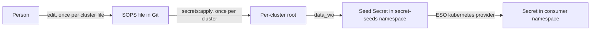
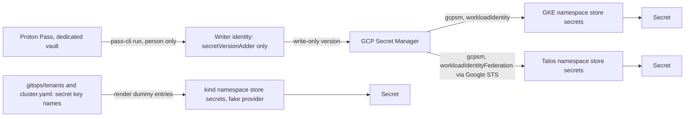
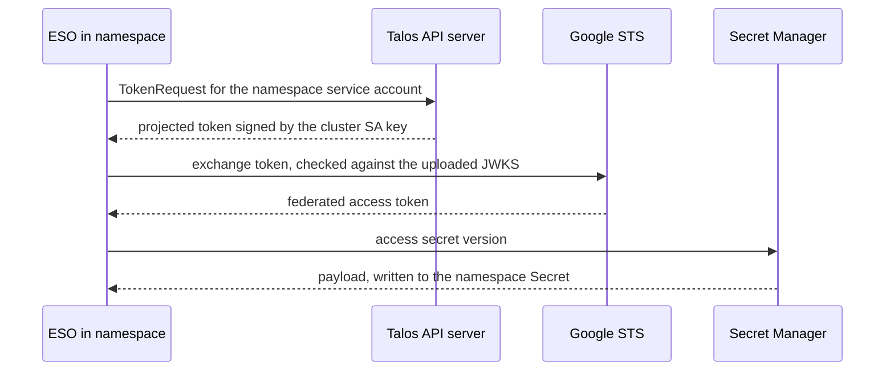
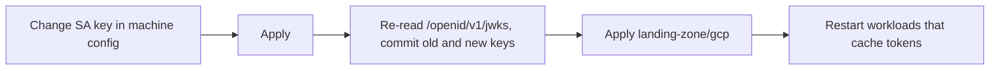

# RFC 0020: Back the ESO store secrets with GCP Secret Manager

## Summary

Every namespace reads secrets through the External Secrets Operator (ESO) store `secrets` (ADR-0016), whose backend is still open. This RFC proposes GCP Secret Manager behind that store on Talos and GKE, the ESO fake provider with dummy values on kind, and Proton Pass as the only human store, feeding Secret Manager through a person-run, write-only path. Outcome: one write per value change whatever the number of clusters, no ciphertext in Git, and an offline kind.

## Context

| Constraint | Consequence for the backend |
| --- | --- |
| `gsuquet/infra` and `gsuquet/gitops` are public. | Anything committed is public forever, ciphertext included: a key leaked in ten years opens every old ciphertext in the history. |
| Agents write the code but must never read or write a value; they run as the owner's OS user. | Agent rules are rules, not controls. A real control is an identity that agents do not hold. |
| N clusters: kind (many, ephemeral), Talos on Raspberry Pis and local servers, GKE. | The cost of one secret change must not grow with N, or must stay small. |
| kind is ephemeral and must work offline. | kind cannot depend on a credential, a network or a person at the keyboard. |
| Each cluster runs its own Argo CD on rendered manifests (ADR-0004, ADR-0005). | No value can go through the render step or the Argo CD repository server. |
| IaC (OpenTofu, RFC 0022) installs only the cluster, Gateway API CRDs, Cilium and Argo CD (ADR-0015). | The backend credential, if any, is created without a value in state, or not needed. |
| The owner's human store is Proton Pass; IaC credentials already come from `pass-cli run` with `pass://` references (`landing-zone/cloudflare/pass/*.env`). | A human-to-backend step already exists and can be reused. |

ADR-0016 fixed the store name `secrets` so that the backend can change; no real cluster can get a value until a backend is chosen.

## Goals and non-goals

Goals:

- One value write per new or rotated value, whatever the number of clusters that read it.
- Nothing secret in the public repositories: names, IAM bindings and public keys only.
- kind gets every `ExternalSecret` `Ready` offline, with no credential and no person.
- No static bootstrap credential (secret zero) in any cluster.
- Keep the ESO store contract (ADR-0016) and the rendered manifests pattern (ADR-0005).

Non-goals:

- Dynamic credentials, leases or an internal PKI (option E covers them; not required today).
- The IaC credentials of the roots themselves: they keep coming from `pass-cli run`.
- Carrying over the homelab SOPS and age tooling.
- kind end-to-end CI (deferred by ADR-0019).

## Decision drivers

- Nothing harvestable in public Git history, ciphertext included.
- A real control between agents and values: an identity agents do not use.
- The cost of one value change does not grow with N, and no cluster needs a static bootstrap credential.
- kind works offline, unattended, and is recreated at will.
- Keep the ESO store contract and rendered manifests, with no new stateful service to run, and recover after the loss of a key, a cluster or an account.

## Options considered

Scores per criterion. Legend: `++` best, `+` good, `0` neutral, `-` poor, `--` blocking. The `pass-cli` read path applies to every option fed from Proton Pass, so the agent isolation row scores the other paths: no option beats `0` there until the `pass-cli` session is protected.

| Criterion | A. SOPS + seeds | B. GCP SM | B-kind. fake | C. Sealed | D. SOPS in cluster | E. OpenBao | F. SaaS |
| --- | --- | --- | --- | --- | --- | --- | --- |
| Public repo (nothing to harvest) | - | ++ | 0 (dummies) | - | - | ++ | ++ |
| Agent isolation (`pass-cli` path aside) | 0 | 0 on Talos (+ once agents cannot read Talos state), + on GKE | n/a | 0 | 0 | + | + |
| Write cost for N clusters (values and IAM) | -- | + (++ with prefix-conditioned IAM) | n/a | -- | 0 | ++ | ++ |
| kind, offline and unattended | - | -- | ++ | - | - | -- | -- |
| No bootstrap credential per cluster | + | ++ | ++ | 0 | - | 0 | - |
| Outage resilience | ++ | 0 | ++ | ++ | ++ | - | 0 |
| DR and key loss | 0 | + | ++ | - | - | - | + |
| Cost | ++ | + (about USD 2-3/month) | ++ | ++ | ++ | - | 0 |
| Talos fit | + | 0 (disruptive key rotation, JWKS re-upload, signing key in state) | n/a | + | 0 | 0 | 0 |
| GKE fit | 0 | ++ | n/a | 0 | 0 | - | 0 |
| Operational complexity | - | + | ++ | 0 | - | -- | 0 |
| Keeps ESO store `secrets` contract | yes | yes | yes | no | no (KSOPS and operator) | yes | yes |
| Fits rendered manifests | yes | yes | yes | yes | no (KSOPS) | yes | yes |

### A. SOPS + age, seed Secrets, ESO Kubernetes provider (homelab model)

A person edits one SOPS file per cluster; a person-only root per cluster decrypts it in memory (`ephemeral "sops_file"`) and writes seed Secrets in `secret-seeds-<consumer>` through `data_wo`; ESO copies them with the Kubernetes provider (`beta`). Source: `gsuquet/homelab` `docs/explanation/secrets-management.md`.

- Good: no runtime dependency, free, offline, proven in homelab; no bootstrap credential in the cluster (the applier needs a kubeconfig that writes the seed namespaces).
- Good: the production scope key on a hardware key with touch is a real control for decryption; a leaked Talos state reads values only from a network that reaches the API server.
- Bad: write cost: one SOPS edit and one person-run `secrets:apply` per cluster; a value shared by 3 clusters is 3 edits (or a shared file) and 3 applies.
- Bad: public repo: ciphertext in Git forever; a leaked scope or recovery key opens every past version and forces a rotation of every value at its issuer.
- Bad: a re-created kind has no seeds until a person applies them (this blocked tests in homelab); each value sits twice in etcd; on GKE it ignores the native store.
- Bad: a second human store next to Proton Pass, with the same `pass-cli` exposure; high complexity (SOPS rules, age keys, a root per cluster, seed namespaces, a state test, a clean-environment apply script). DR: lost scope key falls back to the offline paper recovery key; both lost means re-entering values from the issuer or Proton Pass.

### B. GCP Secret Manager everywhere, kind included (ESO `gcpsm`)

Each value lives once in Secret Manager; each namespace store `secrets` uses `gcpsm` with a short-lived federated token, no static key.

- Good: as G on Talos and GKE (see the Proposal).
- Bad: kind gets new service account signing keys at each creation (**unverified** for kind; kubeadm generates them at init), so each create needs a JWKS upload, a network and a GCP write by a person.

### C. Sealed Secrets

A controller per cluster holds a private key; `kubeseal` encrypts against that cluster's public certificate; the `SealedSecret` is committed. Facts are **unverified**: the project docs are outside the allowed documentation domains.

- Good: free, no runtime dependency; decryption is in-cluster only; works the same on Talos and GKE.
- Bad: write cost: one seal and one commit per cluster per value; rotation is N seals.
- Bad: ciphertext in Git per cluster; a leaked controller key opens every past `SealedSecret` of that cluster; the key must be backed up per cluster, and renewal (every 30 days by default) adds keys that must be kept to read old objects.
- Bad: each new kind has a new key, so committed objects do not decrypt unless a fixed key is injected, which is then a secret on the laptop.
- Bad: bypasses ESO and breaks the store `secrets` contract; the risk on the agent side is a person piping plaintext through an agent session.

### D. SOPS decrypted in the cluster (KSOPS, sops-secrets-operator)

KSOPS is a Kustomize plugin in the Argo CD repository server; a SOPS operator decrypts a `SopsSecret` resource in cluster. Tool facts are **unverified** (outside the allowed domains, except SOPS on `github.com/getsops`).

- Good: one edit can serve many clusters when all are recipients of one file (but then the file opens on every cluster; per-cluster files cost N edits); no apply step; GKE could use Cloud KMS instead of age.
- Bad: an age key in every cluster (secret zero), injected by IaC (in state) or by hand, and re-injected at each kind create; DR as A plus a key copy in every etcd.
- Bad: KSOPS breaks rendered manifests (Argo CD runs a plugin, or the render writes plaintext into `rendered/`); the operator bypasses ESO.

### E. Self-hosted OpenBao or Vault

ESO reads through the Vault provider (`stable`), documented for OpenBao (`alpha` pairing); clusters authenticate with Kubernetes or JWT auth. Operational facts are **unverified** (`openbao.org` is outside the allowed domains).

- Good: nothing in Git; one write per change; path policies and a writer token agents do not hold; dynamic credentials, PKI and leases if ever needed.
- Bad: highest complexity: a stateful HA service (3 Raft nodes), upgrades, unseal keys or an auto-unseal KMS (back to a cloud KMS), off-site Raft snapshots and tested restores, audit logs, TLS; losing unseal keys and snapshots loses everything.
- Bad: on the Pi cluster it is a circular dependency (that cluster cannot bootstrap itself) and its outage stops every cluster's refresh; elsewhere it is a new single point of failure on always-on hardware.
- Bad: Kubernetes auth needs OpenBao to reach each API server for TokenReview; JWT auth has the JWKS upload problem of B; kind needs a network and a role per cluster; pointless next to Secret Manager on GKE.

### F. SaaS secrets managers with an ESO provider

Bitwarden Secrets Manager, 1Password, Infisical, Doppler, Keeper, Passbolt: all `alpha` in ESO.

- Good: nothing in Git, one write per change.
- Bad: `alpha` providers; a static machine token per cluster (secret zero); a new vendor; a network, so no offline kind; 1Password needs Connect or an SDK service account, Bitwarden the `bitwarden-sdk-server` (**unverified**).
- Bad: Proton Pass, the store already in use, has no ESO provider. The Generic Webhook provider (`alpha`) would need a documented Proton Pass machine API (none found, **unverified**) and a Proton credential with vault access in every cluster.

### G. Hybrid: B on Talos and GKE, fake provider on kind, Proton Pass as source (proposed)

B for real clusters, B-kind (ESO fake provider with dummy values) for kind, values written from Proton Pass. Detailed in the Proposal.

- Good: one version write per change and O(namespaces) IAM bindings; no secret zero; nothing harvestable in Git; store contract and rendered manifests intact; Proton Pass is the DR copy.
- Bad: two store providers to template (`gcpsm`, `fake`); a GCP dependency for the Pi clusters at refresh time; agent isolation holds only once the `pass-cli` and Talos state paths are closed.

### Do nothing

The store `secrets` keeps an in-cluster dummy backend on kind only (ADR-0016); Talos and GKE have no backend.

- Good: no cost, no cloud dependency, no new IAM.
- Bad: no real cluster can run a component or tenant that needs a secret; every consumer blocks on this decision.

## Proposal

Option G. Facts were checked on 2026-11-18 against the linked source unless marked **(unverified)**.

### Value path

One write reaches every cluster that reads the secret within its `refreshInterval`; kind never touches the network.

### Stores per cluster type

| Cluster | Store `secrets` provider | Auth | Notes |
| --- | --- | --- | --- |
| GKE | `gcpsm` | `auth.workloadIdentity` with `serviceAccountRef` | With Workload Identity Federation for GKE, the role goes on `principal://iam.googleapis.com/projects/PROJECT_NUMBER/locations/global/workloadIdentityPools/PROJECT_ID.svc.id.goog/subject/ns/NAMESPACE/sa/KSA_NAME`, no Google service account. Standard clusters need nodes with the GKE metadata server; Autopilot handles it. |
| Talos | `gcpsm` | `auth.workloadIdentityFederation` with `serviceAccountRef` and `audience` (full provider name) | `projectID` must be set (no metadata server); optional `gcpServiceAccountEmail` for impersonation. One workload identity pool per Talos cluster. |
| kind | `fake` | none | `provider.fake.data` with dummy values such as `dummy-not-a-secret` that secret scanners do not flag; rendered from `gitops/clusters/<kind-cluster>/cluster.yaml`. |

### Talos authentication

The issuer stays private: read `/.well-known/openid-configuration` and `/openid/v1/jwks`, then create the provider with `--jwk-json-path` (`gcloud`) or `jwks_json` in the `oidc` block of `google_iam_workload_identity_pool_provider` (RSA and EC keys). The command does not validate the JWKS: a wrong or stale one fails later with `Error connecting to the given credential's issuer`. The issuer must match the token `iss` exactly; the Talos default issuer is the cluster endpoint **(unverified)**. Subject mapping `google.subject=assertion.sub` gives `system:serviceaccount:<ns>:<sa>`; a CEL attribute condition on `assertion['kubernetes.io']['namespace']` can limit namespaces.

### IAM, naming and IaC ownership

| Item | Rule |
| --- | --- |
| Principal | One per namespace: each store uses a service account in its own namespace (replaces the homelab seed namespace per consumer). |
| Grant | `roles/secretmanager.secretAccessor` once per namespace principal, with an IAM Condition `resource.name.startsWith("projects/PROJECT_NUMBER/secrets/TENANT--NAMESPACE--")`. Bindings: O(namespaces), against O(secrets x namespaces x pools) with per-secret grants, where each new tenant `ExternalSecret` would need an `infra` change and a person-run apply. The exact `resource.name` format (number or ID) and whether the version name must match too are **(unverified)**: test on the first secret. |
| Key list | `gitops/tenants/<tenant>.yaml` lists the secret key names of each tenant namespace (names only). One list feeds the kind dummies and the IAM prefixes; a tenant adding a secret needs an `infra` change, which keeps the platform in control of what a tenant reads. Without it, a tenant key missing from the fake store stays `NotReady` on kind. |
| `landing-zone/gcp` | Owns the project, the Secret Manager API, secret objects (no versions), workload identity pools, Talos providers with `jwks_json`, and conditional IAM. Holds no value, so agents can write it and the owner reviews it. |
| JWKS | A `cluster:up` post-step reads `/openid/v1/jwks` and commits it as public data (for example `clusters/<name>/jwks.json`). The cluster root needs no Google credential and no live API read, and GCP is not a dependency of cluster creation. Cost: a second apply of `landing-zone/gcp` before ESO on a new Talos cluster turns `Ready`. |
| Versions | Written only by the person-only path, never by `landing-zone/gcp` or a cluster root. |

### Writing values

Proton Pass is the only human source of truth. A person-run task resolves `pass://` references with `pass-cli run` and writes a version through an identity that holds only `roles/secretmanager.secretVersionAdder` and that agents do not use; no human principal needs `secretAccessor`. Two write paths (open question 5):

| Path | How | State |
| --- | --- | --- |
| IaC write-only | `google_secret_manager_secret_version.secret_data_wo` with `secret_data_wo_version`, fed by `ephemeral = true` variables; a rotation bumps the non-secret counter in Git. Write-only attribute support in OpenTofu is **(unverified)**. | No value in state |
| Pipe | `gcloud secrets versions add --data-file=-` from `pass-cli` (**unverified** exact syntax on the `pass-cli` side) | No state at all |

`remoteRef` convention: homelab objects set `property: value` because a seed holds a map; a plain-text Secret Manager payload has none. The fake provider ignores `property`, so plain payloads with no `property` should work on `gcpsm` and `fake`; that `gcpsm` returns the whole payload when `property` is omitted is **(unverified)**: neither ESO page documents it. Test it before tenants copy the convention.

### Agent read paths

A value is only as isolated as the weakest credential the owner's OS user can reach.

| Path | Reach | Control that closes it |
| --- | --- | --- |
| Daily gcloud ADC with Owner, or any role with `secretmanager.versions.access`, on the secrets project | Every secret | The daily identity holds no Secret Manager role there; the writer identity needs an explicit step (separate account or impersonation). |
| Owner's `pass-cli` session | Every value of every cluster, for every option fed from Proton Pass | A dedicated vault for cluster values behind a separate login, re-authentication or biometric per use, a short session lifetime. Which of these `pass-cli` supports is **(unverified)**: not run. |
| Talos cluster state in R2: SA signing key and admin kubeconfig | With the key: any namespace principal of the pool, from anywhere, through STS and the uploaded JWKS; with a shared pool, every Talos cluster of the pool | One pool per Talos cluster; a state credential agents do not hold, person-run `cluster:up`/`plan` for production roots, or a signing key generated outside IaC with no state copy. |
| A kubeconfig that reads Secrets | Values of that cluster, from a network that reaches its API server | Same for every option. |

With A, a leaked Talos state reads values only from a network that reaches the API server; with B the signing key works from anywhere. B rates above A on isolation only once the `pass-cli` and Talos state paths are closed.

### Talos specifics

- The SA signing key is `talos_machine_secrets.machine_secrets.certs.k8s_serviceaccount`, in the cluster root state (R2) with every other cluster secret. The machine config field `cluster.serviceAccount` is a single `PEMEncodedKey` (Talos v1.11 and v1.12 references); the v1.14 page did not show the field when fetched, so the 1.14 shape is **(unverified)**. Update the links when the Talos pin is set.
- `talosctl rotate-ca` rotates the Talos and Kubernetes API CAs only; "other Kubernetes secrets might need to be rotated manually". Whether that covers the SA key is **(unverified)**: assume a manual machine config change.
- Talos generates etcd encryption-at-rest secrets (`secretbox_encryption_secret`, `aescbc_encryption_secret`); encryption at rest being on by default is **(unverified)**.
- Key rotation is disruptive and all at once: with one key, the API server most likely accepts only tokens of the new key, so every projected token (every pod, not only ESO) is invalid until kubelet refreshes it and long-lived token Secrets stop working. A two-key overlap needs API server flags and files outside `cluster.serviceAccount` **(unverified on Talos)**. Run it as a maintenance event:

Uploading old and new keys during the switch is harmless and avoids STS failures for tokens issued just before it.

### Pool sharing

All GKE clusters of one project share the pool `PROJECT_ID.svc.id.goog`, so namespace `foo` / KSA `bar` is one principal on all of them. The `principal://` identifier names the pool and the subject, not the provider, so Talos clusters sharing a pool with `google.subject=assertion.sub` share principals too, and one leaked signing key reads the secrets of every cluster of the pool. A cluster-prefixed subject mapping avoids it, but one wrong mapping silently re-opens it; separate pools limit a leak to one cluster by construction. GKE clusters that must not share secrets go in different projects, or use per-cluster names knowing IAM cannot tell them apart.

### Confirmation checks

- Conftest on `infra` refuses any `ClusterSecretStore`, any `SecretStore` not named `secrets`, any `fake` provider outside kind clusters, and any `secretRef` (static key) auth for `gcpsm`.
- The tenant `AppProject` adds `SecretStore` and `PushSecret` (group `external-secrets.io`) to `namespaceResourceBlacklist`, next to `NetworkPolicy` and `CiliumNetworkPolicy`; `ClusterSecretStore` and `ClusterExternalSecret` are cluster-scoped and already refused to tenants. So only the platform creates the store `secrets`.
- Tenant manifests in `gsuquet/gitops` are outside `infra` CI: tenant-side enforcement (Conftest in its CI, an admission policy per cluster, or both) is a requirement of the tenant onboarding work.
- A kind test cluster shows every `ExternalSecret` `Ready` with no network.
- A first Talos cluster shows `Ready` stores through Workload Identity Federation with a private issuer.
- `git grep` and the secret scanners find no ciphertext and no value in either public repository.

## Operational impact

- Blast radius: every namespace of every Talos and GKE cluster reads through Secret Manager: a wrong store template or IAM condition turns `ExternalSecret` objects `NotReady` (running pods keep their Secrets) or over-grants a namespace; a leaked Talos signing key exposes the secrets granted to one cluster's pool; a leaked writer identity can add versions to every secret; kind is unaffected.
- Rollout: (1) kind fake store, key lists and Conftest rules; (2) `landing-zone/gcp`: project, API, secret objects, writer identity; (3) protect the Proton Pass vault and production Talos state before any production value is written; (4) first Talos cluster with its own pool and committed JWKS; (5) GKE; (6) tenant onboarding with key lists and tenant-side enforcement. Gate between steps: the confirmation checks of that step pass.
- Rollback: per cluster, render the store `secrets` with another provider (for example option A on Talos only) and re-seed values from Proton Pass; consumers do not change thanks to the store contract. Then destroy versions and secret objects in `landing-zone/gcp`. Nothing is irreversible: Proton Pass keeps every value.
- Migration: None: greenfield, no value exists in any backend yet; homelab `ExternalSecret` objects that set `property: value` are rewritten to the chosen `remoteRef` convention when copied.
- Security: new trust boundary: Google STS trusts each Talos cluster's SA signing key through its uploaded JWKS, so that key (in R2 state) becomes an off-cluster credential; IAM per namespace principal, prefix-conditioned; writer identity with `secretVersionAdder` only; no static key in any cluster; no ciphertext in Git; the `pass-cli` session and Talos state need their own controls before isolation holds.
- Cost: about USD 2.3 per month at 40 secrets, 3 non-kind clusters, single-location replication, `refreshInterval: 1h` (pricing **unverified**, see below).
- Observability: the ESO `Ready` condition on every `SecretStore` and `ExternalSecret` (it turns `False` on a failed refresh) proves each store works and detects outages and IAM mistakes; the alert on it is defined with the observability stack. No SLO is touched yet.

Cost basis, from the [pricing page](https://cloud.google.com/secret-manager/pricing) read on 2026-11-18 **(unverified)**: the page renders by JavaScript and a plain fetch returns only its title. Check in a browser.

| Item | Free per month, per account | Above the free tier | Estimate |
| --- | --- | --- | --- |
| Active secret versions | 6 | USD 0.06 per version per month | (40 - 6) x 0.06 = USD 2.04 |
| Access operations | 10,000 | USD 0.03 per 10,000 | 40 x 3 x 24 x 30 = 86,400, about USD 0.23 |
| Destroyed versions, management operations | all | free | 0 |
| Rotation notifications | 3 | USD 0.05 each | 0 |

**(unverified)**: one access per refresh per `ExternalSecret`; whether a version replicated to several locations counts once or per location (automatic or multi-location replication would multiply the version cost); whether "account" means billing account; disabled (not destroyed) versions likely still count as active, so destroy old versions after a rotation. A 24h refresh removes almost all the access cost.

## Drawbacks and risks

- The Talos SA signing key in cluster state (R2) becomes an off-cluster credential: anyone holding it mints tokens for any namespace, exchanges them at STS and reads every secret granted to that pool, from anywhere; agents run as the owner's OS user -> one pool per Talos cluster, and production Talos state out of agents' reach (open question 11) before production values are written.
- The owner's `pass-cli` session reads every value, for every option fed from Proton Pass -> dedicated vault, separate login, re-authentication per use, short session (open question 12).
- Pi clusters depend on the internet and GCP to refresh or rebuild; a home ISP outage stops refreshes and new namespaces; running pods keep their Secrets in etcd. ESO keeping the last synced Secret when the provider is unreachable is **(unverified)**; `deletionPolicy` applies only when data is removed at the provider -> fallback option A per Talos cluster if a cloud dependency is refused (open questions 1 and 10).
- Talos SA key rotation is disruptive for every in-cluster token, plus a JWKS re-upload -> run it as a maintenance event with old and new keys in the JWKS.
- A stale or wrong JWKS breaks authentication silently at upload time -> the `cluster:up` post-step reads the live JWKS and the first-cluster confirmation check catches it.
- Account or billing suspension, or project deletion, removes every value from the backend -> Proton Pass re-seeds them with one task run; nothing else is lost (no customer-managed key).
- Tenant secrets need a name-prefix convention and a key list in `infra`, which couples `gsuquet/gitops` to `infra` -> one list feeds both the kind dummies and IAM, and it keeps the platform in control.
- The homelab `property: value` convention does not carry over and `gcpsm` behaviour without `property` is unverified -> test on the first secret before fixing the convention (open question 7).
- The default `refreshInterval` of 1h is **(unverified)** -> set it explicitly in the store templates (open question 8).

## Open questions

1. Is a GCP dependency at refresh time acceptable for the Pi clusters (home ISP outage = no refresh, no rebuild)?
2. One GCP project for the secrets of all clusters, or one per environment (prod / non-prod)? This also decides whether GKE clusters share a workload identity pool, and so share principals.
3. Workload identity pools: one per Talos cluster (proposed), or one shared pool with the cluster name in the subject mapping?
4. Secret naming: per cluster (`<cluster>--<namespace>--<name>`), shared (`<namespace>--<name>`), or both? This decides whether one write updates every cluster.
5. Write path: IaC write-only (`secret_data_wo`, a version counter in Git, a person-only root) or a `gcloud secrets versions add --data-file=-` pipe from `pass-cli` (no state)?
6. Writer identity: a separate Google account, or impersonation of a writer service account that the daily gcloud configuration cannot use without an explicit step?
7. `remoteRef` convention: plain payloads with no `property` (works with `fake` and, if the test confirms it, `gcpsm`), or JSON payloads with `property: value` (keeps homelab objects)?
8. Default `refreshInterval`: 1h (faster rotation) or 24h (lower cost, less traffic)?
9. Tenant scope: may a tenant `ExternalSecret` read only secrets prefixed with its tenant name, enforced by prefix-conditioned IAM on its namespace principals? Who writes tenant values? Does the tenant file in `infra` list secret keys (feeding kind dummies and IAM)?
10. Is option A acceptable as the documented fallback for an offline-only cluster, or dropped entirely?
11. Talos state isolation: a separate R2 credential agents do not hold, person-only `cluster:up`/`plan` for production Talos roots, or a signing key generated outside IaC? Without one, option B gives agents an off-cluster read path to Secret Manager.
12. Proton Pass session: a dedicated vault for cluster values, a separate login, re-authentication per use, a session lifetime? Without it, `pass-cli` is an agent read path for every option.
13. Bootstrap boundary: Talos workload identity provider and JWKS in `landing-zone/gcp`, fed by a committed public JWKS (proposed), or in the cluster root (which then needs Google credentials and a post-bootstrap API read in every `cluster:up`)?
14. Tenant enforcement in `gsuquet/gitops`: Conftest in its CI, an admission policy in each cluster, or both?

## Decision

Pending.

## Implementation

N/A: not accepted yet.

## References

- [ESO stability and support](https://external-secrets.io/latest/introduction/stability-support/): GCP Secret Manager and Vault `stable`, Kubernetes `beta`, OpenBao, Generic Webhook, Bitwarden, 1Password, Infisical, Doppler, Keeper, Passbolt `alpha`; no Proton Pass and no SOPS provider.
- [ESO GCP Secret Manager provider](https://external-secrets.io/latest/provider/google-secrets-manager/)
- [ESO OpenBao provider](https://external-secrets.io/latest/provider/openbao/): through the Vault provider, tested with ESO v0.16.1 and OpenBao v2.2.0.
- [ESO fake provider](https://external-secrets.io/latest/provider/fake/): static pairs in the store manifest; ignores `property`.
- [ESO Kubernetes provider](https://external-secrets.io/latest/provider/kubernetes/): needs `get`, `list`, `watch` on `secrets` and `create` on `selfsubjectrulesreviews`; cannot use the ESO controller's own service account.
- [ESO ExternalSecret API](https://external-secrets.io/latest/api/externalsecret/): `Ready` turns `False` on a failed refresh.
- [Workload Identity Federation for GKE](https://docs.cloud.google.com/kubernetes-engine/docs/how-to/workload-identity)
- [Workload Identity Federation with Kubernetes](https://docs.cloud.google.com/iam/docs/workload-identity-federation-with-kubernetes): private issuer with an uploaded JWKS; key rotation not covered.
- [Secret Manager access control](https://docs.cloud.google.com/secret-manager/docs/access-control) and [IAM conditions attribute reference](https://docs.cloud.google.com/iam/docs/conditions-attribute-reference): `resource.name` and `startsWith()`.
- [google_iam_workload_identity_pool_provider](https://raw.githubusercontent.com/hashicorp/terraform-provider-google/main/website/docs/r/iam_workload_identity_pool_provider.html.markdown): `jwks_json`.
- [google_secret_manager_secret_version](https://raw.githubusercontent.com/hashicorp/terraform-provider-google/main/website/docs/r/secret_manager_secret_version.html.markdown): `secret_data_wo`, `secret_data_wo_version`.
- [talos_machine_secrets](https://raw.githubusercontent.com/siderolabs/terraform-provider-talos/main/docs/resources/machine_secrets.md): `certs.k8s_serviceaccount`, etcd encryption secrets.
- [Talos v1.12 config reference](https://docs.siderolabs.com/talos/v1.12/reference/configuration/v1alpha1/config), [v1.11](https://docs.siderolabs.com/talos/v1.11/reference/configuration/v1alpha1/config), [CA rotation](https://docs.siderolabs.com/talos/v1.11/security/ca-rotation)
- [Secret Manager pricing](https://cloud.google.com/secret-manager/pricing)
- ADR-0004, ADR-0005, ADR-0009, ADR-0015, ADR-0016, ADR-0019; RFC 0022 (OpenTofu); `gsuquet/homelab` `docs/explanation/secrets-management.md`.

## Future work

- Reconsider option E if dynamic credentials or an internal PKI become requirements.
- A documented option A fallback for an offline-only Talos cluster, if open question 10 keeps it.
- An alert on `ExternalSecret` `Ready=False` once the observability stack exists.
