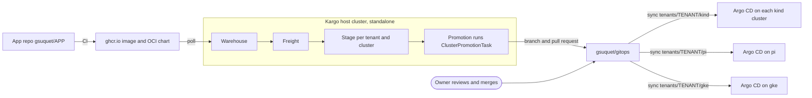
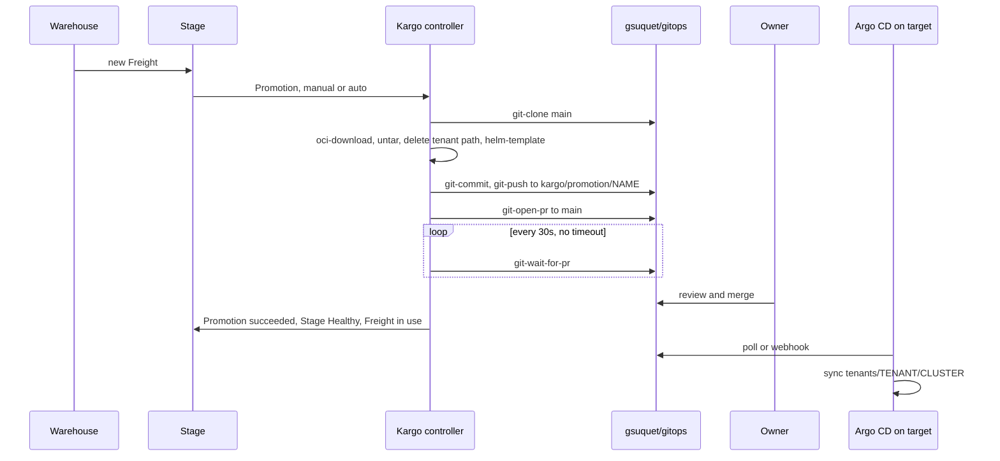

# RFC 0021: Promote tenant releases with one standalone Kargo

## Summary

Run Kargo `v1.12.6` (open source) as an opt-in catalog component on exactly one cluster, with
git-only steps: a platform-owned task renders each tenant release and opens a pull request to
`gsuquet/gitops`, and a human merges it. Kargo gets no access to any target cluster or Argo CD, and
accepts that it knows "merged", not "deployed".

## Context

- ADR-0007 puts rendered tenant manifests in `gsuquet/gitops` under `tenants/<tenant>/<cluster>/`.
- ADR-0008 chose Kargo with git-only steps (no `argocd-update`) and deferred where Kargo runs.
- ADR-0009 onboards tenants from `gitops/tenants/<tenant>.yaml`; a tenant's clusters are the
  `cluster.yaml` files that list it. It defines no promotion order.
- ADR-0004: one self-managed Argo CD per cluster, no hub. ADR-0016 and RFC 0020: kind runs with an
  ESO `fake` store and no real credential.
- Problem: where Kargo runs, how it is installed and configured, and what a promotion does without
  `argocd-update`, before the first tenant is onboarded.
- Study date 2026-11-18, against Kargo source tag `v1.12.6`. Marks: **V** verified against the
  linked source, **U** unverified (prior knowledge, inference, or unreachable source).

## Goals and non-goals

Goals:

- One Kargo instance promotes every tenant to every cluster, with the order between clusters held
  in Kargo.
- Every promotion is a pull request on `gsuquet/gitops` that a human merges; nothing auto-merges.
- A tenant cannot change where its promotion writes.
- Kargo holds no credential for any cluster or Argo CD.

Non-goals:

- Deployment health or verification in slice 1 (no Argo Rollouts).
- `argocd-update`, `argocd-wait`, sharding, or a Kargo per cluster.
- Kargo `v2.0.0` and the unreleased `PromotionRequest` and `Target` kinds.
- Choosing the secrets backend (RFC 0020) or the long-lived Kargo host (open question 1).

## Decision drivers

- Git is the only interface between Kargo and the clusters: no Kargo access to any target cluster
  or Argo CD.
- A human merges every promotion, and the promotion commits plain YAML (rendered manifests).
- A tenant cannot change where its promotion writes.
- Platform rules hold: policy label and ESO store `secrets` in every namespace, no real credential
  on kind (ADR-0010, ADR-0016), tenant clusters from `cluster.yaml` (ADR-0009).
- Footprint and operations fit a very small platform with one owner.

## Options considered

### A. One standalone Kargo, git-only, platform-owned task

One Kargo on one cluster promotes every tenant to every cluster by pull requests on `gsuquet/gitops`.

- Good: one install, one UI and one place for every pipeline (footprint driver).
- Good: no cross-cluster network path or credential (git-only driver).
- Bad: no deployment health signal; the Stage is `Healthy` at merge time.

### B. A Kargo per cluster

Each cluster runs a Kargo that promotes the tenants of that cluster.

- Good: each Kargo could use `argocd-wait` on its local Argo CD.
- Bad: N installs and N UIs (footprint driver).
- Bad: no promotion order across clusters: Freight cannot flow from one cluster's Stage to another's.

### C. Sharded Kargo

Control plane on one cluster, one controller next to each Argo CD.

- Good: each shard controller can read its local Argo CD for health.
- Bad: a ServiceAccount token per shard reaching back to the control plane is the hub the plan
  defers (git-only driver).
- Bad: git-only promotion gains nothing from it: sharding exists to reach several Argo CD instances.

### D. Renovate plus CI render

Renovate bumps the image tag or chart version in a source file; a GitHub Actions workflow renders
and opens the pull request to `gsuquet/gitops`.

- Good: no in-cluster component; tools known from homelab; the workflow uses a GitHub App token
  too, so no new credential model (footprint driver).
- Bad: no Freight, no stage order, no history, no verification: "promote what kind runs to pi" is a
  manual edit. Enough for a few tenants, worse as they grow.

### E. Argo CD Source Hydrator

Argo CD (beta since `v3.5`, current `v3.6.2`) renders a `drySource` and pushes to a `syncSource`
branch and path, possibly in another repository (**V**).

- Good: built into Argo CD.
- Bad: pushes, or with `hydrateTo` pushes to a staging branch, but never opens a pull request
  (human-merge driver) (**V**).
- Bad: needs the commit server and write credentials in every cluster's Argo CD; two Argo CD
  instances cannot hydrate to one repository and branch; stale files stay; no order between
  clusters (**V**).

### F. GitHub Actions environments

A `promote` workflow per tenant, `workflow_dispatch`, one environment per cluster with required
reviewers.

- Good: order and approval without a cluster component.
- Bad: no artifact discovery and no Freight history across clusters; not studied as a full design
  (**U**).

### Do nothing

ADR-0008 stays without a host: promotions are manual, with `mise run tenant:render` plus
`gh pr create`.

- Good: zero footprint; stays the fallback when Kargo is down.
- Bad: all ordering lives in the owner's head; ADR-0008 stays unimplemented.

## Proposal

Option A.

### Architecture



Kargo needs egress to GitHub and `ghcr.io` only; it never reaches a target cluster.

| Component | Required | Internet-facing | Role (**V**, architecture page) |
| --- | --- | --- | --- |
| API server | yes | yes (UI, CLI) | Backend for UI and CLI, serves the UI |
| Controller | yes | no | Watches Warehouses, runs Promotions and health checks, creates `AnalysisRun`s |
| Management controller | yes | no | Per-Project RBAC; broad permissions, never distributed |
| Kubernetes webhooks server | yes | no | Admission webhooks; TLS from a cert-manager self-signed `Issuer` by default |
| External webhooks server | no: disabled | yes | Push notifications to refresh Warehouses; polling is enough here |
| Garbage collector | default on | no | Hourly CronJob deleting old Promotions and unused Freight |
| Dex | no | via API server | OIDC adapter, for example GitHub (open question 8) |

All state is custom resources on the host cluster; no database (**V**). Standalone topology is
documented for testing and "very small deployments" (**V**). Sharding exists to reach several Argo
CD instances (a shard "typically corresponds to one Argo CD control plane"; chart values
`kubeconfigSecrets.kargo` and `kubeconfigSecrets.argocd`) (**V**), so git-only needs no shard.

| Kind (chart `v1.12.6`, **V**) | Scope | Use here |
| --- | --- | --- |
| `Project` | cluster | One per tenant; creates or adopts a namespace of the same name (tenancy and RBAC boundary) |
| `ProjectConfig` | one per Project | Auto-promotion per Stage selector, promotion windows, webhook receivers, auto-rollback |
| `Warehouse` | namespaced | Subscribes to the tenant image and OCI chart (optionally a Git path); emits Freight |
| `Freight` | namespaced | Immutable set of revisions (image tag or digest, chart version, commit) |
| `Stage` | namespaced | One per tenant and cluster: `requestedFreight`, `promotionTemplate`, optional `verification` |
| `Promotion` | namespaced | One run of a Stage's steps for one Freight, inside the controller process |
| `PromotionTask` / `ClusterPromotionTask` | namespaced / cluster | Reusable steps; the platform owns one `ClusterPromotionTask` |
| `ClusterConfig` | cluster | Default Git committer identity, webhook receivers |
| `PromotionRequest`, `Target` | namespaced | In `v1.12` source, absent from its docs (**V**): unreleased, do not design on them |

`AnalysisTemplate` and `AnalysisRun` are Argo Rollouts kinds; Kargo ships only Go stubs (**V**).
Promotions to one Stage run one at a time (`status.currentPromotion`), and none run while a
verification runs (**V**).

### Promotion flow



A closed, unmerged pull request fails the Promotion; the Freight stays available for a new one.

Design sketch: every field checked against the `v1.12.6` step reference docs (**V**); not applied
to a cluster (**U** as a whole). Resources are rendered by `infra` on the Kargo host.

```yaml
apiVersion: kargo.akuity.io/v1alpha1
kind: Warehouse
metadata:
  name: app
  namespace: kargo-demo # Project namespace of tenant "demo"
spec:
  subscriptions:
    - image:
        repoURL: ghcr.io/gsuquet/demo
        imageSelectionStrategy: SemVer
        constraint: ^1.0.0
    - chart:
        repoURL: oci://ghcr.io/gsuquet/charts/demo # OCI: no chart name
        semverConstraint: ^1.0.0
---
apiVersion: kargo.akuity.io/v1alpha1
kind: ClusterPromotionTask
metadata:
  name: render-tenant-pull-request
spec:
  vars:
    - name: tenant
    - name: cluster
    - name: namespace
    - name: imageRepo
    - name: chartRepo
    - name: gitopsRepo
      value: https://github.com/gsuquet/gitops.git
  steps:
    - uses: git-clone
      config:
        repoURL: ${{ vars.gitopsRepo }}
        checkout:
          - branch: main
            path: ./gitops
    - uses: oci-download
      config:
        imageRef: ${{ vars.chartRepo }}:${{ chartFrom(vars.chartRepo).Version }}
        outPath: ./chart.tgz
    - uses: untar
      config:
        inPath: ./chart.tgz
        outPath: ./chart
        stripComponents: 1
    # git-clear would wipe the whole gitops checkout: delete only this tenant/cluster path.
    - uses: delete
      config:
        path: ./gitops/tenants/${{ vars.tenant }}/${{ vars.cluster }}
    - uses: helm-template
      config:
        path: ./chart
        releaseName: ${{ vars.tenant }}
        namespace: ${{ vars.namespace }}
        valuesFiles:
          - ./chart/values-${{ vars.cluster }}.yaml
        ignoreMissingValueFiles: true
        setValues:
          - key: image.tag
            value: ${{ imageFrom(vars.imageRepo).Tag }}
        outPath: ./gitops/tenants/${{ vars.tenant }}/${{ vars.cluster }}
        outLayout: flat
    - uses: git-commit
      config:
        path: ./gitops
        message: "chore(${{ vars.tenant }}): promote ${{ imageFrom(vars.imageRepo).Tag }} to ${{ vars.cluster }}"
    - uses: git-push
      as: push
      config:
        path: ./gitops
        generateTargetBranch: true # kargo/promotion/<promotion name>
    - uses: git-open-pr
      as: open-pr
      config:
        repoURL: ${{ vars.gitopsRepo }}
        sourceBranch: ${{ task.outputs.push.branch }}
        targetBranch: main
        labels: ["promotion", "tenant/${{ vars.tenant }}"]
    # No retry.timeout: a timeout fails the Promotion and leaves the pull request open.
    - uses: git-wait-for-pr
      if: ${{ status('open-pr') != 'Skipped' }}
      config:
        repoURL: ${{ vars.gitopsRepo }}
        prNumber: ${{ task.outputs['open-pr'].pr.id }}
---
apiVersion: kargo.akuity.io/v1alpha1
kind: Stage
metadata:
  name: pi
  namespace: kargo-demo
spec:
  requestedFreight:
    - origin:
        kind: Warehouse
        name: app
      sources:
        stages: [kind] # pi only takes Freight already promoted to kind
  promotionTemplate:
    spec:
      steps:
        - task:
            name: render-tenant-pull-request
            kind: ClusterPromotionTask
          vars:
            - name: tenant
              value: demo
            - name: cluster
              value: pi
            - name: namespace
              value: demo
            - name: imageRepo
              value: ghcr.io/gsuquet/demo
            - name: chartRepo
              value: oci://ghcr.io/gsuquet/charts/demo
```

| Step fact (**V** unless marked) | Design rule |
| --- | --- |
| `git-push` with `generateTargetBranch: true` pushes `kargo/promotion/<promotion name>`, outputs `branch`, `commit`; push policy `RebaseOrMerge` since `v1.12.0`; `force` defaults to `false` | Keep `force: false` |
| `git-open-pr` fails when `targetBranch` is missing (`createTargetBranch` removed in `v1.12.0`); skipped when branches do not differ | `if:` on the wait step |
| `git-wait-for-pr` keeps the Promotion `Running`, polls every `30s` (minimum `10s`), waits forever without `retry.timeout`, fails (no retry) when the pull request closes unmerged | An open pull request blocks the next Promotion to that Stage |
| A step `retry.timeout` fails the Promotion; docs do not say the pull request or `kargo/promotion/*` branch is closed (**U**: assumed left open) | No `retry.timeout` |
| `git-clear` empties the whole working tree | `delete` on `tenants/<tenant>/<cluster>/` only |
| `helm-template` takes a local chart dir with `Chart.yaml`; `oci-download` accepts `oci://...:tag` with Helm credentials; `includeCRDs` defaults to `false` | `oci-download` + `untar` first; tenants ship no cluster-scoped resources anyway |
| `kustomize-build` renders a dir with `kustomization.yaml` | Kustomize tenants need a `git` subscription with `includePaths` (open question 2) |
| `git-merge-pr` exists (beta) | Never used: a human merges |
| SSH repository URLs deprecated since `v1.10.0`, removal announced for `v1.13.0` (so `v2.0.0`) | HTTPS URLs only |
| Enterprise-only steps: `wait-for-approval`, `send-message`, `gh-*`, `gha-*`, `tf-*`, ServiceNow, Jira | None needed |

### Without `argocd-update`

| Lost | Effect (**V** in source unless marked) |
| --- | --- |
| Health | `argocd-update` registers an Argo CD health check. With none, the aggregating checker starts `Healthy`: the Stage is `Healthy` at merge time |
| Verification timing | Verification starts after Promotion success (and after Argo CD `Healthy` when Applications are involved): here, at merge time, before Argo CD syncs |
| Auto-promotion gating | A Stage with no `verification` counts Freight as verified: downstream eligibility follows the upstream merge |
| Sync trigger | Argo CD picks the merge up on its poll (default three minutes, **U**) or a webhook, as ADR-0008 accepted |

`argocd-wait` (read-only; waits on `health`, `sync`, `operation`; no `authorized-stage` annotation;
registers no health check) (**V**) would need Kargo to read each Argo CD `Application`: host cluster
only, or a shard or `kubeconfigSecrets.argocd` per remote Argo CD. It keeps git-only writes but
breaks "no access to target clusters": out of scope.

### Stale promotion pull requests

A timed-out Promotion leaves an open pull request. Merged later, Argo CD deploys Freight that Kargo
records as a failed Promotion: Kargo and Git diverge, and downstream Stages do not see it promoted.

| Rule | Status |
| --- | --- |
| No `retry.timeout` on `git-wait-for-pr`; end a stale promotion by aborting it in Kargo and closing the pull request (the close also fails it on the next poll) | proposal |
| "Automatically delete head branches" on `gsuquet/gitops`; closed-unmerged branches deleted by hand, or by a scheduled workflow closing promotion pull requests older than N days | proposal |
| Merge only while the Promotion is `Running`; a pull request whose Promotion failed, was aborted or was lost with its host is closed and the Freight promoted again. Pull request CI cannot see Kargo state, so this is a human rule | proposal |

Two tenants, or two clusters of one tenant, can have open pull requests at once: different paths,
different branches. Conflicts only arise on one `tenants/<tenant>/<cluster>/`, which the
one-Promotion-per-Stage rule prevents. Kargo marks Freight "in use" only after the merge, so its
view matches `main`.

### Hosting

| Phase | Host | Consequence |
| --- | --- | --- |
| Slice 1 | One named kind cluster; Kargo promotes to an in-cluster Gitea copy of the `gsuquet/gitops` layout, dummy credentials from the `fake` store | Builds and tests the flow offline; nothing reaches `gsuquet/gitops`; GitHub App auth is not exercised |
| Slice 2 | First long-lived cluster (Talos on Pis or GKE, open question 1), enabled in its own `cluster.yaml` | Real GitHub App credential; the only Kargo that writes to `gsuquet/gitops`. Pi costs nothing extra; GKE adds compute cost and the FQDN policy risk |

Why kind cannot write to `gsuquet/gitops`:

| Conflict | Detail |
| --- | --- |
| No real credential | The `fake` store gives a dummy App key: `git-push`, `git-open-pr`, `git-wait-for-pr` fail, and `git-clone` too while a dummy credential matches the public URL (**U**) |
| Several kind clusters | kind runs on several machines; enabled in shared kind settings, each would open the same pull requests |
| Promotion order | Stage `pi` takes Freight with `sources.stages: [kind]`. A recreated kind host has no Freight promoted to `kind`, so nothing is eligible for `pi` until `kind` is promoted again, even when Git already holds it. Every `cluster:down` loses the order |

| kind option | Trade-off |
| --- | --- |
| (a) Person-seeded real App key on one named kind cluster, `kargo` only in that cluster's `cluster.yaml` | Breaks ADR-0016 "kind runs with no credentials" and the RFC 0020 Conftest rule "no `fake` provider outside kind"; needs owner sign-off; still loses promotion order at every recreate. Not proposed |
| (b) Offline sandbox: in-cluster Gitea, kind-only opt-in component; `git-open-pr` and `git-wait-for-pr` support `provider: gitea`, Gitea has no pull request labels yet (issue 6021) (**V**), so the kind task variant drops `labels`. Gitea chart, version and footprint (**U**) | Proposed |

With (b), `kind` is still a Stage of every tenant on the long-lived host: it writes
`tenants/<tenant>/kind/`, and every kind cluster on every machine syncs it with its own Argo CD (no
credential: the repository is public). Promotion order lives on a host that is not recreated.

- Kargo can promote the tenants of its own host: it writes Git only, so no bootstrap loop.
- A second Kargo must never watch the same Projects. One instance per platform, chosen in
  `cluster.yaml`.
- UI and API: an internal `HTTPRoute` on the cluster gateway, or `cloudflared` behind Cloudflare
  Access. External webhooks stay off: Warehouse polling and the `30s` pull request poll suffice.

### Multi-tenancy

| Item | Rule |
| --- | --- |
| Project | One per onboarded tenant, named `kargo-<tenant>` (naming is a proposal), on the Kargo host whatever cluster the tenant runs on |
| Pipeline ownership | The Kargo host render joins across every `gitops/clusters/*/cluster.yaml` (ADR-0009). For each tenant listed by at least one cluster it emits the Project namespace, `Project`, `ProjectConfig`, `Warehouse`, one `Stage` per cluster that lists it, plus the shared `ClusterPromotionTask`, into `gitops/clusters/<kargo-host>/rendered/`, applied under the platform AppProject, not the tenant one |
| Project namespace | Rendered by `infra` with `kargo.akuity.io/project: "true"` (Kargo adopts it, **V**) and the policy label, so Conftest checks it. A namespace Kargo creates at runtime would lack the label |
| Promotion order | New tenant file field, for example `promotion: [kind, pi, gke]` (extends ADR-0009, needs its own follow-up). Stage N takes Freight from N-1 (`sources.stages`), the first from the Warehouse (`sources.direct: true`). Render fails when the list differs from the clusters that list the tenant |
| Roles | Built-in `kargo-admin`, `kargo-promoter` (promote, approve Freight), `kargo-viewer`, each a ServiceAccount, Role and RoleBinding; custom `promote` verb on `stages`. OIDC claims map with `rbac.kargo.akuity.io/claims`; system roles through `api.oidc.*` (**V**) |
| Tenant access | `kargo-promoter` and `kargo-viewer` on its own Project, never `kargo-admin` (admin could repoint its Stage at another path). Future-proofing: the owner is the only user today |
| Auto-promotion | `ProjectConfig.spec.promotionPolicies` (`stageSelector`, `autoPromotionEnabled`) (**V**). It only opens pull requests automatically. Default: on for `kind`, off for later clusters |
| Soak | `requestedFreight[].sources.requiredSoakTime` (**V**): the only time gate between clusters without verification |

### Credentials

| Need | Credential | Scope |
| --- | --- | --- |
| Clone, push branches, open and read pull requests on `gsuquet/gitops` | Dedicated GitHub App installation token | `gsuquet/gitops` only |
| Read public images and OCI charts on `ghcr.io` | None (anonymous OCI pulls through Kargo: **U**) | - |
| Read public app repositories (`git` subscription) | None | - |
| Kargo admin account | `api.adminAccount.passwordHash`, `tokenSigningKey` | kind only |
| UI login on a long-lived cluster | OIDC through Dex and a GitHub OAuth App, or an OIDC provider with PKCE | owner only |

| GitHub App fact | Status |
| --- | --- |
| Secret labelled `kargo.akuity.io/cred-type: git` with `githubAppClientID` (preferred over deprecated `githubAppID`), `githubAppPrivateKey`, `githubAppInstallationID`, `repoURL`; the CLI cannot create it | **V** |
| Delivered by an `ExternalSecret` on store `secrets` (ADR-0016), label set through the ESO target template | proposal |
| App-authored pull requests let the owner approve under "one approval required"; with a personal token the owner is the author and cannot approve their own pull request | **U** (standard GitHub behaviour) |
| Installation tokens are short-lived and "not tied to a specific GitHub user" | **V**; one-hour lifetime **U** |
| Permissions: Contents read and write | **V** |
| Permissions: Pull requests read and write, Metadata read | **U** (inferred from the GitHub API) |
| Installed on `gsuquet/gitops` only: an App gets its permissions on every repository it is installed on | **V** |
| Stored in `kargo-shared-resources`: usable by every Project, unreadable by Project users (`secret()` cannot reference shared credentials) | **V** |
| `kargo.akuity.io/github-token-scopes` (experimental, since `v1.8.0`) limits repositories per Project, not paths; adds nothing with one repository | **V** |
| Lookup: Project namespace first, shared namespace only when nothing matches; exact `repoURL` beats regex, then Secret name order. A Secret created in a Project namespace overrides the platform credential | **V** |

Rules from the lookup order:

- Tenants get no `create` or `update` on `Secret`s in their Project namespace. `kargo-viewer` does
  not reach credentials and `kargo-promoter` cannot edit pipeline resources (**V**); the exact
  Secret verbs of built-in roles are undocumented (**U**): check with
  `kargo get role <name> --as-kubernetes-resources` in slice 1.
- `infra` renders no Secret or `ExternalSecret` labelled `kargo.akuity.io/cred-type` into Project
  namespaces; Conftest fails any such object outside `kargo-shared-resources`.
- The App can write any path of `gsuquet/gitops`: the path boundary is the pull request check
  below plus the human review.

### Pull request checks on `gsuquet/gitops`

Tenant charts render inside the Kargo controller, outside `infra`'s `manifests:check`, kubeconform
and Conftest. A required status check on `main` of `gsuquet/gitops` (proposal):

| Check | Rule |
| --- | --- |
| Path scope | Every changed path under one `tenants/<tenant>/<cluster>/`, `<tenant>` matching the `tenant/<tenant>` label, `<cluster>` a cluster the tenant is onboarded on; a `kargo/promotion/*` branch touching anything else fails |
| kubeconform | Changed directory, with the CRD schemas the platform ships (ESO, Gateway API) |
| Conftest | Tenant rules shared with `infra` (ADR-0009, ADR-0010, ADR-0016): no cluster-scoped kind, no `Namespace`, no `NetworkPolicy` or `CiliumNetworkPolicy`, no `Secret` with `data` or `stringData`, no `SecretStore` or `ClusterSecretStore`, every `ExternalSecret` on `SecretStore` `secrets` |
| CODEOWNERS | Per `tenants/<tenant>/` once there is more than one human (open question 10) |

Policies live once, in `infra`'s `policy/`, pulled by the `gsuquet/gitops` workflow at a pinned
commit, so the two cannot drift. The workflow is outside this repository's CI scope (ADR-0019).
Branch protection: one approval, repository auto-merge disabled, the App in no bypass list.

### Network policy

The cluster default deny (ADR-0010, now hosted by the `network-policy` component) applies to the
`kargo` namespace.

| Flow | Peer |
| --- | --- |
| Egress: controller, management controller, API server, `garbage-collector` pods | Kubernetes API (`kube-apiserver` entity; already a baseline allow, listed so `kargo` does not depend on it silently) |
| Egress: controller, and API server reading Freight sources for the UI (**U**) | `github.com`, `api.github.com`, `ghcr.io`, `pkg-containers.githubusercontent.com` on TCP 443 (`ghcr.io` redirects blobs there: **U**, observed behaviour) |
| Egress: `kargo` namespace to kube-dns | DNS rule (`rules.dns`) so Cilium learns FQDNs (**V**, Cilium `stable` docs); that `toFQDNs` fails without it is **U**; Cilium version not pinned here |
| Ingress: webhooks server | Kubernetes API server (`kube-apiserver` or `remote-node` entity, per distribution) |
| Ingress: `api` Service | Gateway namespace (internal `HTTPRoute`) or `cloudflared` namespace |
| Egress: verification Jobs, if adopted | The URLs they probe |
| Egress on kind, option (b) | In-cluster Gitea Service instead of GitHub |

GKE Dataplane V2 is a managed Cilium: support for `CiliumClusterwideNetworkPolicy` and FQDN rules
is an unverified risk with a plain `NetworkPolicy` fallback that cannot express FQDN egress. A GKE
Kargo host depends on resolving it first (GKE's own FQDN network policy feature: **U**).

### Install

| Item | Value |
| --- | --- |
| Version | Kargo `v1.12.6`, chart `oci://ghcr.io/akuity/kargo-charts/kargo` `1.12.6` (published artifact not pulled: **U**), API `kargo.akuity.io/v1alpha1`, Apache-2.0 |
| Component | Opt-in catalog component `kargo`; exactly one `cluster.yaml` enables it, never shared kind settings |
| Integrations | `controller.argocd.integrationEnabled: false` (fewer controller permissions, as the docs recommend), `api.rollouts.integrationEnabled: false`, `controller.rollouts.integrationEnabled: false` |
| Deployments | `api`, `controller`, `management-controller`, `webhooks-server`; `external-webhooks-server` disabled; `dex-server` only with Dex; CronJob `garbage-collector`; replicas `1` |
| Namespaces | `kargo-system-resources`, `kargo-shared-resources`: `createNamespace: false`, rendered with the policy label |
| TLS | cert-manager self-signed certificates (`*.tls.selfSignedCert`); cert-manager is baseline |
| Resources | Chart sets `resources: {}` everywhere: the platform sets requests and limits after measuring |
| Images | `linux/amd64` and `linux/arm64`: runs on a Pi 4 |
| CRDs | Templated in the chart (`templates/crds.yaml`), rendered by `helm template`, sync wave `-1` |

Footprint is unmeasured: no sizing data in the docs, and `ghcr.io` images were outside the study's
fetch scope. Estimate (**U**): about 0.5 GiB of memory requests, plus about 0.2 GiB for an Argo
Rollouts controller if adopted, next to Talos, Cilium, Argo CD, cert-manager and ESO on a Pi 4 with
8 GiB; the controller spikes during Promotions (`git clone`, `helm template` in-process). Gate: in
slice 1, record `kubectl top pod` (metrics-server on kind) for every Kargo pod, idle and during a
realistic Promotion, in this RFC before fixing requests and limits and accepting a Pi as host.

### Verification (not in slice 1)

| Fact | Status |
| --- | --- |
| Stage `verification` lists `AnalysisTemplate`s in the Project namespace; providers `job`, `web`, `prometheus` | **V** |
| Argo Rollouts CRDs required; workloads need not use Rollouts | **V** |
| The Rollouts controller itself is required (Kargo does not run `AnalysisRun`s; `controller.rollouts.controllerInstanceID`) | **U** (inferred from source) |
| Without a health gate the `AnalysisRun` starts at merge: a `web` metric must poll the tenant public URL `/version` against the Freight tag, with `count`, `interval`, `failureLimit` covering the sync delay | design |
| A `job` metric runs on the Kargo host: reaches other clusters only through public endpoints | design |
| Verifying blocks other Promotions to the Stage; failure blocks Freight downstream; manual Freight approval bypasses verification | **V** |

### Confirmation checks

- Conftest or a render check fails when any rendered `Stage`, `PromotionTask` or
  `ClusterPromotionTask` uses `argocd-update`, `argocd-wait` or `git-merge-pr`.
- At most one `cluster.yaml` enables `kargo`; no shared kind settings enable it.
- A render check fails unless every (tenant, cluster) pair listed by any `cluster.yaml` has exactly
  one `Stage` on the Kargo host, and each tenant's `promotion` list equals the clusters that list it.
- Conftest fails any object labelled `kargo.akuity.io/cred-type` outside `kargo-shared-resources`.
- Every Kargo Project namespace is rendered by `infra` and carries the policy label.
- `gsuquet/gitops` `main` requires the path-scope, kubeconform and Conftest check, a pull request
  with one approval, auto-merge disabled, the App in no bypass list, head branches auto-deleted.
- Footprint gate recorded before requests, limits and a Pi host are fixed.

## Operational impact

- Blast radius: the Kargo host and `gsuquet/gitops`. A broken Kargo stops new tenant promotions on
  every cluster; deployed workloads keep running. A bad merged render breaks one
  `tenants/<tenant>/<cluster>/`. A leaked App key can write any path of `gsuquet/gitops`, held back
  by branch protection and the required check. Losing the host loses Freight, history and promotion
  order: downstream Stages block until upstream ones are promoted again.
- Rollout: (1) slice 1 on one named kind cluster against in-cluster Gitea, footprint measured; (2)
  create the GitHub App and branch protection, required check on `gsuquet/gitops`; (3) enable
  `kargo` on the first long-lived cluster; (4) onboard tenants one by one. Gate between steps: the
  previous step's promotion merged and synced.
- Rollback: disable `kargo` in the host `cluster.yaml` and re-render (minutes); close open
  promotion pull requests and delete `kargo/promotion/*` branches; promote by hand with
  `mise run tenant:render` and `gh pr create`. Merged manifests stay in `gsuquet/gitops`.
- Migration: None: Kargo state is custom resources on its host and rebuilds from Warehouses;
  `gsuquet/gitops` layout and tenant files are unchanged except the new `promotion` field.
- Security: new GitHub App with write access to `gsuquet/gitops`; credential in
  `kargo-shared-resources`; tenants never `kargo-admin` and never Secret write in Project
  namespaces; new egress to GitHub and `ghcr.io`; UI behind an internal route or Cloudflare Access;
  tenant chart output checked in `gsuquet/gitops` CI.
- Cost: none on a Pi host; compute on GKE if chosen as host (open question 1). One more CI workflow
  to maintain in `gsuquet/gitops`.
- Observability: the Kargo UI shows each Stage's Freight and Promotion state; a pull request open
  for more than N days on `gsuquet/gitops` signals a stale promotion; Argo CD Application health on
  each cluster is the only deployment signal ("merged, not deployed").

## Drawbacks and risks

- Kargo knows "merged", not "deployed": the Stage is `Healthy` at merge, and Freight without
  verification becomes eligible downstream at once -> human merge as gate, `requiredSoakTime`,
  `web`-metric verification later.
- Maturity: API `v1alpha1`; each minor breaks things (`v1.12.0` removed the gRPC API,
  `git-open-pr.createTargetBranch`, `git-commit.author`); `v2.0.0` is next and "replaces the
  plumbing underneath Kargo -- how it stores state and how its components learn about changes",
  upgrade details "coming soon" (**V**) -> follow the latest minor (open-source users get fixes only
  there; backports are commercial) and revisit before `v2.0.0`.
- Kargo state (Freight, history, promotion order) lives on one host -> host on a long-lived
  cluster, never kind; re-promote upstream Stages after a loss.
- An open promotion pull request blocks later Promotions to that Stage -> merge or close quickly;
  abort stale Promotions.
- The shared credential can write any path of `gsuquet/gitops` -> required path-scope check and
  human review.
- A new CI workflow and policy set in `gsuquet/gitops` must stay in step with `infra` -> policies
  pulled from `infra` at a pinned commit.
- Slice 1 needs a kind-only Gitea component, and the sandbox does not exercise GitHub App auth ->
  slice 2 tests auth on the long-lived host first.
- Footprint unmeasured; Pi fit not established (**U**) -> footprint gate before choosing the Pi.
- GKE as host depends on Dataplane V2 FQDN policy support -> Pi host first, or resolve the risk.
- Unverified facts above (anonymous `ghcr.io` pulls, App permissions, built-in role Secret verbs,
  timed-out pull request left open, Rollouts controller requirement) -> check each in slice 1.
- Project: Akuity, about 3.8k GitHub stars on 2026-11-18, minors every two to three months (twelve
  from October 2024 to July 2026), patches for several minors at once (**V**).

## Open questions

1. Kargo host after slice 1: Talos Pi cluster (free; default proposal, subject to the footprint
   measurement) or GKE (managed, billed; needs the Dataplane V2 FQDN policy risk resolved)?
2. Tenant packaging: OCI Helm chart only, or also Kustomize sources (`git` subscription +
   `kustomize-build`) in slice 1?
3. Per-cluster tenant values: in the chart (`values-<cluster>.yaml`, as sketched), in the app
   repository (needs a `git` subscription), or in `gitops/tenants/<tenant>.yaml`? Never under
   `tenants/<tenant>/<cluster>/` of `gsuquet/gitops`: Argo CD applies everything there.
4. kind: is `tenants/<tenant>/kind/` one shared target for every kind cluster (proposed: a Stage on
   the long-lived host), or is kind not a Stage (local renders only)?
5. Pull request wait: `git-wait-for-pr` with no `retry.timeout` (proposed), a timeout plus a
   scheduled cleanup workflow in `gsuquet/gitops`, or end at `git-open-pr` (no blocking, but Freight
   marked in use before the merge)?
6. Auto-promotion on for the first Stage only? Any `requiredSoakTime` between clusters?
7. Verification: accept "merged, not deployed" in slice 1 and add Argo Rollouts and `web` metrics
   later, or require it from the first long-lived cluster?
8. UI access: OIDC through Dex with a GitHub OAuth App (one more credential), or the admin account
   behind Cloudflare Access (the docs say never enable it in production)?
9. GitHub App: a dedicated App (proposed) or an existing one? Who creates it? Is its key stored in
   the backend chosen by RFC 0020?
10. Branch protection on `gsuquet/gitops`: one approval and auto-merge disabled (proposed)?
    CODEOWNERS per `tenants/<tenant>/` for later tenants?
11. Start on `v1.12` and upgrade, or wait for `v2.0.0` if it lands before slice 1 ends?
12. Promotion order: accept a `promotion: [kind, pi, gke]` list as an ADR-0009 extension (needs a
    follow-up RFC, ADR-0009 being accepted)? Is a strict list enough, or must two clusters take
    Freight from one upstream in parallel?
13. Slice 1 on kind: option (b), Gitea sandbox (proposed), or option (a), a person-seeded real App
    key on one named kind cluster as an ADR-0016 exception, losing promotion order at every
    `cluster:down`?
14. Accept a required check (path scope, kubeconform, Conftest) in `gsuquet/gitops`, with policies
    from `infra` at a pinned commit?

## Decision

Pending.

## Implementation

N/A: not accepted yet.

## References

- Kargo source at [`v1.12.6`](https://github.com/akuity/kargo/tree/v1.12.6), [releases](https://github.com/akuity/kargo/releases), [roadmap](https://docs.kargo.io/roadmap), [release support](https://docs.kargo.io/release-support), [v1.12.0 notes](https://docs.kargo.io/release-notes/v1.12.0)
- Chart: [`Chart.yaml`](https://github.com/akuity/kargo/blob/v1.12.6/charts/kargo/Chart.yaml), [`values.yaml`](https://github.com/akuity/kargo/blob/v1.12.6/charts/kargo/values.yaml), [CRDs](https://github.com/akuity/kargo/tree/v1.12.6/charts/kargo/resources/crds), [Rollouts stubs](https://github.com/akuity/kargo/tree/v1.12.6/api/stubs/rollouts), [release workflow](https://github.com/akuity/kargo/blob/v1.12.6/.github/workflows/release.yaml), [quickstart `kind.sh`](https://github.com/akuity/kargo/blob/v1.12.6/hack/quickstart/kind.sh) (tests with cert-manager `1.19.3`, Argo CD chart `9.4.3`, Argo Rollouts chart `2.40.6`; not requirements)
- Health in source: [`aggregating_checker.go`](https://github.com/akuity/kargo/blob/v1.12.6/pkg/health/aggregating_checker.go), [`regular_stages.go`](https://github.com/akuity/kargo/blob/v1.12.6/pkg/controller/stages/regular_stages.go)
- Operator docs: [architecture](https://docs.kargo.io/operator-guide/architecture), [basic installation](https://docs.kargo.io/operator-guide/basic-installation), [common configurations](https://docs.kargo.io/operator-guide/advanced-installation/common-configurations), [managing secrets](https://docs.kargo.io/operator-guide/security/managing-secrets), [operator access controls](https://docs.kargo.io/operator-guide/security/access-controls)
- User docs: [core concepts](https://docs.kargo.io/user-guide/core-concepts), [Argo CD integration](https://docs.kargo.io/user-guide/how-to-guides/argo-cd-integration), [verification](https://docs.kargo.io/user-guide/how-to-guides/verification), [working with projects](https://docs.kargo.io/user-guide/how-to-guides/working-with-projects), [access controls](https://docs.kargo.io/user-guide/security/access-controls), [analysis templates](https://docs.kargo.io/user-guide/reference-docs/analysis-templates), [promotion templates](https://docs.kargo.io/user-guide/reference-docs/promotion-templates), [promotion tasks](https://github.com/akuity/kargo/blob/v1.12.6/docs/docs/50-user-guide/60-reference-docs/20-promotion-tasks.md)
- Steps: [all](https://docs.kargo.io/user-guide/reference-docs/promotion-steps/), [git-clone](https://docs.kargo.io/user-guide/reference-docs/promotion-steps/git-clone), [oci-download](https://docs.kargo.io/user-guide/reference-docs/promotion-steps/oci-download), [helm-template](https://docs.kargo.io/user-guide/reference-docs/promotion-steps/helm-template), [git-push](https://docs.kargo.io/user-guide/reference-docs/promotion-steps/git-push), [git-open-pr](https://docs.kargo.io/user-guide/reference-docs/promotion-steps/git-open-pr), [git-wait-for-pr](https://docs.kargo.io/user-guide/reference-docs/promotion-steps/git-wait-for-pr), [argocd-wait](https://docs.kargo.io/user-guide/reference-docs/promotion-steps/argocd-wait), Gitea labels [issue 6021](https://github.com/akuity/kargo/issues/6021)
- Argo: [argo-helm](https://github.com/argoproj/argo-helm) (Rollouts chart `argo-rollouts-2.43.12`, app `v1.10.2`), [Argo CD releases](https://github.com/argoproj/argo-cd/releases) (`v3.6.2`), [Source Hydrator](https://argo-cd.readthedocs.io/en/stable/user-guide/source-hydrator/)
- [Cilium DNS-based policies](https://docs.cilium.io/en/stable/security/dns/)
- Related: ADR-0004, ADR-0007, ADR-0008 (refined here), ADR-0009 (extended by the `promotion` field), ADR-0010, ADR-0016, ADR-0019, RFC 0020 (kind `fake` store)

## Future work

- Verification: opt-in `argo-rollouts` component and `web`-metric `AnalysisTemplate`s polling the
  tenant's public endpoint, once a tenant has a public endpoint and more than one cluster.
- `argocd-wait` or shards, only if a later decision accepts Kargo access to Argo CD.
- Kargo `v2.0.0` upgrade, and `PromotionRequest` and `Target` once documented.
- ADR-0009 follow-up RFC for the tenant file `promotion` field.
- Scheduled workflow in `gsuquet/gitops` closing stale promotion pull requests and their branches.
- GitHub Actions environments as a full design, if Kargo is rejected.
