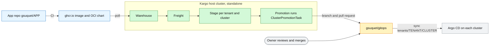

# RFC 0021: Promote tenant releases with one standalone Kargo

## Summary

Run Kargo `v1.12.6` (open source) as an opt-in catalog component on exactly one cluster, with
git-only steps: a platform-owned task renders each tenant release and opens a pull request to
`gsuquet/gitops`, and a human merges it. Kargo gets no access to any target cluster or Argo CD, and accepts that it knows "merged", not "deployed".

| Decision | Why | Cost | Reversible |
|---|---|---|---|
| Install one standalone Kargo, git-only | one install and one promotion order, no cross-cluster credential | no deployment health signal | yes: disable `kargo` in the host `cluster.yaml` and re-render; Stages, Freight and Promotions are lost |
| A platform task renders each release and opens a pull request, merged by a human | a tenant cannot change where its promotion writes | an open pull request blocks the next Promotion to that Stage | open: [Pull request wait](#open-questions) |
| Host on a long-lived cluster; kind only as an offline Gitea sandbox | kind holds no real credential and loses promotion order when recreated | a kind-only Gitea component; GitHub App auth untested on kind | open: [Kargo host](#open-questions), [Slice 1 on kind](#open-questions) |
| The platform renders one Kargo Project and the Stages of each tenant, in the order of its `promotion` list | the order between clusters is held in Kargo | a new tenant file field | open: [Promotion order](#open-questions) |
| Write with a dedicated GitHub App, behind a required check on `gsuquet/gitops` | the App can write any path of the repository | one more CI workflow and policy set | open: [GitHub App](#open-questions), [Required check](#open-questions) |

## Context

- ADR-0007 puts rendered tenant manifests in `gsuquet/gitops` under `tenants/<tenant>/<cluster>/`.
- ADR-0008 chose Kargo with git-only steps (no `argocd-update`) and deferred where Kargo runs.
- ADR-0009 onboards tenants from `gitops/tenants/<tenant>.yaml`; a tenant's clusters are the
  `cluster.yaml` files that list it. It defines no promotion order.
- ADR-0004: one self-managed Argo CD per cluster, no hub.
- ADR-0016: kind runs with no real credential; its in-cluster provider is open. RFC 0020 (draft)
  proposes the ESO `fake` store for kind; this RFC assumes it.
- Problem: where Kargo runs, how it is installed and configured, and what a promotion does without
  `argocd-update`, before the first tenant is onboarded.
- Study date 2026-11-18, against Kargo source tag `v1.12.6`. Verified means checked against the
  linked source; unverified means prior knowledge, inference, or unreachable source.

## Goals and non-goals

Goals:

- One Kargo instance promotes every tenant to every cluster, with the order between clusters held
  in Kargo.
- Every promotion is a pull request on `gsuquet/gitops` that a human merges; nothing auto-merges.
- A tenant cannot change where its promotion writes.
- Kargo holds no credential for any cluster or Argo CD.

Non-goals:

- Deployment health or verification in slice 1 (no Argo Rollouts).
- `argocd-update`, `argocd-wait`, sharding, or a Kargo per cluster.
- Kargo `v2.0.0` and the unreleased `PromotionRequest` and `Target` kinds.
- Choosing the secrets backend (RFC 0020) or the long-lived Kargo host.

## Decision drivers

- Git is the only interface between Kargo and the clusters: no Kargo access to any target cluster
  or Argo CD.
- A human merges every promotion, which commits plain YAML (rendered manifests).
- Pipeline control: a tenant cannot change where its promotion writes.
- Platform rules hold: policy label and ESO store `secrets` in every namespace, no real credential
  on kind (ADR-0010, ADR-0016), tenant clusters from `cluster.yaml` (ADR-0009).
- Footprint and operations fit a very small platform with one owner.

## Options considered

Evidence: [option evidence](../research/0021-tenant-promotion-with-kargo-evidence.md#option-evidence).

### One standalone Kargo

One Kargo on one cluster promotes every tenant to every cluster (proposed).

- Good: one install, UI and place for every pipeline (footprint); no cross-cluster path (git-only).
- Bad: no deployment health signal.

### A Kargo per cluster

Each cluster promotes its own tenants.

- Good: each Kargo could use `argocd-wait` on its local Argo CD.
- Bad: N installs (footprint), no promotion order across clusters.

### Sharded Kargo

One control plane, one controller next to each Argo CD.

- Good: each shard controller can read its local Argo CD for health.
- Bad: a token per shard reaching the control plane (git-only), with no gain for git-only promotion.

### Renovate plus CI render

Renovate bumps a source file; a workflow renders and opens the pull request.

- Good: no in-cluster component, no new credential model (footprint).
- Bad: no Freight, stage order, history or verification.

### Argo CD Source Hydrator

Argo CD renders a `drySource` and pushes to a `syncSource`.

- Good: built into Argo CD.
- Bad: never opens a pull request (human merge, verified); write credentials in every Argo CD (git-only, verified).

### GitHub Actions environments

A `promote` workflow per tenant, one environment per cluster with required reviewers.

- Good: order and approval without a cluster component (footprint).
- Bad: no artifact discovery, no Freight history across clusters; not studied as a full design (unverified).

### Do nothing

ADR-0008 stays without a host: promotions are manual, with `mise run tenant:render` plus `gh pr create`.

- Good: zero footprint; stays the fallback when Kargo is down.
- Bad: ordering lives in the owner's head; ADR-0008 stays unimplemented.

## Proposal

Kargo needs egress to GitHub and `ghcr.io` only; it never reaches a target cluster.

Legend: green is new, yellow is changed, gray is unchanged, blue is external.

Detail and evidence, one page per topic:

- [Components, install and network policy](../research/0021-tenant-promotion-with-kargo-architecture.md)
- [Promotion flow, manifests, stale pull requests and verification](../research/0021-tenant-promotion-with-kargo-promotion-flow.md)
- [Hosting and the kind sandbox](../research/0021-tenant-promotion-with-kargo-hosting.md)
- [Tenants, credentials, pull request checks and confirmation checks](../research/0021-tenant-promotion-with-kargo-tenancy.md)

## Operational impact

Evidence: [impact evidence](../research/0021-tenant-promotion-with-kargo-evidence.md#impact-evidence).

- Blast radius: the Kargo host and `gsuquet/gitops`. A broken Kargo stops new tenant promotions on
  every cluster; deployed workloads keep running. A bad merged render breaks one
  `tenants/<tenant>/<cluster>/`. A leaked App key can write any path of `gsuquet/gitops`, held back
  by branch protection and the required check.
- Rollout: (1) slice 1 on one named kind cluster with Gitea, footprint measured; (2) GitHub App,
  branch protection and required check; (3) first long-lived cluster; (4) tenants one by one. Gate:
  the previous step's promotion merged and synced.
- Rollback: disable `kargo` in the host `cluster.yaml` and re-render (minutes). Pruning the
  component deletes its CRDs and every Stage, Freight and Promotion. Close open promotion pull requests, delete
  `kargo/promotion/*` branches, promote by hand. After re-enabling, promote every upstream Stage
  again.
- Migration: None: Kargo state is custom resources on its host; only the tenant file gains a
  `promotion` field.
- Security: new GitHub App with write access to `gsuquet/gitops`; credential in `kargo-shared-resources`; tenants never
  `kargo-admin`, never Secret write in Project namespaces; new egress to GitHub
  and `ghcr.io`; UI behind an internal route or Cloudflare Access; tenant chart output checked in
  `gsuquet/gitops` CI.
- Cost: none on a Pi host; compute on GKE if chosen as host ([Kargo host](#open-questions)).
- Observability: the Kargo UI shows Freight and Promotion state; a promotion pull request open for
  more than N days signals a stale one; Argo CD Application health on
  each cluster is the only deployment signal ("merged, not deployed").

## Drawbacks and risks

| Risk | Severity (proposed) | Mitigation |
|---|---|---|
| Kargo knows "merged", not "deployed": the Stage is `Healthy` at merge, and Freight without verification becomes eligible downstream at once | high | human merge as gate, `requiredSoakTime`, `web`-metric verification later |
| The shared credential can write any path of `gsuquet/gitops` | high | required path-scope check and human review |
| API `v1alpha1`, each minor breaks things, `v2.0.0` is next; single-vendor project | high | follow the latest minor, revisit before `v2.0.0` |
| Kargo state lives on one host | medium | long-lived host, never kind; re-promote after a loss |
| Footprint unmeasured; Pi fit not established (unverified) | medium | footprint gate before choosing the Pi |
| GKE host depends on Dataplane V2 FQDN policy | medium | Pi host first, or resolve it |
| An open pull request blocks its Stage | medium | merge or close quickly, abort stale Promotions |
| The sandbox does not exercise App auth, and needs RFC 0020 to pick `fake` | medium | slice 2 tests auth on the long-lived host first; if RFC 0020 picks the `kubernetes` provider, seed the dummy App key through it |
| A new CI workflow and policy set in `gsuquet/gitops` must stay in step with `infra` | low | policies pulled from `infra` at a pinned commit |
| Unverified facts, App permissions and built-in role Secret verbs among them | not set: the owner sets high, medium or low | check each in slice 1 |

Evidence: [risk evidence](../research/0021-tenant-promotion-with-kargo-evidence.md#risk-evidence).

## Open questions

Trade-offs: [open question detail](../research/0021-tenant-promotion-with-kargo-evidence.md#open-question-detail).

- **Kargo host:** after slice 1, Talos Pi cluster (proposed, subject to the footprint measurement) or GKE?
- **Tenant packaging:** OCI Helm chart only, or also Kustomize in slice 1?
- **Per-cluster values:** in the chart, the app repository, or `gitops/tenants/<tenant>.yaml`?
- **kind Stage:** one shared target for every kind cluster (proposed), or no Stage?
- **Pull request wait:** no `retry.timeout` (proposed), a timeout plus cleanup, or end at `git-open-pr`?
- **Auto-promotion:** on for the first Stage only? Any `requiredSoakTime`?
- **Verification:** accept "merged, not deployed" in slice 1, or require it from the first long-lived cluster?
- **UI access:** OIDC through Dex, or the admin account behind Cloudflare Access?
- **GitHub App:** dedicated (proposed) or existing? Who creates it? Key in the RFC 0020 backend?
- **Branch protection:** one approval, auto-merge disabled (proposed)? CODEOWNERS later?
- **Kargo version:** start on `v1.12` and upgrade, or wait for `v2.0.0` if it lands before slice 1 ends?
- **Promotion order:** accept the list as an ADR-0009 extension (needs its own RFC)? Strict, or parallel?
- **Slice 1 on kind:** Gitea sandbox (proposed), or a real App key as an ADR-0016 exception?
- **Required check:** accept path scope, kubeconform and Conftest, with policies from `infra` at a pinned commit?

## Decision

Pending.

## Implementation

N/A: not accepted yet.

## References

- Every source of the study: [sources](../research/0021-tenant-promotion-with-kargo-evidence.md#sources)
- Related: ADR-0004, ADR-0007, ADR-0008 (refined here), ADR-0009 (extended by the `promotion` field), ADR-0010, ADR-0016, ADR-0019, RFC 0020 (draft)

## Future work

Out of scope, nothing accepted: [follow-ups](../research/0021-tenant-promotion-with-kargo-evidence.md#future-work).
