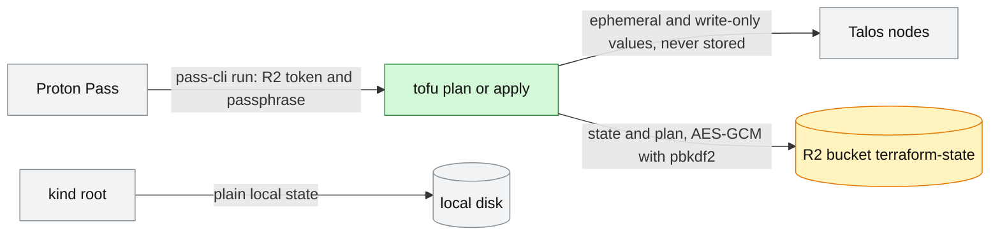
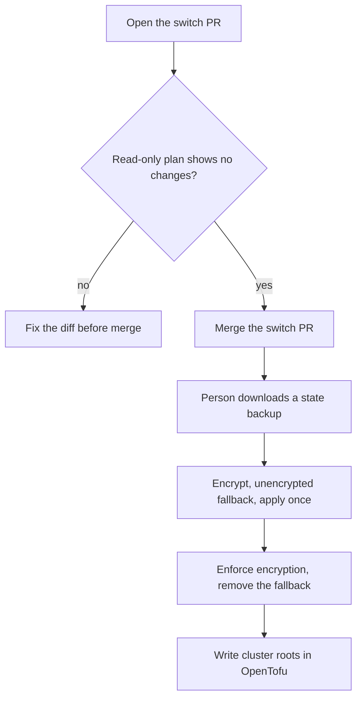

# RFC 0022: Use OpenTofu as the IaC tool

<!-- readability: allow-code R2 -->

## Summary

The landing zones, the bootstrap modules and the cluster roots move from Terraform 1.17 to OpenTofu 1.13,
before the cluster roots exist. Every R2-backed root gets client-side state and plan encryption.

| Decision | Why | Cost | Reversible |
|---|---|---|---|
| OpenTofu 1.13 as the IaC tool | Open-source license, Talos ephemeral pattern, encrypted state and plans | Tooling migration; no Terraform-only features | yes, under an hour until the first encrypted apply; after it, decrypt first |
| One switch PR behind a read-only plan, every dependency pinned exactly | Partial changes flip lock files between registries; each version change is a reviewed Renovate PR | Pin, lock files, hooks and Renovate change once; a regex manager; one Renovate PR per OpenTofu patch | yes, restore the state backup and revert the PR, before encryption; a pin moves in one PR |
| Ephemeral pattern first, then encrypted R2 state and plans | Keeps secrets out of R2, or unreadable there | A lost passphrase loses the state | no, unless a decrypt step runs first |

## Context

| Item | Today |
|---|---|
| Tool | Terraform 1.17.2, pinned by `required_version` and mise |
| Roots | `landing-zone/cloudflare` (545 lines of HCL with `modules/cloudflare-domain`, R2 state); planned: `landing-zone/gcp`, `clusters/<name>/` |
| IaC scope | Cluster, Gateway API CRDs, Cilium, Argo CD only ([ADR 0015](../adr/0015-bootstrap-boundary.md)); Argo CD installs the rest from rendered manifests |
| State | kind local, others R2 bucket `terraform-state` with `use_lockfile` ([ADR 0018](../adr/0018-terraform-state-backends.md)); R2 has server-side encryption at rest only, no object versioning |
| Providers | `siderolabs/talos`, `tehcyx/kind`, `hashicorp/helm`, `hashicorp/kubernetes`, `hashicorp/google`, `cloudflare/cloudflare` 5.x |
| Credentials | Proton Pass through `pass-cli run`; plan runs locally, never in CI ([ADR 0019](../adr/0019-lifecycle-tasks-and-ci-scope.md)) |

Talos 0.12.0 can keep machine secrets and kubeconfigs out of state with ephemeral resources and write-only
inputs; without that pattern they land in R2 state
([threat model](../research/0022-iac-tool-state-secrets.md)). The tool must be chosen before the cluster roots are
written: switching later means more roots, lock files and states to migrate.

## Goals and non-goals

Goals:

- Every provider of the plan works, including Talos ephemeral resources and write-only inputs.
- No long-lived secret readable in an R2 state object or a saved plan by someone holding only the bucket or its token.
- A license with no open question for a public repository used individually and non-commercially.
- Keep HCL, the R2 backend with native lock files, `pass-cli run`, mise pins, pre-commit hooks and Renovate.

Non-goals:

- The secrets backend and where Talos machine secrets live after first creation ([RFC 0020](https://github.com/gsuquet/infra/pull/4)).
- The kind provisioning method (provider or `kind create cluster` from the mise task).
- A plan-review CI job: plans stay local ([ADR 0019](../adr/0019-lifecycle-tasks-and-ci-scope.md)).
- [ADR 0015](../adr/0015-bootstrap-boundary.md), [ADR 0017](../adr/0017-repository-layout.md), [ADR 0018](../adr/0018-terraform-state-backends.md) and [ADR 0019](../adr/0019-lifecycle-tasks-and-ci-scope.md) keep "Terraform" as the name of the language family (HCL, state, providers); they are not edited.

## Decision drivers

- Secrets: long-lived secrets stay out of state; what remains is unreadable to anyone holding only the bucket or its token.
- Talos: provider 0.12.0 ephemeral resources and write-only inputs work.
- License: open source, no ambiguity for a public repository used individually and non-commercially.
- Migration: keep the R2 backend, `pass-cli run`, mise, pre-commit and Renovate at low cost.
- Readability: plans that a reviewer or an agent reads easily.

## Options considered

The [options comparison](../research/0022-iac-tool-options.md) holds the criteria, versions, sources and the rest of the
Pulumi costs.

### OpenTofu 1.13

Switch the binary, keep HCL, the providers and the R2 backend, and add client-side state and plan encryption.

- Good: ephemeral resources and write-only arguments (1.11+), so the Talos pattern works (Talos driver).
- Good: state and plan encryption with `pbkdf2`, KMS, OpenBao or external key providers (secrets driver).
- Good: MPL-2.0 under the Linux Foundation (license driver).
- Good: every provider of the plan is on registry.opentofu.org; HCL and the backend stay (migration driver).
- Bad: more than a binary rename: version pin, both lock files, two hooks and the Renovate rules change (migration driver).
- Bad: Terraform-only features will not arrive.

### Pulumi

Rewrite the IaC layer in Go or TypeScript on a DIY R2 backend or Pulumi Cloud.

- Good: Go and TypeScript are first-class, with unit tests in the same language.
- Good: secret values encrypted per value in state.
- Bad: write-only values from bridged providers stay in state (encrypted as secrets) and are not diffed (secrets driver).
- Bad: Talos sits on a community package that lags upstream and has no `talos_machine` / `talos_cluster` nor their `_wo` inputs (Talos driver).
- Bad: HCL, every hook, the Renovate rules and the R2 bootstrap are rewritten: days of work (migration driver).
- Bad: a general-purpose language adds little (readability driver).

### Do nothing

Stay on Terraform 1.17.

- Good: no migration; provider docs, tflint, trivy and Renovate target it first; it has ephemeral resources and write-only arguments (1.11+).
- Bad: no client-side state encryption: secrets without a write-only variant, or generated by a root, stay readable to anyone with the R2 token (secrets driver).
- Bad: the BSL license keeps a question open for a public repository, even if non-commercial use is allowed **(unverified)** (license driver).

Staying is acceptable only with the full Talos ephemeral pattern and a credential agents do not hold for production Talos roots.

## Proposal

Secrets reach nodes without touching state; whatever still reaches R2 is encrypted on the client.

Legend: green is new, yellow is changed, gray is unchanged.

The reason for each choice and the tested tools are in the
[tooling and migration detail](../research/0022-iac-tool-tooling.md); the key provider and passphrase follow from
[who encryption stops](../research/0022-iac-tool-state-secrets.md#who-pbkdf2-encryption-stops).

### Migration path

The state backup comes before the first encrypted apply, the step that has no undo without decryption.
Effort: about an hour, **an estimate only** until the gate passes.

## Operational impact

- Blast radius: the `landing-zone/cloudflare` state on R2 today and every future R2-backed cluster root; a [lost passphrase](#drawbacks-and-risks) makes every state of its environment unrecoverable.
- Rollout: the [migration path](#migration-path); the [changed files](../research/0022-iac-tool-tooling.md#files-of-the-switch-pr) land together.
- Rollback: before encryption, restore the state backup and run `terraform init` ([migration guide](https://opentofu.org/docs/intro/migration/migration-guide/)) and revert the switch PR, under an hour; after encryption, first decrypt (remove `enforced`, add an `unencrypted` fallback, apply), so irreversible without that decrypt step.
- Migration: R2 state of `landing-zone/cloudflare` read by OpenTofu without changes, then encrypted in place; both lock files rewritten to `registry.opentofu.org`; no compatibility window, the switch is atomic.
- Security: the passphrase joins the Pass session of the R2 token; see [who encryption stops](../research/0022-iac-tool-state-secrets.md#who-pbkdf2-encryption-stops).
- Cost: N/A: OpenTofu and `pbkdf2` are free; a later `gcp_kms` key is a separate decision.
- Observability: the Confirmation checks of the [Decision](#decision). No SLO is touched.

## Drawbacks and risks

| Risk | Severity | Mitigation |
|---|---|---|
| Losing a passphrase makes the state unrecoverable; R2 has [no versioning](#context) | high | Passphrase in Pass plus an offline copy, checked by one decryption after creation |
| Encryption does not stop agents or anyone with the Pass session | high | The ephemeral / `_wo` pattern stays the primary control; a key agents cannot reach is [future work](#future-work) |
| `tofu plan` against state written by Terraform 1.17.2 is untested | medium | The read-only plan gates the switch PR |
| pre-commit-terraform tofu override, Renovate lock file maintenance against registry.opentofu.org and terraform-docs are unverified | medium | Checked in the switch PR before merge |
| Terraform-only features will not arrive in OpenTofu; version numbers are independent (1.13 is not four releases behind 1.17) | medium | Compare features, not numbers; revisit trigger in the [Decision](#decision) |
| Provider docs and examples target Terraform; third-party modules may carry Terraform-only `required_version` constraints that OpenTofu ignores, so they neither block nor protect | low | Pin modules and review their constraints |
| Renovate and tfupdate do not manage the `compatible_with` pin out of the box | low | A Renovate regex manager moves it with the mise pin in one PR |
| `pbkdf2` salt randomness per file is not documented **(unverified)** | low | Move to `gcp_kms` or OpenBao when available |

## Open questions

None.

## Decision

- Status: accepted on 2026-11-19 by gsuquet
- Context: IaC layer of `infra`: landing zones, bootstrap modules, cluster roots for kind, Talos and GKE. Talos secrets need ephemeral resources and write-only inputs; R2 state has only server-side encryption.
- Decision: We decided for OpenTofu 1.13 with client-side state and plan encryption and against staying on Terraform 1.17 and against Pulumi, to achieve an unambiguous open-source license, the Talos ephemeral pattern and encrypted R2 state and plans, accepting a tooling migration and the loss of Terraform-only features.
- Decision: Switch in one PR, merged only after a read-only `tofu plan` on `landing-zone/cloudflare` shows no changes: mise `opentofu`, tasks call `tofu`; `required_version`, which OpenTofu ignores, replaced by top-level `language { compatible_with { opentofu = "1.13.9" } }`; both `.terraform.lock.hcl` regenerated for `registry.opentofu.org`; `terraform_providers_lock` runs tofu via `--tf-path` / `PCT_TFPATH` (if that fails, drop the hook); `tfupdate` dropped; Renovate `registryUrls` for registry.opentofu.org. Exact pins, no ranges: OpenTofu in the `language` block and mise, providers in `required_providers`, modules by `version`, tools in mise; Renovate moves each, with a regex manager for the `language` block; lock file hashes complement the pins, not replace them. The switch PR adds a pre-commit check that fails any root with an R2 `backend "s3"` block and without `enforced = true` on `state` and `plan`; kind roots excluded.
- Decision: Talos roots use ephemeral resources and write-only inputs; encryption is defense in depth, not the primary control. Every R2-backed root: `encryption` block in code, `pbkdf2` key provider, sensitive passphrase variable from `pass-cli run`, `enforced = true` on `state` and `plan`; no `TF_ENCRYPTION`. Migrate with an `unencrypted` fallback, apply once, then remove it. One passphrase per environment (production, rest), with an offline backup. kind roots: local state, not encrypted. `.tf` files only, no `.tofu`.
- Consequences:
  - Good: a secret still reaching state or a saved plan is encrypted before R2; a leaked R2 token, Cloudflare-side access or a stray plan file reads nothing.
  - Good: the license question is closed.
  - Good: the migration happens while only `landing-zone/cloudflare` exists.
  - Bad: a lost passphrase loses the state; R2 cannot roll it back.
  - Bad: encryption does not stop agents or anyone holding the owner's Pass session.
  - Bad: Terraform-only features will not be available; tooling (pin, lock files, hooks, Renovate) changes once.
- Confidence: medium, a moderate preference: with the full Talos ephemeral pattern R2 states hold almost no long-lived secret, and pre-commit-terraform, Renovate and terraform-docs behavior with tofu is unverified.
- Confirmation: read-only `tofu plan` with no changes before the first encrypted apply; the pre-commit check added by the switch PR fails an R2-backed root without `enforced = true` on `state` and `plan`; a downloaded R2 state object holds no known secret string and no plaintext `resources` values.
- Revisit when: OpenTofu stops tracking provider protocol changes, Terraform adds client-side state encryption, or the secrets backend and `landing-zone/gcp` exist (move the key provider to `gcp_kms` or `openbao` with an identity agents do not hold).

## Implementation

N/A: the switch PR is not opened yet.

## References

- [OpenTofu state encryption](https://opentofu.org/docs/language/state/encryption/)
- [OpenTofu settings: `language` block](https://opentofu.org/docs/language/settings/)
- [OpenTofu migration guide](https://opentofu.org/docs/intro/migration/migration-guide/)
- [Talos provider: using ephemeral resources](https://registry.terraform.io/v2/provider-docs/13749226)
- [Terraform write-only arguments](https://developer.hashicorp.com/terraform/language/resources/ephemeral/write-only)
- [Pulumi write-only fields](https://www.pulumi.com/docs/iac/concepts/secrets/write-only-fields/)
- [Renovate terraform manager](https://docs.renovatebot.com/modules/manager/terraform/)
- [ADR 0015: bootstrap boundary](../adr/0015-bootstrap-boundary.md), [ADR 0017: repository layout](../adr/0017-repository-layout.md), [ADR 0018: state backends](../adr/0018-terraform-state-backends.md), [ADR 0019: lifecycle tasks and CI scope](../adr/0019-lifecycle-tasks-and-ci-scope.md)
- [RFC 0020 secrets backend](https://github.com/gsuquet/infra/pull/4), [RFC 0023 Renovate](https://github.com/gsuquet/infra/pull/6), [RFC 0025 Talos on Raspberry Pi](https://github.com/gsuquet/infra/pull/9)

## Future work

| Item | Depends on |
|---|---|
| Where Talos machine secrets live after first creation; the ephemeral pattern needs a backend readable at plan time | [RFC 0020 secrets backend](https://github.com/gsuquet/infra/pull/4) |
| Production passphrase in a Pass vault agents cannot open, with re-authentication per use, if `pass-cli` supports it **(unverified)**; else a separate R2 credential | [RFC 0020 question 10](https://github.com/gsuquet/infra/pull/4) |
| Key provider `gcp_kms` with an identity agents do not hold, or `openbao` | `landing-zone/gcp`, [RFC 0020](https://github.com/gsuquet/infra/pull/4) |
| kind provisioning: provider or `kind create cluster` from the mise task (keeps the kubeconfig out of state, cluster not in a plan) | cluster-kind module task |
| Plan-review CI job reading encrypted plans | A change to [ADR 0019](../adr/0019-lifecycle-tasks-and-ci-scope.md) |
| Rename "Terraform" to OpenTofu in [ADR 0015](../adr/0015-bootstrap-boundary.md), [ADR 0017](../adr/0017-repository-layout.md), [ADR 0018](../adr/0018-terraform-state-backends.md) and [ADR 0019](../adr/0019-lifecycle-tasks-and-ci-scope.md), if wanted | Retro [RFCs 0015-0019](https://github.com/gsuquet/infra/pull/18) superseded |

kind provider options are compared in the [options comparison](../research/0022-iac-tool-options.md#kind-provider-options).
