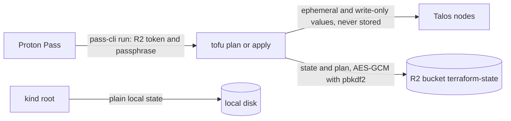
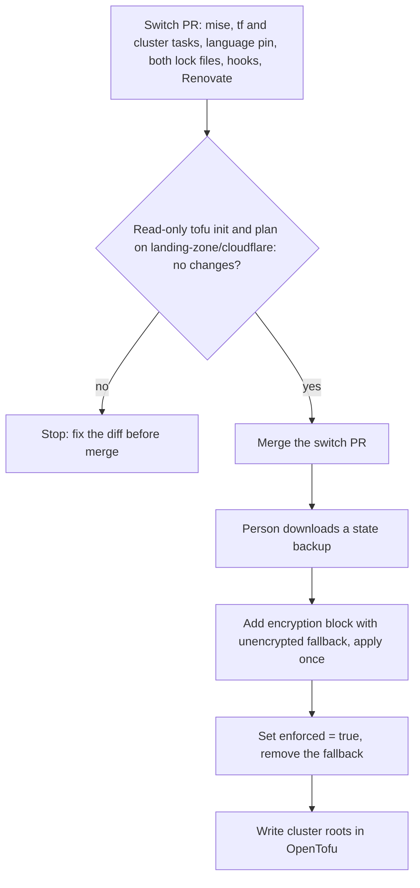

# RFC 0022: Use OpenTofu as the IaC tool

## Summary

Replace Terraform 1.17 with OpenTofu 1.13 for the landing zones, the bootstrap modules and the cluster roots,
before the cluster roots exist. Add client-side state and plan encryption to every R2-backed root as defense in
depth, while the Talos ephemeral and write-only pattern stays the primary control for secrets.

## Context

| Item | Today |
|---|---|
| Tool | Terraform 1.17.2, pinned by `required_version` and mise |
| Roots | `landing-zone/cloudflare` (545 lines of HCL with `modules/cloudflare-domain`, R2 state); planned: `landing-zone/gcp`, `clusters/<name>/` |
| IaC scope | Cluster, Gateway API CRDs, Cilium, Argo CD only ([ADR 0015](../adr/0015-bootstrap-boundary.md)); Argo CD installs the rest from rendered manifests |
| State | kind local, others R2 bucket `terraform-state` with `use_lockfile` ([ADR 0018](../adr/0018-terraform-state-backends.md)); R2 has server-side encryption at rest only, no object versioning |
| Providers | `siderolabs/talos`, `tehcyx/kind`, `hashicorp/helm`, `hashicorp/kubernetes`, `hashicorp/google`, `cloudflare/cloudflare` 5.x |
| Credentials | Proton Pass through `pass-cli run`; plan runs locally, never in CI ([ADR 0019](../adr/0019-lifecycle-tasks-and-ci-scope.md)) |

Talos 0.12.0 can keep machine secrets and kubeconfigs out of state with ephemeral resources and write-only
inputs; without that pattern they land in R2 state. The tool must be chosen before the cluster roots are
written: switching later means more roots, lock files and states to migrate.

## Goals and non-goals

Goals:

- Every provider of the plan works, including Talos ephemeral resources and write-only inputs.
- No long-lived secret readable in an R2 state object or a saved plan by someone holding only the bucket or its token.
- A license with no open question for a public repository used individually and non-commercially.
- Keep HCL, the R2 backend with native lock files, `pass-cli run`, mise pins, pre-commit hooks and Renovate.

Non-goals:

- The secrets backend and where Talos machine secrets live after first creation (RFC 0020, [PR #4](https://github.com/gsuquet/infra/pull/4)).
- The kind provisioning method (provider or `kind create cluster` from the mise task).
- A plan-review CI job: plans stay local (ADR 0019).
- ADRs 0015, 0017, 0018 and 0019 keep "Terraform" as the name of the language family (HCL, state, providers); they are not edited.

## Decision drivers

- Keep long-lived secrets out of state (ephemeral resources, write-only arguments), and keep what remains unreadable to anyone holding only the state bucket or its token.
- Support the Talos provider 0.12.0 ephemeral resources and write-only inputs (`talos_machine`, `talos_cluster`, `talos_machine_configuration_apply`).
- Open-source license with no ambiguity for a public repository used individually and non-commercially.
- Keep the R2 backend, `pass-cli run`, mise, pre-commit and Renovate with low migration cost.
- Plans that a reviewer or an agent reads easily.

## Options considered

Researched on 2026-11-18, revised on 2026-11-19 after review. **(unverified)** marks a claim from prior knowledge
that no allowed documentation domain or local test confirmed; every other claim links to its source or names the
local test.

| Criterion | Terraform 1.17 | OpenTofu 1.13 | Pulumi (Go / TypeScript) |
|---|---|---|---|
| License | BSL 1.1 since 1.6 **(unverified)**; use in a public repository used individually and non-commercially is allowed, the restriction targets competing hosted products **(unverified)**; providers stay MPL-2.0 **(unverified)** | MPL-2.0 ([LICENSE](https://github.com/opentofu/opentofu/blob/main/LICENSE)), Linux Foundation project ([FAQ](https://opentofu.org/faq/)) | Apache-2.0 for CLI and SDKs ([LICENSE](https://github.com/pulumi/pulumi/blob/master/LICENSE)); Pulumi Cloud is a proprietary SaaS |
| Latest version | 1.17.x ([upgrade guide](https://developer.hashicorp.com/terraform/language/upgrade-guides)) | 1.13.9, 2026-11-05 ([releases](https://github.com/opentofu/opentofu/releases)) | CLI 3.276.0 (`mise ls-remote pulumi`) |
| Ephemeral resources | Yes ([ephemeral block](https://developer.hashicorp.com/terraform/language/block/ephemeral)); 1.10+ per the Talos guide | Yes, 1.11+ ([1.11](https://opentofu.org/docs/v1.11/intro/whats-new/)) | No equivalent found; secret outputs encrypted in state instead |
| Write-only arguments | 1.11+, never in state or plan ([write-only](https://developer.hashicorp.com/terraform/language/resources/ephemeral/write-only)) | 1.11+, never in state or plan ([ephemerality](https://opentofu.org/docs/language/ephemerality/)) | Supported but **kept in state**: the initial value "gets written to Pulumi state inputs as a Secret" and changes are not diffed ([write-only fields](https://www.pulumi.com/docs/iac/concepts/secrets/write-only-fields/)) |
| Version pin in code | `terraform { required_version }` | Top-level `language { compatible_with { opentofu = "..." } }`, 1.12+ ([settings](https://opentofu.org/docs/language/settings/)); `"99.0.0"` fails with "Incompatible module"; `required_version` is **not** enforced (`tofu validate` passes with `"99.0.0"`, local test, 1.13.9) | `requiredVersion` in `Pulumi.yaml` **(unverified)** |
| S3/R2 backend, native lock | `use_lockfile`, opt-in; DynamoDB locking deprecated ([S3](https://developer.hashicorp.com/terraform/language/settings/backends/s3)) | `use_lockfile` since 1.10, same `skip_*` and `use_path_style` options ([S3](https://opentofu.org/docs/language/settings/backends/s3/), [1.10](https://opentofu.org/docs/v1.10/intro/whats-new/)); `init -backend=false` + `validate` pass on the current root (local test); real backend init not run | DIY backend with `endpoint=` and `s3ForcePathStyle=`, file lock under `locks/` ([DIY](https://www.pulumi.com/docs/iac/operations/stack-management/using-a-diy-backend/)); not transactional, "cannot transparently recover from certain kinds of partial failures" ([state](https://www.pulumi.com/docs/iac/concepts/state-and-backends/)) |
| Client-side state encryption | None; backend encryption at rest only **(unverified: no such feature in the docs read)** | Since 1.7: state **and** plan, local and remote, AES-GCM; key providers `pbkdf2`, `aws_kms`, `gcp_kms`, `azure_vault`, `openbao`, `external`; `fallback` for migration, `enforced = true`; config in code and/or `TF_ENCRYPTION`, environment wins on conflict ([encryption](https://opentofu.org/docs/language/state/encryption/)) | Per value: secrets encrypted with the stack provider (`passphrase`, `awskms`, `gcpkms`, `azurekeyvault`, `hashivault`, Pulumi Cloud) ([secrets](https://www.pulumi.com/docs/iac/concepts/secrets/)); rest of state in plain text; passphrase from `PULUMI_CONFIG_PASSPHRASE[_FILE]` ([env](https://www.pulumi.com/docs/iac/cli/environment-variables/)) |
| Lock file | `.terraform.lock.hcl`, `registry.terraform.io/...` addresses | Same file, but `tofu init` **rewrites** it: new header, address `registry.opentofu.org/cloudflare/cloudflare`, 8 `h1:` hashes added, `zh:` kept, same binary (local test) | `go.sum` / `package-lock.json` for SDKs; plugin versions not locked **(unverified)** |
| Provider registry | talos 0.12.0 (partner, 2026-09-21), kind 0.13.0 (community) | talos, kind, helm, kubernetes, google, cloudflare all on registry.opentofu.org ([opentofu/registry](https://github.com/opentofu/registry), `gh api`); same binaries | Native kubernetes, gcp; cloudflare bridged v6.24.0 = upstream 5.29.0, days of lag ([releases](https://github.com/pulumi/pulumi-cloudflare/releases)); Talos community `pulumiverse` v0.8.1 (2026-07-29, [API docs](https://www.pulumi.com/registry/packages/talos/api-docs/)), before upstream 0.12.0 ([versions](https://registry.terraform.io/v2/providers/siderolabs/talos/provider-versions)), `machine` module has only `Bootstrap`, `ConfigurationApply`, `Secrets` ([machine](https://www.pulumi.com/registry/packages/talos/api-docs/machine/)); kind: no package, generate a local SDK with `pulumi package add terraform-provider tehcyx/kind` ([any provider](https://www.pulumi.com/docs/iac/concepts/providers/any-terraform-provider/)) |
| Provider-defined functions | Yes **(unverified version)** | Since 1.7 ([functions](https://opentofu.org/docs/language/functions/)) | Not applicable: host language |
| Testing | `terraform test` 1.6+, mocks 1.7+ ([tests](https://developer.hashicorp.com/terraform/language/tests)) | `tofu test`, `mock_provider`, per-instance `override_resource` (1.12) ([test](https://opentofu.org/docs/cli/commands/test/)); reads `.tftest.hcl` | Go/TS unit tests with mocks, policy packs (Node.js/Python only), integration tests ([testing](https://www.pulumi.com/docs/iac/concepts/testing/)) |
| Languages | HCL | HCL plus `.tofu` overrides | Go, TypeScript, Python, C#, Java, YAML, Pulumi HCL ([HCL](https://www.pulumi.com/docs/iac/languages-sdks/hcl/), status **(unverified)**) |
| Extras that matter here | Stacks, `terraform query`, actions **(unverified)**: none in the plan | Encryption, `-exclude`, OCI registry, `-json-into` (1.12), `lifecycle { enabled }` (1.11), `destroy = false` (1.12) ([1.12](https://opentofu.org/docs/v1.12/intro/whats-new/)) | Real loops and abstractions, Automation API, ESC |
| mise | `aqua:hashicorp/terraform` | `aqua:opentofu/opentofu` | `aqua:pulumi/pulumi` |

### OpenTofu 1.13

Switch the binary, keep HCL, the providers and the R2 backend, and add client-side state and plan encryption.

- Good: ephemeral resources and write-only arguments (1.11+), so the Talos pattern works (Talos driver).
- Good: state and plan encryption with `pbkdf2`, KMS, OpenBao or external key providers (secrets driver).
- Good: MPL-2.0 under the Linux Foundation (license driver).
- Good: every provider of the plan is on registry.opentofu.org; HCL and the backend stay (migration driver).
- Bad: more than a binary rename: version pin, both lock files, two hooks and the Renovate rules change (migration driver).
- Bad: Terraform-only features will not arrive.

### Pulumi

Rewrite the IaC layer in Go or TypeScript on a DIY R2 backend or Pulumi Cloud.

- Good: Go and TypeScript are first-class, with unit tests in the same language.
- Good: secret values encrypted per value in state; `passphrase` is the closest to a local key, `gcpkms` fits GKE later.
- Bad: write-only values from bridged providers stay in state (encrypted as secrets) and are not diffed (secrets driver).
- Bad: Talos sits on a community package that lags upstream and has no `talos_machine` / `talos_cluster` nor their `_wo` inputs; kind needs a generated local SDK whose version in `Pulumi.yaml` Renovate cannot update **(unverified)** (Talos driver).
- Bad: every pre-commit hook replaced by language tooling (`gofmt`, `golangci-lint`, `tsc`, `eslint`) plus `pulumi preview`; trivy IaC scanning of Pulumi programs not supported **(unverified)**; `PULUMI_CONFIG_PASSPHRASE` comes from Pass like the R2 token (migration driver).
- Bad: DIY backend not transactional and without drift detection; Pulumi Cloud Free (1 user, no resource cap, 25 ESC secrets, [pricing](https://www.pulumi.com/pricing/)) is a SaaS holding the state.
- Bad: rewrite of 545 lines plus `pulumi import --from terraform` of every resource (`pulumi convert` covers 90-95% of most projects, [migration](https://www.pulumi.com/docs/iac/guides/migration/migrating-to-pulumi/from-terraform/)), all hooks and Renovate rules replaced, R2 bootstrap rewritten: days of work (migration driver).
- Bad: ESC is a Pulumi Cloud service without Proton Pass integration ([ESC](https://www.pulumi.com/docs/esc/)), self-hosting not described **(unverified)**; it overlaps RFC 0020 and does not replace `pass-cli`.
- Bad: with rendered manifests the IaC layer is about four resources per cluster plus three Helm installs, so a general-purpose language adds little; `pulumi preview --diff` is less common than plan output and Go/TS need a build step before an agent can check them, while HCL keeps one declarative format next to the rendered YAML, readable without a language toolchain (readability driver).

### Do nothing

Stay on Terraform 1.17.

- Good: no migration; provider docs, tflint, trivy and Renovate target it first; it has ephemeral resources and write-only arguments (1.11+).
- Bad: no client-side state encryption: secrets without a write-only variant, or generated by a root, stay readable to anyone with the R2 token (secrets driver).
- Bad: the BSL license keeps a question open for a public repository, even if non-commercial use is allowed **(unverified)** (license driver).

Staying is acceptable only with the full Talos ephemeral pattern and a credential agents do not hold for production Talos roots.

## Proposal

Switch to OpenTofu 1.13 in one PR, gated by a read-only plan, then encrypt every R2-backed state.

Secrets reach nodes without touching state; whatever still reaches an R2 state or plan is encrypted on the client.

### Settled choices

| Topic | Choice | Reason |
|---|---|---|
| Version pin | Remove `required_version`; add top-level `language { compatible_with { opentofu = "~> 1.13.9" } }`; no Renovate regex manager | OpenTofu ignores `required_version`; `"~> 1.13.9"` passes and `"~> 1.13.10"` fails on 1.13.9 (local test); the range takes patch releases from mise without a code change, an exact pin would block each one; a minor upgrade edits the range by hand |
| `terraform_providers_lock` | Runs tofu through the `--tf-path` / `PCT_TFPATH` override; if the override fails in the switch PR, drop the hook and regenerate lock files with `tofu providers lock` | Run as is, it rewrites lock files back to `registry.terraform.io` |
| `tfupdate` | Dropped | It only rewrites `required_version`, which OpenTofu ignores; Renovate already updates providers |
| Encryption check | The switch PR adds a pre-commit check that fails any root with an R2 `backend "s3"` block and without `enforced = true` on `state` and `plan`; kind roots excluded | Gives the Confirmation an owner |
| Key provider | `pbkdf2`, in code: `encryption` block, sensitive passphrase variable fed by `pass-cli run`, `enforced = true` on `state` and `plan`; no `TF_ENCRYPTION` | Config in code is checkable; the secrets backend (RFC 0020) and `landing-zone/gcp` do not exist yet |
| Passphrases | One per environment: production roots, everything else; an offline copy kept apart from Pass, checked by decrypting a downloaded state once | Docs advise one key per state for KMS and OpenBao providers only; each extra passphrase is one more item to lose |
| kind roots | No encryption | Local, disposable state; `cluster:up` on kind must work offline and without secrets (ADR 0018) |
| File extension | `.tf` only, no `.tofu` | tflint and trivy are tested on `encryption` and `language` blocks in `.tf`; `.tofu` is not |
| Gate | Read-only `tofu init` + `tofu plan` against the R2 state written by Terraform 1.17.2 shows no changes before merge | Not run in the study: needs the R2 read token |

### State secrets threat model

What stays in state with the ephemeral / `_wo` pattern:

| Root | State | Left in state with the pattern | Without it |
|---|---|---|---|
| `landing-zone/cloudflare` | R2 | None by design ("No secret value is created by a resource of this configuration", `landing-zone/cloudflare/README.md`); OAuth IdP `client_secret` kept out of IaC | Same |
| `clusters/<kind>` | Local disk | kind kubeconfig and client key, no write-only variant known **(unverified)** | Same |
| `clusters/<talos>` | R2 | Hashes and IDs (Talos study option B, [PR #9](https://github.com/gsuquet/infra/pull/9)), plus any key the root generates, such as the service account signing key of RFC 0020 option G | Cluster CA, etcd CA, bootstrap tokens, admin kubeconfig, talosconfig |
| `clusters/<gke>` | R2 | Cluster CA (public); Google access token if read with the `google_client_config` data source, short-lived (about one hour) **(unverified: whether an ephemeral variant exists)** | Same |
| Helm releases (Cilium, Argo CD) | With the cluster | Release values, no secret planned | Same |

Encryption matters when the pattern is not used (Talos options A/C), when a root generates a key (RFC 0020 option
G), or when a provider lacks a write-only variant.

Talos 0.12.0 ephemeral resources: `machine_secrets`, `machine_configuration`, `client_configuration`,
`cluster_kubeconfig`, `cluster_health` ([index](https://registry.terraform.io/v2/provider-docs?filter[provider-version]=109978&page[size]=100),
[ephemeral guide](https://registry.terraform.io/v2/provider-docs/13749226)). Write-only inputs:

| Resource | Write-only inputs | Source |
|---|---|---|
| `talos_machine` | `machine_configuration_wo`, `client_configuration_wo`, `kubeconfig_wo` | [docs 13749231](https://registry.terraform.io/v2/provider-docs/13749231) |
| `talos_cluster` | `client_configuration_wo` | [docs 13749228](https://registry.terraform.io/v2/provider-docs/13749228) |
| `talos_machine_configuration_apply` | `client_configuration_wo`, `machine_configuration_input_wo` | [docs index](https://registry.terraform.io/v2/provider-docs?filter[provider-version]=109978&page[size]=100) |

The guide requires storing ephemeral `talos_machine_secrets` in a secret manager on first creation and reading
them back each run; Terraform 1.11+ and OpenTofu 1.11+ support the full pattern, OpenTofu 1.10 does not.

Who `pbkdf2` encryption stops, with the passphrase in the same Pass session as the R2 token:

| Adversary | Reads state today | With encryption |
|---|---|---|
| Leaked R2 state token alone (shell history, log, over-scoped token) | Yes | **No** |
| Cloudflare-side access, R2 data at rest | Yes | **No** |
| A saved plan file left on disk or attached somewhere | Yes | **No** |
| Anyone holding the owner's `pass-cli` session | Yes | **Yes** |
| Agents running mise tasks as the same OS user | Yes | **Yes**: `tofu state pull` / `tofu show` decrypt transparently |

Only a key agents cannot reach closes the agent path (RFC 0020 question 10): a separate Pass vault with
re-authentication per use **(unverified: `pass-cli` support)**, `gcp_kms` with an identity agents do not hold
(`roles/cloudkms.cryptoKeyEncrypterDecrypter`, needs `landing-zone/gcp`), or a separate R2 credential (closes the
agent path, not the Cloudflare-side one). Then a person runs `plan` on those roots and pastes it.

### Tooling impact

Local tests on a scratch copy of `landing-zone/cloudflare` without credentials, repo pins (tflint 0.66.0, trivy
0.76.1, tfupdate 0.10.3), OpenTofu 1.13.9, `encryption` block (`pbkdf2`, `enforced = true`) and `language` block in
`.tf`:

| Check | Result |
|---|---|
| `tofu init -backend=false`, `tofu validate` | Pass |
| tflint | No error on either block |
| `trivy config --exit-code 1` | 0 misconfigurations |
| `tfupdate opentofu -v` | Rewrites `required_version` only |

| Tool | Change |
|---|---|
| pre-commit-terraform | Point at tofu with `--tf-path` / `PCT_TFPATH` **(unverified)**; if that fails, drop `terraform_providers_lock`, which otherwise rewrites lock files back to `registry.terraform.io` |
| tflint, trivy | Unchanged (tested) |
| terraform-docs | Works on HCL **(unverified)** |
| tfupdate | Dropped: it targets `required_version`, which OpenTofu ignores; Renovate updates providers |
| Encryption check | New pre-commit check: fails a root with an R2 `backend "s3"` block and without `enforced = true` on `state` and `plan`; kind roots excluded |
| Renovate | `terraform` manager reads `*.tf` and `*.tofu`; `registryUrls: ["https://registry.opentofu.org"]` in a `packageRule` ([manager](https://docs.renovatebot.com/modules/manager/terraform/)); the `language` block is not managed **(unverified: not documented)**; lock file maintenance is done by Renovate itself, whether it writes `registry.opentofu.org` addresses is **(unverified)** |
| mise, CI | `terraform` replaced by `opentofu`; CI takes tools from mise |
| `pass-cli run` | Unchanged; the passphrase variable comes from Pass like the R2 token |
| Plan output | Plan text stays the most common IaC diff format; `tofu plan -json-into=plan.json` gives text and JSON in one run; an encrypted saved plan needs the key to be read by a tool |

### Migration

Every switch PR change lands together, or lock files flip between registries. Effort: about an hour, **an
estimate only** until the gate passes.

| File | Change |
|---|---|
| `.mise/config.toml`, `.mise/mise.lock` | `terraform` replaced by `opentofu` |
| `.mise/tasks/tf`, `cluster:*` tasks | Call `tofu` |
| `.pre-commit-config.yaml` | `terraform_providers_lock` runs tofu (or is dropped), `tfupdate` dropped, encryption check added |
| `.github/renovate.json` | "terraform cli" group renamed to match `opentofu` / `opentofu/opentofu`; "terraform providers" group with `registryUrls` for registry.opentofu.org; one lock file maintenance run checked |
| `landing-zone/cloudflare/terraform.tf`, `modules/cloudflare-domain/terraform.tf` | `required_version` replaced by the `language` block |
| Both `.terraform.lock.hcl` | Regenerated with `tofu init` / `tofu providers lock`; diff reviewed (address, header, `h1:` hashes) |

## Operational impact

- Blast radius: the `landing-zone/cloudflare` state on R2 today and every future R2-backed cluster root; a lost passphrase makes every state of its environment unrecoverable, and R2 cannot roll it back.
- Rollout: switch PR, gated by a read-only `tofu plan` with no changes; then encryption with an `unencrypted` fallback, one apply, then `enforced = true`; cluster roots start on OpenTofu.
- Rollback: before encryption, restore the state backup and run `terraform init` ([migration guide](https://opentofu.org/docs/intro/migration/migration-guide/)) and revert the switch PR, under an hour; after encryption, first decrypt (remove `enforced`, add an `unencrypted` fallback, apply), so irreversible without that decrypt step.
- Migration: R2 state of `landing-zone/cloudflare` read by OpenTofu without changes, then encrypted in place; both lock files rewritten to `registry.opentofu.org`; no compatibility window, the switch is atomic.
- Security: the passphrase joins the Pass session of the R2 token; encryption stops a leaked R2 token, Cloudflare-side access and stray plan files, not holders of that session nor agents running as the owner's OS user.
- Cost: N/A: OpenTofu and `pbkdf2` are free; a later `gcp_kms` key is a separate decision.
- Observability: the read-only plan shows no changes; the pre-commit check added by the switch PR fails an R2-backed root without `enforced = true`; a downloaded R2 state object holds no known secret string and no plaintext `resources` values. No SLO is touched.

## Drawbacks and risks

- Losing a passphrase makes the state unrecoverable; R2 has no versioning -> passphrase in Pass plus an offline copy, checked by one decryption after creation.
- Encryption does not stop agents or anyone with the Pass session -> the ephemeral / `_wo` pattern stays the primary control; a key agents cannot reach is future work.
- `tofu plan` against state written by Terraform 1.17.2 is untested -> the read-only plan gates the switch PR.
- Terraform-only features will not arrive in OpenTofu; version numbers are independent (1.13 is not four releases behind 1.17) -> compare features, not numbers; revisit trigger in the Decision.
- The `compatible_with` pin is not managed by Renovate or tfupdate out of the box -> range pin `~> 1.13.9` takes patches; a minor upgrade edits it by hand.
- pre-commit-terraform tofu override, Renovate lock file maintenance against registry.opentofu.org and terraform-docs are unverified -> checked in the switch PR before merge.
- Provider docs and examples target Terraform; third-party modules may carry Terraform-only `required_version` constraints that OpenTofu ignores, so they neither block nor protect -> pin modules and review their constraints.
- `pbkdf2` salt randomness per file is not documented **(unverified)** -> move to `gcp_kms` or OpenBao when available.

## Open questions

None.

## Decision

- Status: accepted on 2026-11-19 by gsuquet
- Decision: In the context of the IaC layer of `infra` (landing zones, bootstrap modules, cluster roots for kind, Talos and GKE), facing Talos secrets that need ephemeral resources and write-only inputs and R2 state with only server-side encryption, we decided for OpenTofu 1.13 with client-side state and plan encryption and against staying on Terraform 1.17 and against Pulumi, to achieve an unambiguous open-source license, the Talos ephemeral pattern and encrypted R2 state and plans, accepting a tooling migration and the loss of Terraform-only features.
- Rules:
  - Switch in one PR: mise `opentofu`, tasks call `tofu`, `required_version` replaced by top-level `language { compatible_with { opentofu = "~> 1.13.9" } }` (range, no Renovate regex manager), both `.terraform.lock.hcl` regenerated for `registry.opentofu.org`, `terraform_providers_lock` runs tofu via `--tf-path` / `PCT_TFPATH` (if that fails, drop the hook), `tfupdate` dropped, Renovate `registryUrls` for registry.opentofu.org.
  - The switch PR adds a pre-commit check that fails any root with an R2 `backend "s3"` block and without `enforced = true` on `state` and `plan`; kind roots excluded.
  - Merge the switch only after a read-only `tofu plan` on `landing-zone/cloudflare` shows no changes.
  - Every R2-backed root: `encryption` block in code, `pbkdf2` key provider, sensitive passphrase variable from `pass-cli run`, `enforced = true` on `state` and `plan`; no `TF_ENCRYPTION`. Migrate with an `unencrypted` fallback, apply once, then remove it.
  - One passphrase per environment (production, rest), with an offline backup.
  - kind roots: local state, not encrypted.
  - `.tf` files only, no `.tofu`.
  - Talos roots use ephemeral resources and write-only inputs; encryption is defense in depth, not the primary control.
- Consequences:
  - Good: a secret still reaching state or a saved plan is encrypted before R2; a leaked R2 token, Cloudflare-side access or a stray plan file reads nothing.
  - Good: the license question is closed.
  - Good: the migration happens while only `landing-zone/cloudflare` exists.
  - Bad: a lost passphrase loses the state; R2 cannot roll it back.
  - Bad: encryption does not stop agents or anyone holding the owner's Pass session.
  - Bad: Terraform-only features will not be available; tooling (pin, lock files, hooks, Renovate) changes once.
- Confidence: medium, a moderate preference: with the full Talos ephemeral pattern R2 states hold almost no long-lived secret, and pre-commit-terraform, Renovate and terraform-docs behavior with tofu is unverified.
- Confirmation: read-only `tofu plan` with no changes before the first encrypted apply; the pre-commit check added by the switch PR fails an R2-backed root without `enforced = true` on `state` and `plan`; a downloaded R2 state object holds no known secret string and no plaintext `resources` values.
- Revisit when: OpenTofu stops tracking provider protocol changes, Terraform adds client-side state encryption, or the secrets backend and `landing-zone/gcp` exist (move the key provider to `gcp_kms` or `openbao` with an identity agents do not hold).

## Implementation

N/A: the switch PR is not opened yet.

## References

- [OpenTofu state encryption](https://opentofu.org/docs/language/state/encryption/)
- [OpenTofu settings: `language` block](https://opentofu.org/docs/language/settings/)
- [OpenTofu migration guide](https://opentofu.org/docs/intro/migration/migration-guide/)
- [Talos provider: using ephemeral resources](https://registry.terraform.io/v2/provider-docs/13749226)
- [Terraform write-only arguments](https://developer.hashicorp.com/terraform/language/resources/ephemeral/write-only)
- [Pulumi write-only fields](https://www.pulumi.com/docs/iac/concepts/secrets/write-only-fields/)
- [Renovate terraform manager](https://docs.renovatebot.com/modules/manager/terraform/)
- [ADR 0015: bootstrap boundary](../adr/0015-bootstrap-boundary.md), [ADR 0017: repository layout](../adr/0017-repository-layout.md), [ADR 0018: state backends](../adr/0018-terraform-state-backends.md), [ADR 0019: lifecycle tasks and CI scope](../adr/0019-lifecycle-tasks-and-ci-scope.md)
- RFC 0020 secrets backend ([PR #4](https://github.com/gsuquet/infra/pull/4)), RFC 0023 Renovate ([PR #6](https://github.com/gsuquet/infra/pull/6)), RFC 0025 Talos on Raspberry Pi ([PR #9](https://github.com/gsuquet/infra/pull/9))

## Future work

| Item | Depends on |
|---|---|
| Where Talos machine secrets live after first creation; the ephemeral pattern needs a backend readable at plan time | RFC 0020 secrets backend |
| Production passphrase in a Pass vault agents cannot open, with re-authentication per use, if `pass-cli` supports it **(unverified)**; else a separate R2 credential | RFC 0020 question 10 |
| Key provider `gcp_kms` with an identity agents do not hold, or `openbao` | `landing-zone/gcp`, RFC 0020 |
| kind provisioning: provider or `kind create cluster` from the mise task (keeps the kubeconfig out of state, cluster not in a plan) | cluster-kind module task |
| Plan-review CI job reading encrypted plans | A change to ADR 0019 |
| Rename "Terraform" to OpenTofu in ADRs 0015, 0017, 0018 and 0019, if wanted | Retro RFCs 0015-0019 superseded |

kind provider options; the choice does not depend on the IaC tool, every one is on both registries:

| Option | registry.opentofu.org | Notes |
|---|---|---|
| `tehcyx/kind` | 0.13.0 (`providers/t/tehcyx/kind.json` in [opentofu/registry](https://github.com/opentofu/registry)) | Plan default, same version as registry.terraform.io |
| `kyma-incubator/kind` | 0.0.11 | Stale; `tehcyx/kind` started as its fork **(unverified)** |
| `unicell/kind` | 0.0.2-u2 | Stale |
| `kind create cluster --config` from the mise task | Not applicable | IaC starts at bootstrap |
