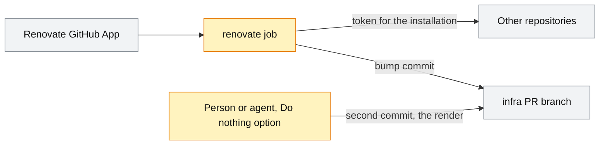
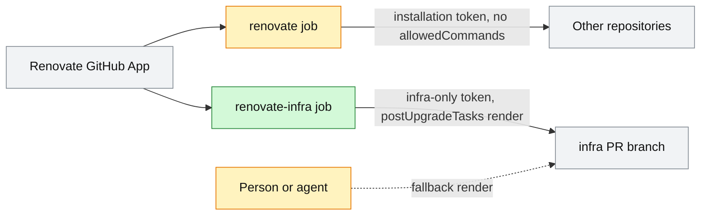
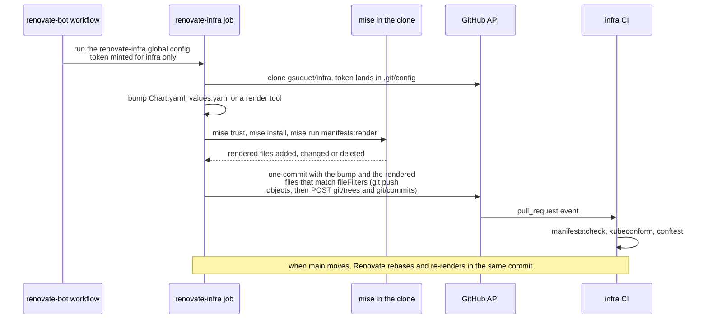

# RFC 0023: Re-render manifests in Renovate's own commit

## Summary

Renovate PRs that bump a chart, an image tag in default values or a render tool re-render
`gitops/clusters/*/rendered/**` in the same commit, through self-hosted `postUpgradeTasks`. infra gets its own runner
job with a token scoped to `gsuquet/infra`.

| Decision | Why | Cost | Reversible |
| --- | --- | --- | --- |
| Render in Renovate's commit (`postUpgradeTasks`), manual or agent render as fallback | One commit, so Renovate keeps the branch | Branch code can write to infra | open, [Write boundary](#open-questions) |
| Run infra in its own `renovate-infra` job with a token for infra only, on a bumped Renovate | Render code cannot reach other repositories | Job split, global options, version bump | open, [Write boundary](#open-questions) and [Runner bump](#open-questions) |
| Attach the render task only to rules that match every upgrade of the branch | Renovate reads the task from the first sorted upgrade only | Render tools leave the `dev tools` group | yes, the [Rollback](#operational-impact) removes the task rules |
| Proposed: an umbrella `Chart.yaml` per component | Native `helmv3` manager, no regex | If `Chart.lock` is committed, `lockFileMaintenance` is scoped or split | open, [Component shape](#open-questions) |
| Proposed: one version per component: group or drop default-values image tags, no chart pins in bootstrap modules, `cluster.yaml` overrides better forbidden by schema | A chart and its tag or module cannot disagree | Grouping rules, a schema rule | open, [Image tags](#open-questions) and [Overrides](#open-questions) |

Before, as the [Do nothing](#do-nothing) option:

With Do nothing, a manual render adds a second commit, and the one job's token likely reaches
`gsuquet/renovate-bot`.

Legend: yellow is changed, gray is unchanged.

After:

Compromised render code can no longer reach the other repositories.

Legend: green is new, yellow is changed, gray is unchanged.

## Context

CI fails on a stale render (`mise run manifests:check`), so a PR that bumps render input must carry the new render
that `mise run manifests:render` writes from
`gitops/components/<name>/` to `gitops/clusters/<cluster>/rendered/`. Render tools (helm, kustomize, yq) come from mise.

- infra is public and holds no credential in CI ([ADR-0019](../adr/0019-lifecycle-tasks-and-ci-scope.md)).
- Renovate is self-hosted in `gsuquet/renovate-bot`, so global options are in the owner's hands.
- Humans merge every PR; a red PR is fine only when the fix is obvious.
- Prior art: `gsuquet/homelab` has no post-upgrade task; a person or an agent renders on the PR branch. That does not
  scale to N clusters x M components and marks the branch modified, so Renovate stops maintaining it.

[Every constraint and its consequence](../research/0023-renovate-rendered-manifests-options.md#constraints).

## Goals and non-goals

Goals:

- Every Renovate PR that changes render input carries the matching render in Renovate's own commit and passes
  `manifests:check` with no human push.
- Renovate keeps rebasing those branches (no "modified branch", no extra CI cycle, no loop).
- No write credential in infra's GitHub Actions secrets.
- Render code on a Renovate branch can reach a token valid for `gsuquet/infra` only.

Non-goals:

- Automerge, including `dev tools`.
- Tenant manifests in `gsuquet/gitops`: Kargo promotes them (RFC 0021).
- Replacing Renovate for mise tools, GitHub Actions or OpenTofu providers.
- A kind end-to-end CI job (deferred by ADR-0019).

## Decision drivers

- Token blast radius: branch code must not reach a token wider than infra, and infra CI holds no write secret.
- Render in the same commit, so Renovate keeps maintaining the branch.
- No human step per chart PR.
- One updater for every update kind: charts, images, mise tools, actions, providers.

## Options considered

[Full evidence and comparison table](../research/0023-renovate-rendered-manifests-options.md).

### Renovate postUpgradeTasks, self-hosted

Renovate renders after it updates files and before it commits.

- Good: single commit, recomputed on every rebase; covers every update kind.
- Bad: render code can read the Renovate token; acceptable only with the runner isolation, and needs a runner change.

### GitHub Actions pushes the render

A workflow renders, and a second job with a dedicated App token commits.

- Good: cleanest boundary: the job that holds the write token never runs branch code.
- Bad: a write secret in public CI against ADR-0019, a second commit and loop prevention.

### Kargo or Updatecli

Kargo renders and opens PRs, or Updatecli runs shell targets (both unverified).

- Good: Kargo is already planned for tenants (RFC 0021).
- Bad: Kargo covers no mise tools, actions or providers; Updatecli needs a write secret and duplicates Renovate.

### Do nothing

A person or agent checks out the PR, renders and pushes.

- Good: free, and no token near branch code except on the person's machine.
- Bad: a human step per chart PR, and Renovate stops rebasing the branch.

## Proposal

postUpgradeTasks, only with the runner isolation; without it, GitHub Actions pushes the render. Manual render is the
fallback on an artifact error.

One Renovate commit carries the bump and its render (signed via `platformCommit`, checked in
[pilot step 6](../research/0023-renovate-rendered-manifests-pilot.md#steps)).

Detail:

- [Component shape and managers](../research/0023-renovate-rendered-manifests-managers.md)
- [postUpgradeTasks behaviour](../research/0023-renovate-rendered-manifests-tasks.md)
- [Runner isolation and token threat](../research/0023-renovate-rendered-manifests-runner.md)
- [Repository rules, grouping, bootstrap coupling](../research/0023-renovate-rendered-manifests-rules.md)
- [Pilot](../research/0023-renovate-rendered-manifests-pilot.md)

## Operational impact

- Blast radius: Renovate PRs of `gsuquet/infra` that touch `gitops/components/**` or render tools, on every cluster's `rendered/` tree; a wrong render is caught by `manifests:check` before merge. With the isolation, compromised render code can write to infra branches (and `main` while no ruleset exists); without it, to every repo of the App installation, `gsuquet/renovate-bot` and its `RENOVATE_PRIVATE_KEY` included.
- Rollout: [pilot](../research/0023-renovate-rendered-manifests-pilot.md) order: 1. runner split and Renovate bump, gate: the token is rejected outside infra; 2. repo rules; 3. forced chart, mixed, large-CRD and lock file runs, gate: each check passes; then the weekly schedule.
- Rollback: remove the `postUpgradeTasks` rules from `.github/renovate.json` and `allowedCommands` from the `renovate-infra` config, in one PR each; open PRs fall back to manual render on the next run. Restored within one Renovate run.
- Migration: None: no state or data changes; Renovate re-creates its branches from config on the next run.
- Security: render code runs next to the Renovate token, and `allowedCommands` is not a boundary; controls in the [token threat](../research/0023-renovate-rendered-manifests-runner.md#token-threat).
- Cost: no new paid service; one extra job per scheduled run in `gsuquet/renovate-bot` and repeated downloads until the cache works (runner billing not checked).
- Observability: a failing render shows as an artifact error on the Renovate PR and a red `manifests:check`; runner logs live in `gsuquet/renovate-bot`, not infra; the Dependency Dashboard lists blocked branches. No SLO.

## Drawbacks and risks

| Risk | Severity | Mitigation |
| --- | --- | --- |
| Render code reads a token that likely reaches `renovate-bot` and its `RENOVATE_PRIVATE_KEY` | high | `renovate-infra` job with a token and `allowedCommands` for infra only, App permissions checked, ruleset on `main`; without the isolation, GitHub Actions pushes |
| A mixed group silently skips the task and leaves the PR red | medium | `render tools` group, rules that match every upgrade, pilot mixed run |
| With a committed `Chart.lock`, repo-wide `lockFileMaintenance` mixes it with other lock files: task skipped, or unwanted renders | medium | Scope or split it for `gitops/components/**`, pilot lock run |
| A bootstrap module pins its own chart version and drifts | medium | Modules read `rendered/`, pin nothing |
| An image tag and its chart move in separate PRs and disagree | medium | Group per component or drop image tags |
| Large CRD renders hit an unknown tree-entry limit (unverified) | medium | Pilot CRD run |
| Unauthenticated mise downloads hit 60 requests per hour (unverified) | low | Token through `customEnvVariables` |
| No cross-run cache on the ephemeral runner: every run downloads mise, tools and charts | low | `actions/cache` keyed on `.mise/mise.lock` |
| Debugging moves to `renovate-bot` logs | low | PR artifact error points there |
| `ignorePaths` replaces the preset list | low | The rules repeat it; re-check on preset changes |

## Open questions

- **Component shape:** umbrella `Chart.yaml` (proposed, native `helmv3`) or a custom `component.yaml` with a regex manager? This also settles whether `Chart.lock` is committed; if so, scope or split `lockFileMaintenance` for `gitops/components/**` so a lock branch holds only matching upgrades.
- **Write boundary:** is "branch code can write to infra" acceptable with the single-repo token, or is the GitHub Actions boundary worth a write secret in infra's Actions and a second CI cycle per push? Either way, confirm the App's `workflows: write` and whether `gsuquet/renovate-bot` is in its installation.
- **Runner bump:** bump from 41.115.2 now? The `mise.lock` refresh needs it regardless.
- **Image tags:** pin them in component default values, or let charts own them?
- **Overrides:** forbid chart and image version overrides in `cluster.yaml` (schema rule), so one version lives in the catalog?
- **Kargo reuse:** should Kargo tenant promotion (render -> PR to `gsuquet/gitops`) reuse the same render task?
- **Required check:** make `manifests:check` a required status check on `main` (no ruleset today)? It stops merging a stale render and stops the infra-scoped token from pushing to `main`.

## Decision

Pending.

## Implementation

N/A: not accepted yet.

## References

- [ADR-0015](../adr/0015-bootstrap-boundary.md), [ADR-0019](../adr/0019-lifecycle-tasks-and-ci-scope.md)
- RFC 0021 (Kargo tenant promotion), RFC 0022 (OpenTofu)
- [Renovate and GitHub sources](../research/0023-renovate-rendered-manifests-tasks.md#sources)

## Future work

None.
