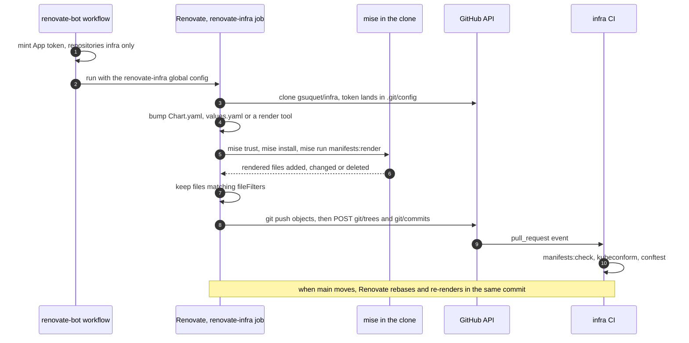
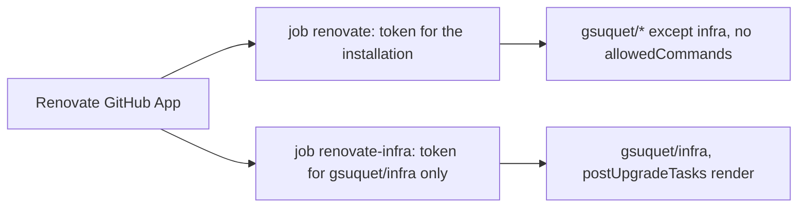

# RFC 0023: Re-render manifests in Renovate's own commit

## Summary

Renovate PRs that bump a chart, an image tag in default values or a render tool re-render
`gitops/clusters/*/rendered/**` in the same commit, through self-hosted Renovate `postUpgradeTasks`. infra gets its
own runner job with a token scoped to `gsuquet/infra`, so render code cannot reach other repositories. Manual or
agent render stays the fallback.

## Context

`mise run manifests:render` writes `gitops/components/<name>/` output to `gitops/clusters/<cluster>/rendered/`, and
CI fails on a stale render (`mise run manifests:check`). A Renovate bump of a chart, a default-values image tag or
a render tool (helm, kustomize, yq via mise) changes that output, so its PR must carry the new render.

| Constraint | Consequence |
| --- | --- |
| Public repo, no credential in CI ([ADR-0019](../adr/0019-lifecycle-tasks-and-ci-scope.md)) | A write token in infra's CI goes against an accepted ADR |
| Owner self-hosts Renovate: `gsuquet/renovate-bot` runs `renovatebot/github-action` on a schedule, GitHub App token, `autodiscover` over `gsuquet/*`, `platformCommit: enabled`, Renovate 41.115.2 | Global (admin-only) options such as `allowedCommands` are in the owner's hands |
| Humans merge every PR | No automerge, no `ignoreTests`; a red PR is fine only when the fix is obvious |
| Render tools pinned in `.mise/config.toml` + `.mise/mise.lock` | Whatever renders runs the same task with the same tools, or `manifests:check` fails |
| Tool, action and provider bumps do not touch `gitops/`, except render tools | Only some update kinds need a render |

Prior art: `gsuquet/homelab` has no post-upgrade task; a person or an agent renders on the PR branch. That does not
scale to N clusters x M components and marks the branch modified, so Renovate stops maintaining it.

## Goals and non-goals

Goals:

- Every Renovate PR whose upgrades change render input carries the matching render in Renovate's own commit and
  passes `manifests:check` with no human push.
- Renovate keeps rebasing those branches (no "modified branch", no extra CI cycle, no loop).
- No write credential in infra's GitHub Actions secrets.
- Render code on a Renovate branch can reach a token valid for `gsuquet/infra` only.

Non-goals:

- Automerge: humans merge every PR, including `dev tools`.
- Tenant manifests in `gsuquet/gitops`: Kargo promotes them (RFC 0021).
- Replacing Renovate for mise tools, GitHub Actions or OpenTofu providers.
- A kind end-to-end CI job (deferred by ADR-0019).

## Decision drivers

- Token blast radius: branch code must not reach a token wider than infra, and infra CI holds no write secret.
- Render lands in the same commit, so Renovate keeps maintaining the branch.
- No human step per chart PR.
- One updater for every update kind: charts, images, mise tools, actions, providers.

## Options considered

Legend: **(v)** verified on 2026-11-18 against docs.renovatebot.com, docs.github.com, the Renovate 44.239.1 source or
a local run; **(u)** unverified, check before building on it.

### A. Renovate postUpgradeTasks, self-hosted

Renovate runs the render after it updates files and before it commits, and adds the files matching `fileFilters` to
its own commit **(v)**.

- Good: render in Renovate's single commit; every rebase recomputes it; no modified branch, no loop, no secret in
  infra's CI.
- Good: covers every update kind, since Renovate stays the updater.
- Bad: the Renovate token sits in `.git/config` of the clone, the commands' `cwd`, so any render code, mise-installed
  binary, mise hook or env template (trusted by the allowed `mise trust --yes`) can read it **(v)**;
  `allowedCommands` is not a security boundary. Acceptable only with the `renovate-infra` job isolation.
- Bad: needs runner changes (separate job, global options, Renovate bump) and debugging moves to the runner logs.

### B. GitHub Actions workflow pushes the render to the Renovate branch

A workflow on Renovate PRs renders and pushes a second commit with a dedicated App token. Design if chosen:

1. Trigger on `pull_request` (never `pull_request_target`) for head refs under `gsuquet/renovate/` and the Renovate
   App actor.
2. Job 1, `contents: read`, no secret: render, upload `git diff --binary`.
3. Job 2 mints a dedicated App token (contents: write on infra only), checks the patch touches only
   `gitops/clusters/*/rendered/**`, commits through the API (signed), no git push; it never runs PR code.
4. Commit only on a non-empty diff, so job 1 on the bot's own commit stops.
5. Bot email in `gitIgnoredAuthors`; each rebase costs one extra CI cycle (`:rebaseStalePrs` sets
   `rebaseWhen: behind-base-branch` **(v)**).

The `GITHUB_TOKEN` variant avoids the secret but needs an approval click per push, and hands the PR-code job a write
token unless split as above.

- Good: cleanest boundary: the job that holds the write token never runs branch code.
- Bad: a write credential in the public repo's Actions secrets, against ADR-0019, and a second App to manage.
- Bad: second commit: two CI runs per Renovate push, `gitIgnoredAuthors` needed, loop prevention to design, and
  unsigned commits unless the job commits through the API.

### C. Kargo or Updatecli

Kargo Warehouses watch charts and images and promotion steps render and open PRs **(u)**; Updatecli runs shell
targets in an Action **(u)**.

- Good: Kargo is already planned for tenant promotion (RFC 0021).
- Bad: Kargo makes a cluster upgrade its own platform (it needs Argo CD, cert-manager first) and covers no mise
  tools, actions or providers, so Renovate stays anyway. Updatecli has B's token problem and duplicates Renovate.

### Do nothing

Manual or agent render, as in homelab: check out the PR, `mise run manifests:render`, push.

- Good: free, simple, no token near branch code except on the person's machine.
- Bad: a human action on every chart PR, and the branch becomes modified so Renovate stops rebasing it; ticking
  rebase or `rebaseLabel` regenerates Renovate's commit and discards the manual render commit **(v)**.

| Criterion | A. postUpgradeTasks | B. Actions push | C. Kargo / Updatecli | Do nothing |
| --- | --- | --- | --- | --- |
| Secret in infra CI | none | App key (or approval click) | Kargo: in-cluster creds; Updatecli: write secret like B | none |
| Render in the same commit | yes | second commit | n/a | second commit |
| Renovate keeps rebasing | yes | only with `gitIgnoredAuthors` | n/a | no |
| Loop risk | none | must be designed out | none | none |
| Covers mise, actions, providers | yes | yes | no | yes |
| Branch code next to a write token | infra-only token with isolation; every `gsuquet/*` repo without | no | n/a | on the person's machine |
| Changes outside infra | runner job split, global options, version bump | new App | Kargo install | none |
| Human work per chart PR | review | review | review | render, push, review |

Weighing: without isolation, A is worse than B. With a single-repo token, A's blast radius equals B's ("write to
infra") but is reached through branch code. A render that can write to infra could already change what infra
deploys through the PR it renders, so A's extra risk is small once `main` has a ruleset (open question 7).

## Proposal

Option A, only with the runner isolation below; without it, B, as designed in option B. Do nothing (manual
render) is the fallback when A reports an artifact error.



The update flow: one Renovate commit carries the bump and its render (signed via `platformCommit`, checked in pilot
step 6).

### Component shape and managers

Checked with Renovate 44.239.1 `--platform=local --dry-run=extract` on a scratch repo **(v)**:

| Version source | Manager | Result |
| --- | --- | --- |
| Umbrella `gitops/components/<name>/Chart.yaml`, `dependencies[].version` | `helmv3`, default match `/(^\|/)Chart\.ya?ml$/` **(v)** | Extracted, datasource `helm`; OCI charts use `docker` **(v)** |
| Custom `component.yaml` with `chart.repository/name/version` | `custom.regex`, `datasourceTemplate: helm` | Extracted with the regex below (`cert-manager` `v1.19.1` from `https://charts.jetstack.io`) **(v)** |
| Image tags in component `values.yaml`, nested keys too | `helm-values`, default match `/(^\|/)values\.ya?ml$/` **(v)** | Extracted, including `argo-cd.global.image` |
| Overrides in `gitops/clusters/<name>/cluster.yaml` | none | Needs a `# renovate:` regex; better forbid overrides by schema |
| `gitops/clusters/*/rendered/**` | none | Not extracted **(v)**; still add to `ignorePaths` so a broad regex never bumps generated files |
| Render tools in `.mise/config.toml` | `mise`, includes `**/.mise/config{,.*}.toml` **(v)** | Extracted |

Proposed shape: umbrella `Chart.yaml` per component. No custom manager, native OCI and `registryAliases` **(v)**,
and what homelab renders. The regex alternative is order- and indentation-sensitive and must follow the file format:

```json
{
  "customType": "regex",
  "managerFilePatterns": ["/^gitops/components/[^/]+/component\\.yaml$/"],
  "datasourceTemplate": "helm",
  "matchStrings": [
    "chart:\\s*\\n\\s+repository:\\s*(?<registryUrl>\\S+)\\s*\\n\\s+name:\\s*(?<depName>\\S+)\\s*\\n\\s+version:\\s*(?<currentValue>\\S+)"
  ]
}
```

| Note | Status |
| --- | --- |
| A committed `Chart.lock` is updated by `helmv3` as an artifact, which needs `helm` in the Renovate environment; the helmv3 page only says lock file maintenance runs the package manager | **(u)** for artifacts |
| With `binarySource=install` (default) Renovate installs helm through Containerbase for helmv3 | **(u)** |
| A default-values image tag usually tracks the chart `appVersion`; a separate image PR can disagree with the chart PR: drop image tags or group them with the chart | design rule |
| The `mise` manager reports `skipReason: github-token-required` without a token; the App token covers it in the runner | **(v)** locally, **(u)** in the runner |

### postUpgradeTasks behaviour

| Fact | Source |
| --- | --- |
| Each command must match a regex of global-only `allowedCommands` (formerly `allowedPostUpgradeCommands`); empty runs nothing; the Mend-hosted app does not allow it | docs **(v)** |
| Commands are compiled from templates before the check; we use none, so anchored exact strings work | docs **(v)** |
| No shell unless global `allowShellExecutorForPostUpgradeCommands`: no `&&`, one command per entry | `execute-post-upgrade-commands.js` **(v)** |
| `executionMode: branch` runs once per branch; a grouped PR renders once | docs **(v)** |
| Branch-mode tasks come from the branch config `{ ...config, ...config.upgrades[0] }` after sorting by `fileReplacePosition`, then `depName`: the task runs only if the first sorted upgrade carries it, else it silently never runs and the PR goes red | `generate.js` **(v)** |
| `fileFilters` default to `**/*`; deleted matching files are committed, so a dropped resource removes its rendered file | docs, source **(v)** |
| A failing command becomes an artifact error on the branch, not a crash; `manifests:check` stays red | source **(v)** |
| `installTools` installs Containerbase tools (`mise`, `helm` listed); no effect with `binarySource=global` | docs **(v)** |
| Child processes get only `basicEnvVars` (proxies, `HOME`, `PATH`, locale, CA, Corepack; no token) unless `exposeAllEnv` | docs, `util/exec/env.js` **(v)** |
| Commands run with `cwd` = the clone, whose `.git/config` holds `x-access-token:` plus the token (`getRepoUrl`, `util/git/index.js`) | source **(v)** |
| Refreshing `.mise/mise.lock` needs `mise` in global `allowedUnsafeExecutions`; 41.115.2 rejects the option, 44.239.1 accepts it; infra needs it today (`lockfile = true`) | docs, local run **(v)** |
| `platformCommit` pushes objects to `refs/renovate/branches/<branch>`, then REST `POST /git/trees` (blob SHAs only) and `POST /git/commits`: payload bounded by file count, not size | `pushFiles` **(v)**; tree-entry limit **(u)** |

### Runner isolation (`gsuquet/renovate-bot`)



Two jobs, one App: only the infra job runs branch code, with a token that reaches infra alone.

| Step | Change |
| --- | --- |
| 1 | Split the workflow into `renovate` and `renovate-infra`, same `concurrency` group so they never overlap |
| 2 | `renovate`: current global config plus `"autodiscoverFilter": ["gsuquet/*", "!gsuquet/infra"]` (negation in `util/string-match.js` **(v)**); no `allowedCommands` |
| 3 | `renovate-infra`: `actions/create-github-app-token` with `owner: gsuquet`, `repositories: infra` **(u)**; `autodiscover: false`, `repositories: ["gsuquet/infra"]`, a second global config file that alone carries the options below |
| 4 | Check the App permissions and installation scope: `workflows: write`, and whether `renovate-bot` is installed **(u)** |
| 5 | `actions/cache` for the mise and Containerbase directories mounted into the container, keyed on `.mise/mise.lock` (paths **(u)**) |
| 6 | Bump Renovate from 41.115.2 to a pinned version that accepts `allowedUnsafeExecutions` (44.239.1 **(v)**; first such version **(u)**); keep `binarySource=install` |

`renovate-infra` global config:

```json
{
  "allowedCommands": [
    "^mise trust --yes \\.mise/config\\.toml$",
    "^mise install$",
    "^mise run manifests:render$"
  ],
  "allowedUnsafeExecutions": ["mise"],
  "customEnvVariables": { "MISE_GITHUB_TOKEN": "{{ the infra job's token }}" }
}
```

- The anchors keep stray commands out; they are not a security control.
- `customEnvVariables` is global-only **(v)**. The value comes from the workflow (env var or generated file), never
  committed. Wiring through `renovatebot/github-action` **(u)**; the env var name mise reads **(u)**.
- The token gives `mise install` an authenticated GitHub API limit. Without it, `github:`, `aqua:` and `ubi:`
  backends share 60 requests per hour per runner IP **(u)**: expect intermittent artifact errors.

### Repository rules (`.github/renovate.json`)

```json
{
  "ignorePaths": [
    "**/node_modules/**",
    "**/bower_components/**",
    "**/vendor/**",
    "**/examples/**",
    "**/__tests__/**",
    "**/test/**",
    "**/tests/**",
    "**/__fixtures__/**",
    "gitops/clusters/*/rendered/**"
  ],
  "packageRules": [
    {
      "description": "Render tools get their own group, so every upgrade of that branch carries the render task",
      "groupName": "render tools",
      "groupSlug": "render-tools",
      "matchDepNames": ["helm", "kustomize", "yq"],
      "matchManagers": ["mise"],
      "semanticCommitScope": "tools"
    },
    {
      "description": "Branches whose every upgrade can change the render output re-render in the same commit",
      "matchFileNames": ["gitops/components/**"],
      "postUpgradeTasks": {
        "installTools": { "mise": {} },
        "commands": [
          "mise trust --yes .mise/config.toml",
          "mise install",
          "mise run manifests:render"
        ],
        "fileFilters": ["gitops/clusters/*/rendered/**"],
        "executionMode": "branch"
      }
    },
    {
      "description": "Same task for the render tools group",
      "matchDepNames": ["helm", "kustomize", "yq"],
      "matchManagers": ["mise"],
      "postUpgradeTasks": {
        "installTools": { "mise": {} },
        "commands": [
          "mise trust --yes .mise/config.toml",
          "mise install",
          "mise run manifests:render"
        ],
        "fileFilters": ["gitops/clusters/*/rendered/**"],
        "executionMode": "branch"
      }
    }
  ]
}
```

Passes `renovate-config-validator --strict` 44.239.1 **(v)**; the full flow (install, render, commit of added and
deleted files) is **(u)** until the pilot.

| Rule | Why |
| --- | --- |
| `ignorePaths` repeats the `:ignoreModulesAndTests` paths | `mergeable: false` **(v)**: a repo value replaces the preset list; re-check when the preset changes |
| Every branch with the task holds only matching upgrades | `executionMode: branch` reads `upgrades[0]` only |
| `render tools` takes helm, kustomize, yq out of `dev tools` | the later rule wins for `groupName`: `dev tools` never renders, `render tools` always does |
| `matchDepNames` follows the tools the render uses | add a tool when the render task starts using it |
| `fileFilters` limits the commit to `rendered/` | a render that rewrites anything else is dropped and `manifests:check` catches it |
| Render every cluster | the render is deterministic and the check renders everything anyway |
| Providers, actions and other `dev tools` do not render | they do not touch `gitops/` |

### Grouping

| Updates | Rule |
| --- | --- |
| Existing groups `dev tools` and the IaC groups (today `terraform cli`, `terraform providers`; renamed with RFC 0022) | Keep, with the weekly schedule |
| Charts | One PR per component (default); group chart and image tags of a component when both are pinned (`matchFileNames: ["gitops/components/<name>/**"]`, `groupName: "<name>"`), or drop image tags |
| Coupled components | One group: `gateway-api-crds` with the Gateway API implementation that needs its CRD version; `cert-manager` with its CRDs if split |
| Mixed groups | Never mix component files with anything else in one group |
| Majors | Keep `dependencyDashboardApproval` |
| Semantic scope | `gitops` (or `component`) for `gitops/**` |

### Bootstrap coupling

IaC installs Cilium, the Gateway API CRDs and Argo CD from `rendered/` (ADR-0015). When the bootstrap modules read
`gitops/clusters/<name>/rendered/<component>/` and pin no chart version of their own, one chart PR updates both and
one version exists per component. A module that pins its own version gets a second Renovate PR that can drift.

### Pilot

| Step | Check |
| --- | --- |
| 1 | Bump the runner, split out `renovate-infra` with its single-repo token and global options; from a throwaway task, check the `.git/config` token is rejected by another repo |
| 2 | Add the repo rules once the render task and one component exist |
| 3 | Force a chart bump (`workflow_dispatch`, `dry_run: off`): tools installed, render in Renovate's commit, deleted files removed, `manifests:check` green |
| 4 | Force a mixed run, `helm` (render tools) plus `actions/checkout` (dev tools): `render tools` re-renders, `dev tools` carries no render |
| 5 | Force a large CRD bump in every cluster (cert-manager or Argo CD major): the platform commit goes through |
| 6 | Commit still signed with the rendered files; two consecutive runs hit the cache and no GitHub rate limit |
| 7 | If `Chart.lock` is committed, force a lock file maintenance run: the `gitops/components/**` lock branch re-renders, the other lock branch carries no render |

Local checks done for this RFC: `renovate --platform=local --dry-run=extract` 44.239.1 on a scratch repo (manager
table); `renovate-config-validator --strict` 44.239.1 on the repo rules and global options: pass; the same with
41.115.2 on the global options: fails on `allowedUnsafeExecutions`.

## Operational impact

- Blast radius: Renovate PRs of `gsuquet/infra` that touch `gitops/components/**` or render tools, on every cluster's `rendered/` tree; a wrong render is caught by `manifests:check` before merge. With the isolation, compromised render code can write to infra branches (and `main` while no ruleset exists); without it, to every repo of the App installation, `gsuquet/renovate-bot` and its `RENOVATE_PRIVATE_KEY` included.
- Rollout: 1. split the runner job and bump Renovate (pilot step 1), gate: the token is rejected outside infra; 2. add the repo rules (pilot step 2); 3. forced chart, mixed, large-CRD and lock file runs (pilot steps 3 to 7), gate: each check passes; then normal weekly schedule.
- Rollback: remove the `postUpgradeTasks` rules from `.github/renovate.json` and `allowedCommands` from the `renovate-infra` config, in one PR each; open PRs fall back to manual render on the next run. Restored within one Renovate run.
- Migration: None: no state or data changes; Renovate re-creates its branches from config on the next run.
- Security: render code on a Renovate branch runs next to the Renovate token in `.git/config`; `allowedCommands` is not a boundary, since `mise run manifests:render` and `mise install` run whatever the branch's task files and `.mise/config.toml` say, and any mise-installed binary, mise hook or env template (trusted by the allowed `mise trust --yes`) can read it. Until infra runs in its own job, a malicious render could read a token valid for every installed repo and, if the App has `workflows: write` (needed to bump actions **(u)**), push a workflow to `renovate-bot` that exfiltrates `RENOVATE_PRIVATE_KEY`. Controls: single-repo token, `minimumReleaseAge: 3 days`, `.mise/mise.lock` checksums, review of task changes on `main`, a ruleset on `main`.
- Cost: no new paid service; one extra job per scheduled run in `gsuquet/renovate-bot` and repeated downloads until the cache works (runner billing not checked).
- Observability: a failing render shows as an artifact error on the Renovate PR and a red `manifests:check`; runner logs live in `gsuquet/renovate-bot`, not infra; the Dependency Dashboard lists blocked branches. No SLO.

## Drawbacks and risks

- The Renovate token in `.git/config` is readable by every post-upgrade command; today the token is minted with `owner: gsuquet` and no `repositories`, so it likely reaches `gsuquet/renovate-bot`, which holds `RENOVATE_PRIVATE_KEY`; with `workflows: write` a malicious render could push a workflow that exfiltrates the App key -> `renovate-infra` job with a token minted for `infra` only, `allowedCommands` only there, App permissions checked, a ruleset on `main`; without the isolation choose B.
- A branch-mode task silently skipped in a mixed group leaves the PR red -> `render tools` group, task rules only on rules that match every upgrade of the branch, pilot step 4.
- Unauthenticated mise downloads hit the 60 requests per hour limit **(u)** -> single-repo token through `customEnvVariables`.
- No cross-run cache on the ephemeral runner: every run downloads mise, tools and charts -> `actions/cache` keyed on `.mise/mise.lock`.
- Large CRD renders may hit an unknown tree-entry limit of the REST commit path **(u)** -> pilot step 5.
- A default-values image tag and its chart move in separate PRs and disagree -> group per component or drop image tags.
- A bootstrap module that pins its own chart version drifts from the catalog -> modules read `rendered/` and pin nothing.
- Debugging moves to `gsuquet/renovate-bot` logs -> PR artifact error points there.
- `ignorePaths` replaces the preset list -> the snippet repeats it; re-check on preset changes.
- With a committed `Chart.lock`, the repo-wide `lockFileMaintenance` branch mixes it with `.mise/mise.lock` and
  provider lock files, so the render task is silently skipped or the branch carries renders it should not ->
  scope or split `lockFileMaintenance` for `gitops/components/**`, pilot step 7.

## Open questions

1. Component shape: umbrella `Chart.yaml` (proposed, native `helmv3`) or a custom `component.yaml` with a regex manager? This also settles whether `Chart.lock` is committed; if it is, scope or split `lockFileMaintenance` for `gitops/components/**` so a lock branch holds only matching upgrades.
2. Is "branch code can write to infra" acceptable with the single-repo token (A), or is B's boundary worth a write secret in infra's Actions and a second CI cycle per push? Either way, confirm the App's `workflows: write` and whether `gsuquet/renovate-bot` is in its installation.
3. Bump the runner from 41.115.2 now? The `mise.lock` refresh needs it regardless.
4. Pin image tags in component default values, or let charts own them?
5. Forbid chart and image version overrides in `cluster.yaml` (schema rule), so one version lives in the catalog?
6. Should Kargo tenant promotion (render -> PR to `gsuquet/gitops`) reuse the same render task?
7. Make `manifests:check` a required status check on `main` (no ruleset today)? It stops merging a stale render and stops the infra-scoped token from pushing to `main`.

## Decision

Pending.

## Implementation

N/A: not accepted yet.

## References

- [postUpgradeTasks](https://docs.renovatebot.com/configuration-options/#postupgradetasks), [executionMode](https://docs.renovatebot.com/configuration-options/#postupgradetasksexecutionmode), [fileFilters](https://docs.renovatebot.com/configuration-options/#postupgradetasksfilefilters), [installTools](https://docs.renovatebot.com/configuration-options/#postupgradetasksinstalltools)
- [allowedCommands](https://docs.renovatebot.com/self-hosted-configuration/#allowedcommands), [exposeAllEnv](https://docs.renovatebot.com/self-hosted-configuration/#exposeallenv)
- [gitIgnoredAuthors](https://docs.renovatebot.com/configuration-options/#gitignoredauthors), [rebaseWhen](https://docs.renovatebot.com/configuration-options/#rebasewhen), [Updating and rebasing](https://docs.renovatebot.com/updating-rebasing/)
- Managers: [helmv3](https://docs.renovatebot.com/modules/manager/helmv3/), [helm-values](https://docs.renovatebot.com/modules/manager/helm-values/), [mise](https://docs.renovatebot.com/modules/manager/mise/)
- [GITHUB_TOKEN](https://docs.github.com/en/actions/concepts/security/github_token): its events start no workflow, except `workflow_dispatch`, `repository_dispatch` and `pull_request` opened/synchronize/reopened, which wait for approval **(v)**
- [Triggering a workflow from a workflow](https://docs.github.com/en/actions/how-tos/write-workflows/choose-when-workflows-run/trigger-a-workflow): an App token or PAT starts runs normally **(v)**
- [ADR-0015](../adr/0015-bootstrap-boundary.md), [ADR-0019](../adr/0019-lifecycle-tasks-and-ci-scope.md); RFC 0021 (Kargo tenant promotion), RFC 0022 (OpenTofu)
- `gsuquet/homelab` `docs/explanation/automated-updates.md`: manual render, exact pins, `minimumReleaseAge: 3 days`, weekly batches

## Future work

None.
