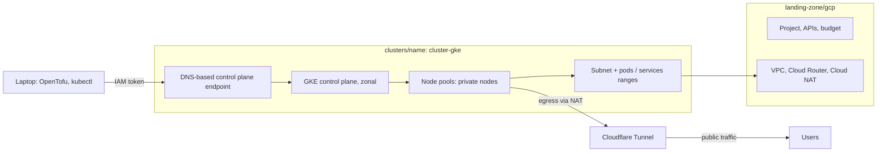
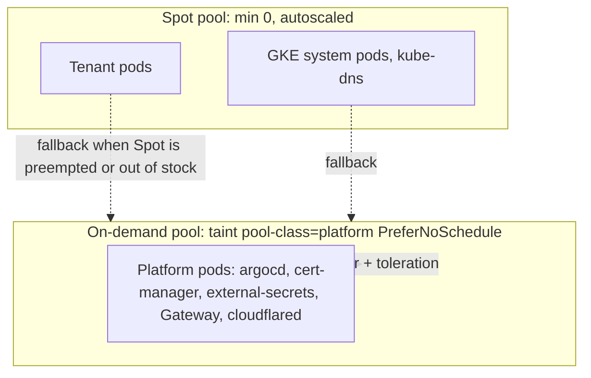
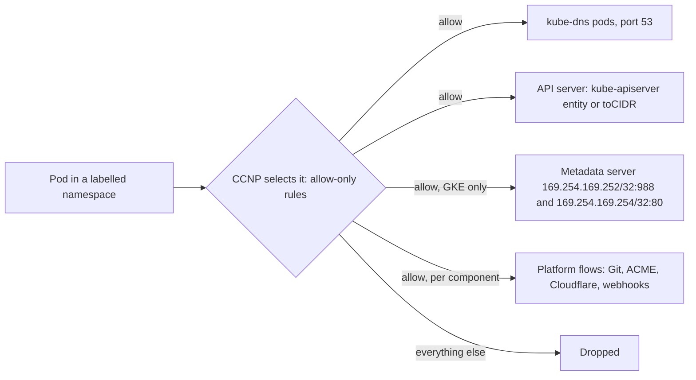
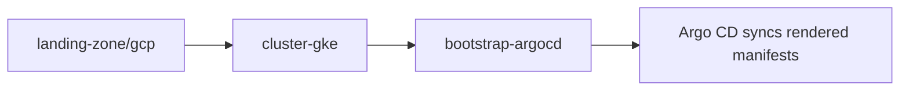

# RFC 0024: Run GKE Standard zonal with Dataplane V2 as the cloud target

## Summary

The first cloud cluster is GKE Standard, zonal, with Dataplane V2, a DNS-only control plane endpoint, private
nodes and node pools that are Spot, on-demand or both, per cluster. It is built from raw `google` provider
resources in `landing-zone/gcp` and `modules/cluster-gke`, with OpenTofu. The platform keeps its invariants on
GKE: the `network-policy` component's default deny, one Gateway API CRD owner, and the `secrets` store.

## Context

- ADR-0003 picks GKE for the cloud target, ADR-0011 Dataplane V2 (DPv2) instead of our Cilium, ADR-0012 makes GKE
  the Gateway API CRD owner on GKE. ADR-0017 defers the content of `landing-zone/gcp/`.
- ADR-0010 and ADR-0011 leave unverified whether DPv2 supports `CiliumClusterwideNetworkPolicy` (CCNP) with
  namespace-label selectors, so the GKE default deny has no confirmed design.
- Owner decisions of 2026-11-19 that this RFC applies:
  - OpenTofu replaces Terraform (RFC 0022).
  - `cluster-gke` supports Spot pools, on-demand pools, or both, per cluster, by input.
  - A baseline `network-policy` component hosts the default deny and platform policies on every cluster, GKE
    included, replacing the render-emitted layer of ADR-0010.
  - A cluster root's Cloudflare token is least-privileged.
- Nothing is implemented. Facts were checked on 2026-11-18 against the GKE, Cloud pricing, provider, cert-manager,
  ESO, Cilium and GitHub docs; anything marked **(unverified)** was not confirmed there.
- Decision needed now: the module shape, the landing zone and the catalog changes block the first GKE cluster.

## Goals and non-goals

Goals:

- One GKE cluster whose management fee is covered by the free tier credit (US$74.40/month per billing account).
- Same platform invariants as kind and Talos: default deny on every labelled namespace, one Gateway API CRD owner
  per cluster, a `secrets` store in every namespace, Argo CD self-managed.
- Laptop and CI reach the control plane through IAM only: no bastion, no authorized networks.
- `cluster-gke` runs Spot-only, on-demand-only or mixed pools from one input, with platform pods kept off Spot
  when both kinds exist.
- A billing budget alert exists before the first cluster.

Non-goals:

- Autopilot support in `cluster-gke` (scope creep until a second GKE cluster exists).
- A GKE Gateway controller or any Google Cloud load balancer: public traffic enters through Cloudflare Tunnel
  (ADR-0013).
- The secrets backend (RFC 0020) and the Gateway implementation choice.
- Artifact Registry, Cloud DNS zones, org policies and folders.
- Non-GKE clouds.

## Decision drivers

- Platform invariants hold on GKE without a GKE-only exception the render cannot check.
- Cost floor: the fee under the free credit, nodes and NAT measured before they are bought.
- Small, readable OpenTofu surface that Renovate can upgrade.
- Least privilege on the control plane, IAM and the network trust boundary.

## Options considered

### GKE Standard, zonal, Dataplane V2

Managed control plane, our node pools, DPv2 as the CNI, raw `google` provider resources.

- Good: keeps privileged opt-in components possible and node pools under our control (invariants, cost floor).
- Good: zonal Standard is covered by the free tier credit; a zonal control plane has a 99.5% SLA, enough here.
- Bad: we size, upgrade and pay for whole nodes (cost floor); Standard node prices are **(unverified)**.

### GKE Autopilot

Google manages nodes; billing per Pod request.

- Good: no node pools to manage; rough baseline cost is known (see Cost floor).
- Bad: privileged pods run only for allowlisted partners, so Falco and Tetragon cannot run (invariants).
- Bad: no node pools, so the Spot / on-demand pool input does not apply (cost floor).
- Bad: request defaults and ratios inflate tenant bills (cost floor).

### GKE Standard with our own Cilium

Legacy datapath cluster plus Cilium installed with `gke.enabled`, a NodeInit DaemonSet and the
`node.cilium.io/agent-not-ready` taint
([Cilium GKE install](https://docs.cilium.io/en/stable/installation/k8s-install-helm/)).

- Good: same Cilium and policy features as kind and Talos (invariants).
- Bad: privileged NodeInit that rewrites kubelet, no Google support for the CNI (least privilege); contradicts
  ADR-0011.

### Do nothing

No cloud cluster: tenants run on kind and Talos only.

- Good: no cloud bill.
- Bad: no cloud stage for Kargo promotion (ADR-0008); ADR-0003 stays unimplemented.

## Proposal

### Topology



Caption: the landing zone outlives clusters; a cluster root owns its subnet ranges; no Google load balancer.

### Cluster settings (`modules/cluster-gke`)

| Setting | Value | Why |
|---|---|---|
| Mode, location | Standard, one zone | Free tier credit covers zonal or Autopilot only; a regional Standard cluster never is |
| `datapath_provider` | `ADVANCED_DATAPATH` | DPv2; **creation-only**: "Existing clusters cannot be upgraded" |
| `enable_cilium_clusterwide_network_policy` | `true` | CCNP for the `network-policy` component (GA field) |
| `enable_fqdn_network_policy` | `true` | GKE `FQDNNetworkPolicy` for egress by name |
| `gateway_api_config.channel` | `CHANNEL_STANDARD` | GKE owns the Gateway API CRDs on GKE (ADR-0012) |
| `workload_identity_config.workload_pool` | `<project>.svc.id.goog` | Workload Identity, optional on Standard, enabled anyway |
| `control_plane_endpoints_config` | `dns_endpoint_config { allow_external_traffic = true }`, `ip_endpoints_config { enabled = false }` | IAM-gated endpoint, no bastion |
| `private_cluster_config.enable_private_nodes` | `true` | Nodes without public IPs; egress through Cloud NAT |
| `dns_config.cluster_dns` | `KUBE_DNS` | kube-dns allow of the default deny keeps matching |
| `advanced_datapath_observability_config` | `enable_relay = true`, `enable_metrics = var.observability_metrics` (default `false`) | Managed Hubble relay; metrics bill in Managed Prometheus |
| `logging_config.enable_components` | `["SYSTEM_COMPONENTS"]` | Limit Cloud Logging ingestion |
| Default node pool | omitted (`initial_node_count` unset) | Needs GKE `1.36.4-gke.1469000`+, so `min_master_version` is pinned at or above it |
| `release_channel`, `maintenance_policy`, `deletion_protection` | `REGULAR`, set, `true` | `cluster:down` applies `deletion_protection = false` first |

Default node pool fallback: if the zone or channel cannot offer `1.36.4-gke.1469000` yet, use
`remove_default_node_pool = true` plus `initial_node_count = 1` (deprecated field), removed once the version is
available.

### Inputs and outputs

```hcl
variable "name"                  { type = string }
variable "project_id"            { type = string }
variable "location"              { type = string }  # a zone: keeps the free tier credit
variable "network"               { type = string }  # from landing-zone/gcp
variable "subnet_cidr"           { type = string }
variable "pods_cidr"             { type = string }
variable "services_cidr"         { type = string }
variable "release_channel"       { type = string, default = "REGULAR" }
variable "min_master_version"    { type = string }  # >= 1.36.4-gke.1469000
variable "deletion_protection"   { type = bool, default = true }
variable "extra_webhook_ports"   { type = list(number), default = [] } # webhooks not on 443/10250
variable "observability_metrics" { type = bool, default = false }

variable "node_pools" {
  type = map(object({
    machine_type = string
    spot         = bool
    min          = number           # autoscaling bounds
    max          = number
    disk_gb      = optional(number, 50)
    labels       = optional(map(string), {})
    taints       = optional(list(object({ key = string, value = string, effect = string })), [])
  }))
  validation {
    condition     = length(var.node_pools) > 0
    error_message = "At least one node pool."
  }
}

# outputs: cluster name, location, dns_endpoint, workload_pool, control plane CIDR,
#          platform_placement (nodeSelector + tolerations, empty unless pools are mixed)
```

Resources: `google_compute_subnetwork` (subnet and secondary ranges), `google_container_cluster`, one
`google_container_node_pool` per `node_pools` entry with autoscaling, and `google_compute_firewall` only when
`extra_webhook_ports` is not empty. No CA output: the DNS endpoint certificate "is signed by a public, generally
recognized Google CA", so `clusters/<name>/` sets the `kubernetes` and `helm` providers with
`host = "https://${dns_endpoint}"` and a `google_client_config` token, without `cluster_ca_certificate`.

### Pod placement across Spot and on-demand pools

| Pools in `node_pools` | Module adds | Platform pods | Tenant and GKE system pods |
|---|---|---|---|
| Spot only | nothing | anywhere; preemption or stockout can take Argo CD down | anywhere |
| On-demand only | nothing | anywhere | anywhere |
| Both | on every on-demand pool: label and taint `pool-class=platform`, effect `PreferNoSchedule` | `nodeSelector` + toleration from `platform_placement`, `platform` PriorityClass | prefer Spot, fall back to on-demand when Spot is gone |



Caption: platform pods are pinned to on-demand; everything else prefers Spot and can spill over.

- `cluster.yaml` declares `placement.platform` with the same `nodeSelector` and tolerations as the
  `platform_placement` output; the render applies them to every platform component. A mismatch leaves platform
  pods Pending, which is visible, never silently on Spot.
- The `platform` PriorityClass sits above the tenant default, so platform pods preempt tenant spillover on the
  on-demand pool. The on-demand `max` bounds the cost of spillover.
- `PreferNoSchedule`, not `NoSchedule`: GKE-managed kube-system pods do not carry our toleration
  **(unverified)**; with `NoSchedule` they would live only on Spot and a preemption would take cluster DNS away
  from the platform.

### Default deny on GKE (`network-policy` component)



Caption: the same CCNP as kind and Talos, plus the metadata server allow on GKE.

| # | Rule on GKE | Source |
|---|---|---|
| 1 | Express default deny with allow-only rules, never `ingressDeny`/`egressDeny`: on GKE "explicit Deny rules in a CCNP override allow rules in namespace-scoped policies", which would also block tenant NetworkPolicies. Selecting an endpoint with allow rules already denies the rest, as upstream Cilium does. | [CCNP on GKE](https://docs.cloud.google.com/kubernetes-engine/docs/how-to/configure-cilium-network-policy) |
| 2 | CCNP on GKE is L3/L4 only: "Layer 7 policies are not supported", "Node selectors are not supported", 1000 CCNP per cluster max. GKE calls CCNP "a proprietary API" and steers new work to `ClusterNetworkPolicy`. | same |
| 3 | Namespace-label `endpointSelector` (`k8s:io.cilium.k8s.namespace.labels.<key>`) and `toEntities: [kube-apiserver]` are not in the GKE examples **(unverified)**. If `toEntities` is rejected, the API server allow uses `toCIDR` with the control plane CIDR output of `cluster-gke`. | same |
| 4 | Workload Identity under a strict policy needs egress to `169.254.169.252/32:988` and, on DPv2, `169.254.169.254/32:80`. The GKE variant allows both on every labelled namespace (the metadata server only serves the Pod's own identity). Without it, ESO on Google Secret Manager and any Workload Identity caller fails. | [Workload Identity](https://docs.cloud.google.com/kubernetes-engine/docs/concepts/workload-identity) |
| 5 | Cloud DNS for GKE (default on new Autopilot since 1.25.9-gke.400, opt-in on Standard) resolves through `169.254.169.254:53` on Standard or NodeLocal DNSCache `169.254.20.10` on Autopilot, so a kube-dns pod selector stops matching. `cluster_dns = "KUBE_DNS"` is pinned; choosing Cloud DNS later needs `toCIDR` allows on port 53 instead. | [Cloud DNS](https://docs.cloud.google.com/kubernetes-engine/docs/how-to/cloud-dns) |
| 6 | GKE-managed namespaces (`kube-system`, `gke-managed-*`, `gmp-system`, full list **(unverified)**) carry no policy label, so the selector leaves them out. Conftest only checks rendered namespaces: unchanged. | |
| 7 | `ClusterNetworkPolicy` (`policy.networking.k8s.io/v1alpha2`, Admin and Baseline tiers, GKE `1.36.0-gke.4447000`+) would give a Baseline-tier default deny tenants can override. Pre-GA on GKE, alpha upstream, Cilium support **(unverified)**. | |
| 8 | `FQDNNetworkPolicy` (`networking.gke.io/v1alpha1`): 50 IPs per policy, single-level wildcards, kube-dns or Cloud DNS only; enabling it on an existing Standard cluster needs an `anetd` restart. Whether CCNP `toFQDNs` works on GKE is **(unverified)**: assume not. How it combines with a CCNP default deny is undocumented (open question). | [FQDN policies](https://docs.cloud.google.com/kubernetes-engine/docs/how-to/fqdn-network-policies) |

### Dataplane V2 against our Cilium needs

| Need | DPv2 | Consequence |
|---|---|---|
| eBPF datapath, no kube-proxy | Yes, "uses `cilium` instead of `kube-proxy`" | Set from day one (creation-only) |
| CCNP | Opt-in, L3/L4 only | See default deny table |
| `CiliumNetworkPolicy` | CRD present | Tenants already denied it in the AppProject |
| FQDN egress | GKE `FQDNNetworkPolicy`, not Cilium `toFQDNs` | Add it to the tenant AppProject `namespaceResourceBlacklist` on GKE |
| Hubble | Managed relay and CLI; Hubble UI optional | No Hubble component of ours; optional `hubble-ui` on the GKE relay (service name **(unverified)**) |
| Policy logging | Built in, through a logging CRD | Replaces Hubble-based deny auditing |
| Gateway API / Envoy L7 | Not offered **(unverified; the CCNP doc rejects L7)** | Non-Cilium Gateway implementation on GKE |
| Custom eBPF | "GKE doesn't support installing custom eBPF programs on nodes that use GKE Dataplane V2": they "might disrupt cluster networking", and GKE raises a Recommendation | Support statement, not a block: Falco and Tetragon attach tracing programs, so they may run on Standard at our own risk of interfering with `anetd`. Off on GKE until the owner decides. |

### Gateway API on GKE

| | GKE owns the CRDs (chosen, ADR-0012) | `gateway-api-crds` owns them |
|---|---|---|
| Setting | `CHANNEL_STANDARD`: GKE "[installs] the CRDs of the Gateway API Standard Channel with the cluster"; reconciliation up to 45 min | `CHANNEL_DISABLED` from creation |
| Catalog | Skip `gateway-api-crds`; the implementation must support the GKE-shipped version | Same as kind and Talos |
| Bootstrap | No `bootstrap-gateway-api` | `bootstrap-gateway-api` as on kind and Talos |
| Experimental types (`TLSRoute`...) | Not available | Available if the component ships them |
| GKE load balancer classes | Available, unused | Not available |

- The GKE Gateway controller provisions Google Cloud load balancers (`gke-l7-global-external-managed`,
  `gke-l7-regional-external-managed`, `gke-l7-gxlb`, `gke-l7-rilb`). "You can use multiple Gateway controllers,
  including controllers not provided by Google, in a GKE cluster simultaneously."
- The implementation on GKE is any non-Cilium one installed without bundled CRDs, with its own GatewayClass and a
  ClusterIP Service that cloudflared targets (Envoy Gateway is one example; the choice is out of scope).
- What GKE does with Gateway API CRDs it did not install, and whether disabling the channel removes them, is
  **(unverified)**.

### Workload Identity Federation

| Fact | Consequence |
|---|---|
| Direct principals work without a Google service account: `principal://iam.googleapis.com/projects/PROJECT_NUMBER/locations/global/workloadIdentityPools/PROJECT_ID.svc.id.goog/subject/ns/NAMESPACE/sa/KSA`; some APIs still need impersonation | Prefer direct principals |
| Identity sameness: every cluster in a project shares the pool | The same namespace and service account on two clusters get the same access |
| `hostNetwork: true` Pods get no Workload Identity | Keep consumers off the host network |

| Consumer | Identity |
|---|---|
| cert-manager DNS-01 | No Workload Identity: zones are on Cloudflare, ClusterIssuer uses `dns01.cloudflare.apiTokenSecretRef`. The token holds only "Zone - DNS - Edit" and "Zone - Zone - Read" on the platform zones, is created by hand in the Cloudflare dashboard and stored only in the secrets backend, delivered by ESO. Not a `cloudflare_api_token` in `landing-zone/cloudflare`: its value would land in state, against that root's rule "No secret value is created by a resource of this configuration". |
| ESO | Only if the backend is Google Secret Manager: per-namespace `SecretStore` named `secrets` with `auth.workloadIdentity.serviceAccountRef` to a service account in that namespace, as a direct principal holding `roles/secretmanager.secretAccessor`. IAM per secret, or per prefix with IAM conditions **(unverified on Secret Manager)**, so a tenant cannot read another's secrets. The annotation-linked service account and the controller identity (`gcpsm: {}`) are the other two patterns. |

### Control plane and nodes

- Laptop: `gcloud container clusters get-credentials <name> --location <location> --dns-endpoint` (untested,
  flag spelling **(unverified)**), with the user's IAM role on the project.
- CI needs no cluster access while `plan` stays local (ADR-0019). Later: GitHub OIDC through a WIF pool in
  `landing-zone/gcp`, granting a read-only Kubernetes role.
- Private Standard nodes accept control plane to Pod traffic only on 443 and 10250. cert-manager
  (`webhook.securePort: 10250`, chart comment cites GKE private clusters) and ESO (`webhook.port: 10250`) already
  default to 10250, so no firewall rule while every catalog webhook listens on 443 or 10250.
- Cloud NAT carries node egress: cloudflared, and image pulls from non-Google registries.

### `landing-zone/gcp` (R2 backend, key `landing-zone/gcp/terraform.tfstate`)

| Resource | Content |
|---|---|
| `google_project` (or an import) | Linked to the billing account |
| `google_project_service` | `container`, `compute`, `iam`, `iamcredentials`, `sts`, `cloudresourcemanager`, `serviceusage`, `billingbudgets`, `logging`, `monitoring`; `secretmanager` and `artifactregistry` only if chosen |
| `google_billing_budget` | Thresholds such as 50/90/100% of a monthly amount; alerts, does not cap spend **(cap behaviour unverified)**; billing admins or Monitoring notification channels |
| `google_compute_network`, `google_compute_router`, `google_compute_router_nat` | One VPC, custom subnets; per-cluster subnets and ranges belong to `cluster-gke` |
| `google_iam_workload_identity_pool` and provider | GitHub OIDC with an `attribute_condition` on the immutable `assertion.repository_owner_id` and `assertion.repository_id`, never on renamable names ([GitHub OIDC](https://docs.github.com/en/actions/reference/security/oidc)); deferred until CI needs Google Cloud |

No secret value in state, same rule as `landing-zone/cloudflare`. Artifact Registry is not created: platform
images come from upstream, tenant images from GHCR; add a remote or cache repository if Docker Hub rate limits bite.

### Raw provider resources over `terraform-google-modules`

| | `hashicorp/google` resources (chosen) | `terraform-google-modules/kubernetes-engine/google` |
|---|---|---|
| Version on 2026-11-17 | 8.12.0 | 47.0.0 (2026-10-30) |
| Surface | About 20 fields we set | 146 root inputs, 20+ submodules |
| Provider | GA `google`: every field above is GA | Submodules enable beta features, so `google-beta` |
| Upgrade churn | Renovate bumps one provider | 47 majors so far |

`project-factory` (18.4.0) and `network` (18.3.1) are not worth it at one project and one VPC either. Same
pattern as `modules/cloudflare-domain`.

### Bootstrap and catalog



Caption: no `bootstrap-cilium` and no `bootstrap-gateway-api` on GKE (ADR-0015).

`cluster.yaml` gains `provider: gke | kind | talos`, which the render uses for provider defaults.

| Component | GKE treatment |
|---|---|
| `cilium` | Skipped; DPv2 instead |
| `gateway-api-crds` | Skipped; GKE owns the CRDs |
| `network-policy` | Baseline; GKE variant adds the metadata server allow, may use `toCIDR` for the API server |
| Gateway implementation | Non-Cilium, no bundled CRDs, own GatewayClass, ClusterIP behind cloudflared |
| `argocd` | Unchanged, plus `placement.platform` |
| `cert-manager` | `global.leaderElection.namespace=cert-manager` on every provider (required on Autopilot, harmless elsewhere); Cloudflare DNS-01 issuer, token from `secrets` |
| `external-secrets` | Backend per the secrets RFC; Workload Identity wiring only for Google Secret Manager |
| `cloudflared` | Unchanged; outbound through Cloud NAT |
| Hubble | No relay component; optional `hubble-ui` |
| Tenant AppProject | Add `FQDNNetworkPolicy` (`networking.gke.io`) to `namespaceResourceBlacklist` on GKE |
| Falco, Tetragon | Not enabled on GKE until the owner decides |
| kubeconform | Schemas for GKE CRDs (`FQDNNetworkPolicy`, `ClusterNetworkPolicy` if used) |

### Autopilot facts kept for a later decision

| Need | Autopilot |
|---|---|
| Privileged pods | Only for allowlisted partners; Falco, Tetragon and Cilium are not on the list |
| hostPath | Read-only `/var/log` only |
| Host namespaces | Blocked |
| `NET_ADMIN` | Dropped; re-enabled per cluster with `allow_net_admin` |
| Workloads in `kube-system` | Not allowed: cert-manager leader election moves to `cert-manager` |
| Webhooks | Allowed; GKE excludes managed namespaces and rejects webhooks on nodes, persistentvolumes, certificatesigningrequests, tokenreviews |
| Unprivileged DaemonSets, CRDs | Allowed (DaemonSet minimum 1m CPU / 2 MiB on bursting clusters) |
| Gateway API | GKE Gateway "is always enabled"; Experimental channel CRDs cannot be installed |
| Requests | No requests means 0.5 vCPU / 2 GiB; minimum 50m / 52 MiB with bursting, else 250m / 512 MiB; CPU:memory between 1:1 and 1:6.5, the smaller is raised. The tenant LimitRange must set default requests. |

## Operational impact

- Blast radius: one new GKE cluster and its tenants; the `landing-zone/gcp` state in R2; the shared GCP project's Workload Identity pool. kind and Talos are untouched except `cert-manager` leader election and the `network-policy` component, which change on every cluster.
- Rollout: 1. price nodes and NAT in the calculator and set the budget; 2. apply `landing-zone/gcp`; 3. `mise run cluster:plan` then `cluster:up` for the GKE cluster; 4. run the first-cluster checks (open questions) before enabling tenants; 5. add the cluster to Kargo stages. Each step waits for the previous one to pass.
- Rollback: `mise run cluster:down <name>` after applying `deletion_protection = false` (minutes), then destroy `landing-zone/gcp` if no cluster remains. Tenants on the cluster lose their cloud stage; DPv2 and private nodes can only change by recreating the cluster.
- Migration: None: a new cluster and a new landing zone; no existing state or data moves.
- Security: new trust boundary in Google Cloud. IAM-gated DNS endpoint, IP endpoints off; private nodes; Workload Identity pool shared per project (identity sameness); hand-made least-privileged Cloudflare DNS token held only in the secrets backend; GitHub OIDC conditioned on immutable IDs; tenants blacklisted from `FQDNNetworkPolicy`; Falco and Tetragon off on GKE until decided.
- Cost: management fee US$0.10/hour (about $73/month) covered by the $74.40 monthly credit for one zonal cluster; a second cluster on the billing account pays it in full. Plus nodes and boot disks, Cloud NAT gateway and per-GB processing, egress, persistent disks, DPv2 metrics in Managed Prometheus (per sample) and Logging/Monitoring above the free allotment, all **(unverified figures)**. No load balancer cost.
- Observability: billing budget alerts at 50/90/100%; GKE-managed Hubble relay and DPv2 policy logging for denied flows; Argo CD sync and health status per application; node pool autoscaler events for Spot preemption and stockout.

## Drawbacks and risks

- Spot-only clusters can sit at zero nodes during preemption or a stockout, Argo CD included, with nothing
  self-healing until capacity returns (notice length and stockout behaviour **(unverified)**) -> mixed pools keep
  platform pods on on-demand; Spot-only is an explicit per-cluster choice.
- Standard node, Cloud NAT, Managed Prometheus and Logging prices are **(unverified)**; Standard vs Autopilot cost
  is not compared -> price them in the calculator before the first `cluster:up`; budget alert from day one.
- Rough Autopilot baseline (1.25 vCPU, 3 GiB requests **(estimate, measure on kind first)**, us-central1 list:
  vCPU $0.0445 on demand / $0.0133 Spot, GiB $0.0049225 / $0.0014767 per hour) is about $51/month on demand and
  $15 on Spot; the Standard baseline should fit one 2 vCPU / 8 GiB node **(unverified sizing)** -> use those
  figures only as an upper bound to compare against the calculator.
- CCNP namespace-label selectors or `toEntities` may be rejected on GKE -> `toCIDR` fallback for the API server;
  test on the first cluster before tenants.
- GKE owns the Gateway API CRD version, so it follows Google's schedule and Experimental types are unavailable ->
  check the implementation's supported version on every GKE upgrade.
- Falco or Tetragon on DPv2 is unsupported by Google and may interfere with `anetd` -> off on GKE until decided.
- Tenant pods that spill onto the on-demand pool stay there after Spot returns -> on-demand `max` caps the cost;
  a descheduler is future work.
- `cluster.yaml` `placement.platform` can drift from the module's `platform_placement` -> platform pods stay
  Pending instead of landing on Spot.
- `CHANNEL_STANDARD` reconciliation can take up to 45 minutes after creation -> Argo CD retries the Gateway
  implementation sync.

## Open questions

- Region and zone: europe-west1 (Belgium), europe-west9 (Paris) or us-central1 (cheapest list prices)? The
  credit is region-agnostic.
- Private nodes plus Cloud NAT, or public nodes without NAT behind GKE firewall rules? Decide after pricing NAT.
- One project per cluster, or a shared project? Pools are per project; same-named tenant namespaces on two
  clusters share IAM identity in a shared project.
- Monthly budget amount and recipients.
- Runtime security on cloud clusters: Falco or Tetragon on Standard at our risk (test `anetd` interference), a
  managed alternative (GKE Security Posture, an allowlisted partner sensor), or Talos only?
- The Google account has no Organization: are org policies and folders not needed for now? Verify whether a Cloud
  Identity org exists.
- Pools of the first cluster: Spot only, on-demand only, or mixed? Price the on-demand node first.
- Which component owns the `platform` PriorityClass?
- Cloudflare DNS-01 token: stays hand-made, unless the secrets RFC finds a write-only or ephemeral token attribute
  that keeps the value out of state.
- Does an `FQDNNetworkPolicy` open egress for endpoints the CCNP default deny selects (the GKE doc only covers
  Kubernetes `NetworkPolicy`)? Should the platform own per-tenant FQDN allowlists, as a field in
  `gitops/tenants/<tenant>.yaml` rendered into the tenant namespace?
- First-cluster checks: CCNP namespace-label selectors and `toEntities`; a Workload Identity call from a
  default-denied namespace succeeds with the metadata allow and fails without it; GKE-managed kube-system pods
  and the `PreferNoSchedule` taint; the `--dns-endpoint` flag; the Hubble relay service name; cert-manager and ESO
  webhooks reachable on 10250 without a firewall rule.

## Decision

Pending.

## Implementation

N/A: not accepted yet.

## References

- [GKE pricing](https://cloud.google.com/kubernetes-engine/pricing)
- [Autopilot resource requests](https://docs.cloud.google.com/kubernetes-engine/docs/concepts/autopilot-resource-requests)
- [Autopilot security](https://docs.cloud.google.com/kubernetes-engine/docs/concepts/autopilot-security)
- [Autopilot partner workloads](https://docs.cloud.google.com/kubernetes-engine/docs/how-to/run-autopilot-partner-workloads)
- [Autopilot partners](https://docs.cloud.google.com/kubernetes-engine/docs/resources/autopilot-partners)
- [Dataplane V2](https://docs.cloud.google.com/kubernetes-engine/docs/concepts/dataplane-v2)
- [DPv2 observability](https://docs.cloud.google.com/kubernetes-engine/docs/concepts/about-dpv2-observability)
- [Network isolation](https://docs.cloud.google.com/kubernetes-engine/docs/concepts/network-isolation)
- [cert-manager compatibility](https://cert-manager.io/docs/installation/compatibility/)
- [cert-manager Cloudflare DNS-01](https://cert-manager.io/docs/configuration/acme/dns01/cloudflare/)
- [ESO Google Secret Manager](https://external-secrets.io/latest/provider/google-secrets-manager/)
- ADR-0003, ADR-0008, ADR-0010, ADR-0011, ADR-0012, ADR-0013, ADR-0014, ADR-0015, ADR-0017, ADR-0018, ADR-0019
- RFC 0020 (secrets backend), RFC 0022 (IaC tool), RFC 0026 (Cloudflare Tunnel)

## Future work

- `gateway-api-crds` as the CRD owner on GKE Standard (`CHANNEL_DISABLED`, Experimental types possible): needs an
  RFC that supersedes the GKE part of ADR-0012.
- Autopilot support in `cluster-gke`, once a second GKE cluster exists.
- `ClusterNetworkPolicy` Baseline-tier default deny, once GA on GKE and implemented by upstream Cilium.
- Cloud DNS for GKE, with `toCIDR` DNS allows.
- GitHub OIDC WIF pool and a read-only Kubernetes role for CI.
- Artifact Registry remote or cache repository if Docker Hub rate limits bite.
- A descheduler to move tenant pods back to Spot.
- OpenTofu ownership of the Cloudflare DNS-01 token through a write-only or ephemeral attribute.
