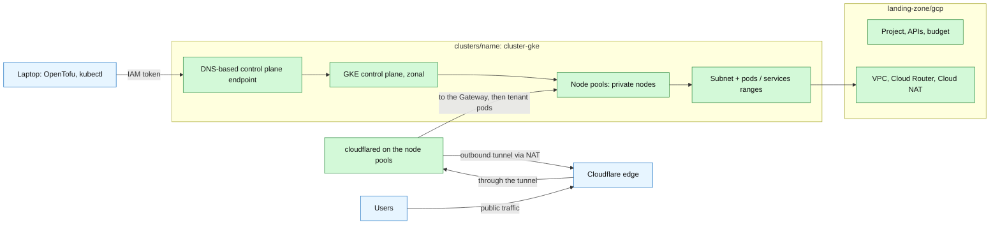

# RFC 0024: Run GKE Standard zonal with Dataplane V2 as the cloud target

## Summary

<!-- readability: allow-code V2 R2 -->

The first cloud cluster is GKE Standard, zonal, with Dataplane V2. The platform keeps its
invariants on GKE.

| Decision | Why | Cost | Reversible |
|---|---|---|---|
| Run GKE Standard, zonal, with Dataplane V2 and a DNS-only endpoint, built from raw `google` resources with OpenTofu | Free tier credit covers the fee | We size, upgrade and pay for nodes | yes: two-way; Dataplane V2 change needs a new cluster |
| Make node pools Spot, on-demand or both, per cluster; platform pods stay off Spot when both exist | Chosen per cluster, by input (owner decision) | On-demand nodes; tenants can spill onto them | yes: two-way; pools are an input per cluster |
| Let GKE own the Gateway API CRDs; the catalog follows `distribution` in `cluster.yaml` | One CRD owner per cluster (ADR-0012) | CRD versions follow Google's schedule | yes: two-way, by `cluster:down`; disabling the channel in place is **(unverified)** |
| Keep the `network-policy` default deny, with platform egress by name in `FQDNNetworkPolicy` | Same invariant on every cluster | A GKE variant and a fallback | open: [does FQDN egress pass the default deny?](#open-questions) |
| Private nodes behind Cloud NAT (proposed) | No public node IPs | Cloud NAT, not priced | open: [private or public nodes?](#open-questions) |

## Context

- ADR-0003 picks GKE for the cloud target, ADR-0011 Dataplane V2 (DPv2) instead of our Cilium, ADR-0012 makes GKE
  the Gateway API CRD owner on GKE. ADR-0017 defers the content of `landing-zone/gcp/`.
- ADR-0010 and ADR-0011 leave unverified whether DPv2 supports `CiliumClusterwideNetworkPolicy` (CCNP) with
  namespace-label selectors, so the GKE default deny has no confirmed design.
- Owner decisions that this RFC applies:
  - OpenTofu replaces Terraform (RFC 0022).
  - `cluster-gke` supports Spot pools, on-demand pools, or both, per cluster, by input.
  - A baseline `network-policy` component hosts the default deny and platform policies on every cluster, GKE included.
    Retro RFC 0010 and RFC 0014 ([#18](https://github.com/gsuquet/infra/pull/18)) own it and regenerate ADR-0010 and
    ADR-0014; this RFC depends on them and adds only the GKE variant and fallback.
  - A cluster root's Cloudflare token is least-privileged.
- Nothing is implemented. Facts checked 2026-11-18/19 against GKE, pricing, provider, cert-manager, ESO, Cilium
  and GitHub docs; anything marked **(unverified)** was not confirmed there.
- Decision needed now: the module shape, the landing zone and the catalog changes block the first GKE cluster.

## Goals and non-goals

Goals:

- One GKE cluster whose management fee is covered by the free tier credit (US$74.40/month per billing account).
- Same platform invariants as kind and Talos: default deny on every labelled namespace, one Gateway API CRD owner
  per cluster, a `secrets` store in every namespace, Argo CD self-managed.
- Laptop and CI reach the control plane through IAM only: no bastion, no authorized networks.
- `cluster-gke` runs Spot-only, on-demand-only or mixed pools from one input, with platform pods kept off Spot
  when both kinds exist.
- A billing budget alert exists before the first cluster.

Non-goals:

- Autopilot support in `cluster-gke` (scope creep until a second GKE cluster exists).
- A GKE Gateway controller or any Google Cloud load balancer: public traffic enters through Cloudflare Tunnel
  (ADR-0013).
- The secrets backend (RFC 0020) and the Gateway implementation choice.
- Artifact Registry, Cloud DNS zones, org policies and folders.
- Non-GKE clouds.

## Decision drivers

- Platform invariants hold on GKE without a GKE-only exception the render cannot check.
- Cost floor: the fee under the free credit, nodes and NAT measured before they are bought.
- Small, readable OpenTofu surface that Renovate can upgrade.
- Least privilege on the control plane, IAM and the network trust boundary.

## Options considered

### GKE Standard, zonal, Dataplane V2

Managed control plane, our node pools, DPv2 as the CNI, raw `google` provider resources.

- Good: keeps privileged opt-in components possible and node pools under our control (invariants, cost floor).
- Good: zonal Standard is covered by the free tier credit; a zonal control plane has a 99.5% SLA (99.95% regional and Autopilot), enough here.
- Bad: we size, upgrade and pay for whole nodes (cost floor); Standard node prices are **(unverified)**.

### GKE Autopilot

Google manages nodes; billing per Pod request.

- Good: no node pools to manage; rough baseline cost is known (see [cost figures](../research/0024-gke-autopilot-and-cost.md#cost-figures)).
- Bad: privileged pods run only for allowlisted partners, so Falco and Tetragon cannot run (invariants).
- Bad: no node pools, so the Spot / on-demand pool input does not apply (cost floor).
- Bad: request defaults and ratios inflate tenant bills (cost floor).

### GKE Standard with our own Cilium

Legacy datapath cluster plus Cilium installed with `gke.enabled`, a NodeInit DaemonSet and the
`node.cilium.io/agent-not-ready` taint
([Cilium GKE install](https://docs.cilium.io/en/stable/installation/k8s-install-helm/)).

- Good: same Cilium and policy features as kind and Talos (invariants).
- Bad: privileged NodeInit that rewrites kubelet, no Google support for the CNI (least privilege); contradicts
  ADR-0011.

### Do nothing

No cloud cluster: tenants run on kind and Talos only.

- Good: no cloud bill.
- Bad: no cloud stage for Kargo promotion (ADR-0008); ADR-0003 stays unimplemented.

## Proposal

The landing zone outlives clusters; a cluster root owns its subnet ranges; no Google load balancer; requests reach pods
only through the tunnel cloudflared opens outbound.

Legend: green is new, blue is external.

Detail:

- [Cluster module and landing zone](../research/0024-gke-cluster-module.md).
- [Pod placement](../research/0024-gke-node-placement.md).
- [Default deny and Dataplane V2](../research/0024-gke-network-policy.md).
- [Platform services](../research/0024-gke-platform-services.md).
- [First-cluster checks](../research/0024-gke-first-cluster-checks.md).

## Operational impact

- Blast radius: one new GKE cluster and its tenants; the `landing-zone/gcp` state in R2; the shared GCP project's Workload Identity pool. kind and Talos are untouched except `cert-manager` leader election and the `network-policy` component, which change on every cluster.
- Rollout: 1. price nodes and NAT in the calculator and set the budget; 2. apply `landing-zone/gcp`; 3. `mise run cluster:plan` (untested) then `cluster:up` (untested) for the GKE cluster; 4. run the [first-cluster checks](../research/0024-gke-first-cluster-checks.md), policy checks before Argo CD syncs the default deny, the others before enabling tenants; 5. add the cluster to Kargo stages. Each step waits for the previous one to pass.
- Rollback: `mise run cluster:down <name>` (untested) after applying `deletion_protection = false` (minutes), then destroy `landing-zone/gcp` if no cluster remains. Tenants on the cluster lose their cloud stage; DPv2 and private nodes can only change by recreating the cluster.
- Migration: None: a new cluster and a new landing zone; no existing state or data moves.
- Security: new trust boundary in Google Cloud. IAM-gated DNS endpoint, IP endpoints off; private nodes; Workload Identity pool shared per project (identity sameness); hand-made least-privileged Cloudflare DNS token held only in the secrets backend; GitHub OIDC conditioned on immutable IDs; tenants blacklisted from `FQDNNetworkPolicy`; Falco and Tetragon off on GKE until decided.
- Cost: management fee US$0.10/hour (about $73/month) covered by the $74.40 monthly credit for one zonal cluster; a second cluster on the billing account pays it in full. Other costs are **(unverified figures)**: [cost figures](../research/0024-gke-autopilot-and-cost.md#cost-figures).
- Observability: billing budget alerts at 50/90/100%; GKE-managed Hubble relay and DPv2 policy logging for denied flows; Argo CD sync and health status per application; node pool autoscaler events for Spot preemption and stockout.

## Drawbacks and risks

| Risk | Severity (proposed) | Mitigation |
|---|---|---|
| Platform egress by name (GitHub, ACME, Cloudflare) relies on `FQDNNetworkPolicy` past a CCNP default deny **(unverified)**; if it fails, Argo CD cannot reach GitHub to repair itself | high | Checked before the default deny syncs; [NetworkPolicy fallback](../research/0024-gke-network-policy.md#networkpolicy-fallback), with which FQDN policies are additive |
| CCNP namespace-label selectors or `toEntities` may be rejected on GKE | high | `NetworkPolicy` fallback if the selector is rejected, `toCIDR` for the API server; test on the first cluster before Argo CD syncs the default deny |
| Spot-only clusters can sit at zero nodes during preemption or a stockout, Argo CD included, with nothing self-healing until capacity returns (notice length and stockout behaviour **(unverified)**) | high | Mixed pools keep platform pods on on-demand; Spot-only is an explicit per-cluster choice |
| Standard node, Cloud NAT, Managed Prometheus and Logging prices are **(unverified)**; Standard vs Autopilot cost is not compared | medium | Price them in the calculator before the first `cluster:up`; budget alert from day one |
| Scheduler preferences do not steer the cluster autoscaler **(unverified)**: tenants can grow the on-demand pool to `max` while Spot capacity exists | medium | On-demand `max` caps the cost; `ComputeClass` with Spot first as the candidate fix, tested on the first mixed cluster |
| kube-dns replicas on Spot drop with a preemption, platform pods included | medium | `PreferNoSchedule` only keeps them schedulable on on-demand; replica spread across pool classes checked on the first cluster |
| GKE owns the Gateway API CRD version, so it follows Google's schedule and Experimental types may be unavailable **(unverified on Standard)** | medium | Check the implementation's supported version on every GKE upgrade |
| Falco or Tetragon on DPv2 is unsupported by Google and may interfere with `anetd` | medium | Off on GKE until decided |
| Tenant pods that spill onto the on-demand pool stay there after Spot returns | low | On-demand `max` caps the cost; a descheduler is future work |
| `cluster.yaml` `placement.platform` can drift from the module's `platform_placement` | low | Platform pods stay Pending instead of landing on Spot |
| `CHANNEL_STANDARD` reconciliation can take up to 45 minutes after creation | low | Argo CD retries the Gateway implementation sync |

## Open questions

- Region and zone: europe-west1 (Belgium), europe-west9 (Paris) or us-central1 (cheapest list prices)? The
  credit is region-agnostic.
- Private nodes plus Cloud NAT, or public nodes without NAT behind GKE firewall rules? Decide after pricing NAT
  against external IPv4 addresses. `private_nodes` and the conditional router and NAT keep both open.
- One project per cluster, or a shared project? Pools are per project; same-named tenant namespaces on two
  clusters share IAM identity in a shared project.
- Monthly budget amount and recipients.
- Runtime security on cloud clusters: Falco or Tetragon on Standard at our risk (test `anetd` interference), a
  managed alternative (GKE Security Posture, an allowlisted partner sensor), or Talos only?
- The Google account has no Organization: are org policies and folders not needed for now? Verify whether a Cloud
  Identity org exists.
- Pools of the first cluster: Spot only, on-demand only, or mixed? Price the on-demand node first.
- Which component owns the `platform` PriorityClass?
- Cloudflare DNS-01 token: stays hand-made, unless the secrets RFC finds a write-only or ephemeral token attribute
  that keeps the value out of state.
- Does an `FQDNNetworkPolicy` open egress for endpoints the CCNP default deny selects (the GKE doc only covers
  Kubernetes `NetworkPolicy`)? It blocks platform egress (Argo CD sync, ACME, the tunnel) as well as tenants: if
  not, GKE uses the `NetworkPolicy` fallback. Should the platform own per-tenant FQDN allowlists, as a field in
  `gitops/tenants/<tenant>.yaml` rendered into the tenant namespace?

## Decision

Pending.

## Implementation

N/A: not accepted yet.

## References

- RFC 0020 (secrets backend), RFC 0022 (IaC tool), RFC 0025 (Talos, `TLSRoute`), RFC 0026 (Cloudflare Tunnel)
- [Related ADRs](../research/0024-gke-future-work.md#related-adrs)

## Future work

- [Future work](../research/0024-gke-future-work.md#future-work).
