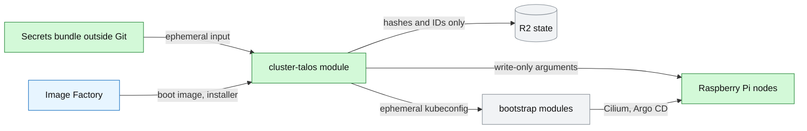
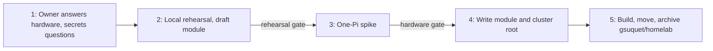

# RFC 0025: Build Talos clusters on Raspberry Pis with cluster-talos

<!-- readability: allow-code R2 CM[45] L2 -->

## Summary

Add `modules/cluster-talos` and a first Talos cluster of Raspberry Pi 4B or CM4 nodes, built and upgraded with
`mise run cluster:up`; the one manual step per node is writing the boot image. It replaces
`olympus`, one k3s Pi run by Ansible from `gsuquet/homelab`.

| Decision | Why | Cost | Reversible |
| --- | --- | --- | --- |
| Add `cluster-talos` with the `cluster-kind` output names and the same `bootstrap-*` modules; Cilium comes from `rendered/cilium/` | Same path as kind | Talos overrides in `cluster.yaml` | yes: before [step 5](#operational-impact), `mise run cluster:down <name>` and reflash the Pis |
| Keep every Talos and Kubernetes secret out of OpenTofu state; proposed: bundle from a local file now, Proton Pass once the Proton Pass item and the task exist | State token no longer gives cluster root | Only holders of the bundle can plan | [open](#open-questions): secrets question |
| Pi 4B (8 GiB) and CM4 only, USB 3 SSD boot on the Pi 4B, local-path storage first | Pi 4B: in the support matrix; CM4: in the matrix, but only "community tested on one variant ... using Super 6C boards" | No Pi 5 or CM5; no data replication | [open](#open-questions): hardware and storage questions |
| Target three control planes with workloads (single-node start is open), reached by a DNS name on an L2 VIP | Survives one node loss | Part of each 8 GiB node | [open](#open-questions): topology and network questions |
| Replace `olympus`, then archive `gsuquet/homelab` | One platform, no frozen repo | Migration window | no: irreversible after `olympus` is reflashed: going back needs the homelab Ansible run and a data move back |

## Context

- ADR-0003: Talos with the `siderolabs/talos` provider on Pis and local servers. ADR-0015: IaC bootstraps only the
  cluster, Gateway API CRDs, Cilium and Argo CD. ADR-0018: state in R2, no object versioning.
- Owner decisions: OpenTofu replaces Terraform (RFC 0022); the `network-policy` component hosts the default deny on every cluster (replaces the
  render-emitted layer of ADR-0010).
- Problem: a `talos_machine_secrets` resource puts the full cluster PKI in R2 state, and the one R2 token is
  read-write on the whole bucket: anyone who can plan holds cluster root.
- [Current state, unverified claims](../research/0025-talos-raspberry-pi-rollout.md#current-state).
- Decision needed now: the module interface and the secrets source block the first Talos cluster.

## Goals and non-goals

Goals:

- One Talos cluster on supported Pi boards; target: three control planes, so it survives the loss of one node
  (a single-node start is an open question).
- No Talos or Kubernetes secret (PKI, tokens, talosconfig, kubeconfig) in OpenTofu state or plan.
- `cluster-talos` exposes the `cluster-kind` output names, so `bootstrap-*` work unchanged on both.
- Talos OS and Kubernetes upgrades driven from OpenTofu, one node at a time.
- The same module serves local x86 servers through per-node inputs only.

Non-goals:

- Raspberry Pi 5 and CM5 (not in the Talos support matrix).
- Remote access to the Talos or Kubernetes API through Cloudflare Tunnel (RFC 0026).
- The secrets backend itself (RFC 0020); only what it must serve.
- Replicated block storage (Longhorn, Rook/Ceph) on day one.
- Enabling Falco or Tetragon on the Pis before the eBPF check list passes.

## Decision drivers

- Secrets: holding the state or its token must not give cluster root.
- Parity with kind: same bootstrap path, same output contract, same Cilium install method.
- Supported hardware only: Sidero Labs gives no support for SBC boot failures, so stay inside the support matrix.
- One `cluster:up` per cluster, with the flashing as the only manual step.
- Small, upgradeable module: pinned versions Renovate can bump.

## Options considered

[Detail](../research/0025-talos-raspberry-pi-options.md#options).

### Ephemeral `cluster-talos`, bundle from a local file, then the secrets backend (proposed)

Bundle generated once outside the module, passed as an ephemeral input.

- Good: state holds hashes and IDs only (secrets); same modules and outputs as kind (parity).
- Bad: only the machine holding the file can plan until the backend exists (one `cluster:up`); the offline backup
  is the only copy of the PKI (secrets).

### `talos_machine_secrets` resource in state, encrypted by OpenTofu

The cluster root creates the bundle; OpenTofu client-side encryption hides it from holders of the R2 token alone.

- Good: nothing new to run, no bundle file to keep (one `cluster:up`).
- Bad: anyone who can plan holds the decryption key, hence cluster root; the read-write token can still
  overwrite or delete the only copy of the PKI in an unversioned bucket (secrets).

### Talos inline manifests for Cilium and CoreDNS

Talos installs Cilium itself instead of `bootstrap-cilium`.

- Good: Cilium arrives with the control plane (one `cluster:up`).
- Bad: each Kubernetes upgrade fights Argo CD; a second Cilium install path, only on Talos (parity).

### Do nothing

Keep `olympus` on k3s, managed by Ansible in the frozen `gsuquet/homelab`.

- Good: no work, no hardware, no migration window.
- Bad: one node, no HA; the frozen repo stays alive, outside the platform.

## Proposal

State holds hashes and IDs only; the hand-over is the one kind uses.

Legend: green is new, gray is unchanged, blue is external.

- [Hardware, boot assets, x86](../research/0025-talos-raspberry-pi-hardware.md)
- [Topology](../research/0025-talos-raspberry-pi-topology.md)
- [Enrollment](../research/0025-talos-raspberry-pi-enrollment.md)
- [Secrets](../research/0025-talos-raspberry-pi-secrets.md)
- [Cilium, Gateway API, CoreDNS](../research/0025-talos-raspberry-pi-cilium.md)
- [Storage](../research/0025-talos-raspberry-pi-storage.md)
- [Upgrades](../research/0025-talos-raspberry-pi-upgrades.md)
- [eBPF check list](../research/0025-talos-raspberry-pi-ebpf.md)
- [Module inputs and outputs](../research/0025-talos-raspberry-pi-module.md)

## Operational impact

[Detail](../research/0025-talos-raspberry-pi-rollout.md#operational-detail).

- Blast radius: the new cluster, its R2 state object, the workloads moved from `olympus`; kind, GKE and `landing-zone/cloudflare` are untouched.
- Rollout: the chart below; [gates](../research/0025-talos-raspberry-pi-rollout.md#gates).
- Rollback: before step 5, `mise run cluster:down <name>` and reflash the Pis (minutes per node); `olympus` keeps running. Irreversible after `olympus` is reflashed: going back needs the homelab Ansible run and a data move back.
- Migration: stateful volumes and databases move from `olympus` in a downtime window ([open](#open-questions)).
- Security: new home trust boundary. State holds no secrets; anyone who can plan needs the bundle, so plan access equals secret access; Talos maintenance mode accepts an unauthenticated config on port 50000 until the first apply; the bundle and its backup become the cluster root.
- Cost: hardware only, sized by the [hardware question](#open-questions); no recurring service fee.
- Observability: `talos_cluster_health` in every apply, node `Ready`, Cilium status, Argo CD sync and health. No SLO yet.

Each step gates the next; each gate must pass.

## Drawbacks and risks

[Detail](../research/0025-talos-raspberry-pi-options.md#risks-and-mitigations).

Severities are proposed by the author, for owner confirmation.

| Risk | Severity | Mitigation |
| --- | --- | --- |
| Bundle file: single point of failure and compromise | high | Offline backup from day one; Proton Pass when RFC 0020 lands |
| Maintenance mode accepts an unauthenticated config on port 50000: any LAN host can push its own config first | high | Flash and apply on an isolated segment or VLAN, apply right after power-on, check the node identity (address, hardware) before the apply |
| The bundle reaches OpenTofu as `TF_VAR_machine_secrets`, visible to child processes and process listings of the same user | high | The mise task scopes the variable to the `tofu` process only (`pass-cli run`-style injection) and never exports it to the shell |
| Firmware or u-boot regression, no vendor fix | medium | Pi 4B / CM4 only; A/B rollback, one node at a time |
| First apply by `talos_machine` unproven | medium | Test both resources before writing the module |
| Ephemeral health gate may not prove the API server answers, or may not gate providers in one apply | medium | Rehearsal; fallback is a second apply |
| USB boot or bridge quirks may block the recommended medium | medium | Test the exact enclosure; SD boot with SSD data |
| Unmeasured overhead on 8 GiB | medium | Local-path first; measure |
| `ignore_kubernetes_upgrade_drift` is experimental | medium | Pin the provider |
| `drain_on_upgrade` may not be wireable on first create | low | Drain disabled on create, enabled through `cluster:upgrade` |
| eBPF features unchecked on Talos arm64 | low | Falco and Tetragon off until the check list passes |
| Public discovery is an external dependency of a home cluster | low | Option to disable it ([open](#open-questions)) |

## Open questions

- Hardware: how many Pis, which models (4B 8 GiB only, CM4, any Pi 5), boot media, SSDs and USB enclosures, PoE
  or USB-C power? Is `olympus` the only Pi today?
- Topology: one control plane first, or wait for three Pis? Are x86 servers in scope for the first cluster, and as
  control planes?
- Name: keep `olympus` for the Talos cluster (both side by side under different names during the move), or a new
  name?
- Network: one L2 segment for all nodes? A free VIP address outside DHCP? DHCP reservations or static addresses?
  Internal DNS name for the API endpoint?
- Secrets: accept the local bundle with offline backup now and Proton Pass later? Where does the offline backup
  live?
- RFC 0020: drop its assumption that the SA signing key is in the cluster root state in R2, so both RFCs agree
  before either is accepted.
- Plan access: should agents plan Talos roots at all, knowing that with Proton Pass or the local file plan means secret access?
- R2 token: `tf` and `tf:read` share one read-write token for the whole `terraform-state` bucket, so a "read-only"
  plan can write any state. Separate read-only token, per bucket or key prefix? Affects every root.
- Pi 5 / CM5: excluded until the support matrix lists them, or the unofficial port for a lab node?
- Storage: local-path first and Longhorn later, or Longhorn from day one (extensions in the schematic now, or a new
  schematic and an upgrade later)?
- CoreDNS: Talos-owned (updated by `upgrade-k8s`, out of the catalog), or disabled in Talos and a component?
- Gateway on bare metal: host-network Cilium Gateway, Cilium LB IPAM with L2 announcements, or `cloudflared` only?
- Discovery: accept `discovery.talos.dev`, or disable it (KubePrism then learns control planes from the endpoint
  only)?
- Runtime security: Falco and Tetragon on 8 GiB Pis, given the unchecked kernel items?
- `olympus` move: acceptable downtime, and which stateful data moves (volumes, databases)?
- `cluster-kind` outputs: move kind to ephemeral outputs too, or accept per-target root wiring?

## Decision

Pending.

## Implementation

N/A: not accepted yet.

## References

- External sources: in each research file.
- ADR-0003, ADR-0010, ADR-0012, ADR-0015, ADR-0017, ADR-0018, ADR-0019.
- RFC 0020 (secrets backend), RFC 0022 (IaC tool), RFC 0023 (Renovate), RFC 0026 (Cloudflare Tunnel).

## Future work

- [Follow-ups](../research/0025-talos-raspberry-pi-rollout.md#follow-ups).
