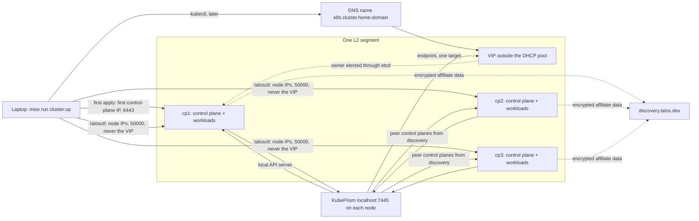
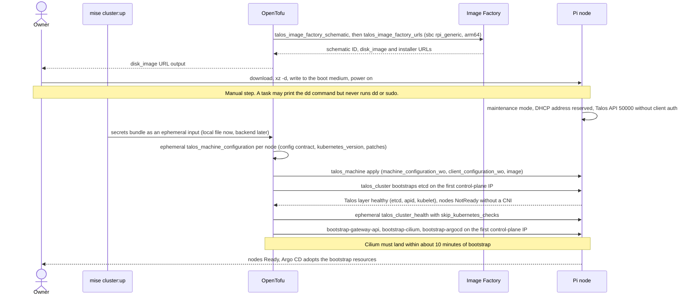
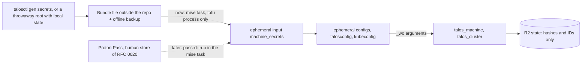
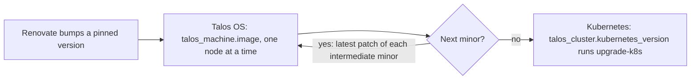
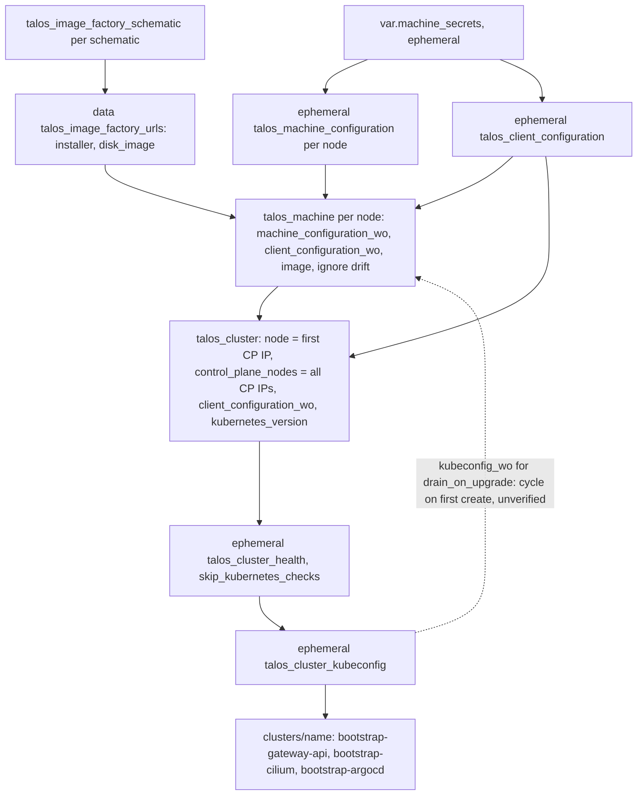
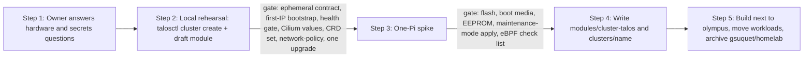

# RFC 0025: Build Talos clusters on Raspberry Pis with cluster-talos

## Summary

Add `modules/cluster-talos` and a first Talos cluster of Raspberry Pi 4B or CM4 nodes that replaces the k3s
cluster `olympus` of `gsuquet/homelab`. The module keeps the same output contract as `cluster-kind`, keeps every
Talos and Kubernetes secret out of OpenTofu state (ephemeral resources and write-only arguments), and hands over to
the usual `bootstrap-*` modules. Outcome: a cluster built and upgraded with `mise run cluster:up`, target 3 control planes (a single-node start is
an open question), with one manual step per node: writing the boot image.

## Context

- ADR-0003: Talos with the `siderolabs/talos` provider on Pis and local servers. ADR-0015: IaC bootstraps only the
  cluster, Gateway API CRDs, Cilium, Argo CD. ADR-0018: state in R2 (`terraform-state`), no object versioning.
- Owner decisions of 2026-11-19 applied: OpenTofu replaces Terraform (RFC 0022); the `network-policy` component
  hosts the default deny on every cluster (replaces the render-emitted layer of ADR-0010).
- `olympus` today: one Raspberry Pi (arm64, `olympus.local`, `k3s_server` group, no agents, API 6443, TLS SAN
  `olympus.local`), k3s `v1.34.1+k3s1`, embedded datastore, Ansible edits `cmdline.txt` for cgroups; homelab sizes
  target a Pi 4 with 8 GiB. Not recorded: model, Pi count, boot media, disks, network, power. The homelab line "a
  Talos cluster runs on the Raspberry Pi nodes" describes the target, not the present.
- Problem: a `talos_machine_secrets` resource puts the full cluster PKI in R2 state, and the one R2 token (shared by
  `tf` and `tf:read`, only the Cloudflare token has a read-only twin) is read-write on the whole bucket: anyone who
  can plan holds cluster root.
- Checked 2026-11-18 on `docs.siderolabs.com` (`www.talos.dev` redirects): Talos `v1.14.6` (Linux 6.18, Kubernetes
  1.37), provider 0.12.0 (`0.13.0-alpha.1` exists), Cilium 1.20.5. **(unverified)**: no allowed source (memory,
  inference, `raspberrypi.com`, `factory.talos.dev`, `github.com/siderolabs/*`); needs hardware or a later study.
- Decision needed now: the module interface and the secrets source block the first Talos cluster.

## Goals and non-goals

Goals:

- One Talos cluster on supported Pi boards; target: 3 control planes, so it survives the loss of one node (a
  single-node start is an open question).
- No Talos or Kubernetes secret (PKI, tokens, talosconfig, kubeconfig) in OpenTofu state or plan.
- `cluster-talos` exposes the `cluster-kind` output names, so `bootstrap-*` modules work unchanged on both.
- Talos OS and Kubernetes upgrades driven from OpenTofu, one node at a time.
- The same module serves local x86 servers through per-node inputs only.

Non-goals:

- Raspberry Pi 5 and CM5 (not in the Talos support matrix).
- Remote access to the Talos or Kubernetes API through Cloudflare Tunnel (RFC 0026).
- The secrets backend itself (RFC 0020); this RFC states only what it must serve.
- Replicated block storage (Longhorn, Rook/Ceph) on day one.
- Enabling Falco or Tetragon on the Pis before the eBPF check list passes.

## Decision drivers

- Secrets: holding the state or its token must not give cluster root.
- Parity with kind: same bootstrap path, same output contract, same Cilium install method.
- Supported hardware only: Sidero Labs gives no support for SBC boot failures, so stay inside the support matrix.
- One `cluster:up` per cluster, with the flashing as the only manual step.
- Small, upgradeable module: pinned versions Renovate can bump.

## Options considered

### Ephemeral `cluster-talos`, bundle from a local file, then the secrets backend (proposed)

Secrets bundle generated once outside the module and passed as an ephemeral input; configs, talosconfig and
kubeconfig ephemeral; `talos_machine` and `talos_cluster` fed through `_wo` arguments; Cilium from
`rendered/cilium/` through `bootstrap-cilium`, as on kind (ADR-0015).

- Good: state holds hashes and IDs only, so the shared R2 token stops being a cluster-root token (secrets).
- Good: same bootstrap modules and outputs as kind (parity).
- Bad: plan needs the bundle, so only the machine holding the file can plan until the backend exists (one
  `cluster:up`).
- Bad: the offline backup of the bundle is the only copy of the cluster PKI (secrets).

### `talos_machine_secrets` resource in state, encrypted by OpenTofu

Option A of the Secrets table: the cluster root creates the bundle, state carries the PKI, OpenTofu client-side state
encryption (RFC 0022) hides it from holders of the R2 token alone.

- Good: nothing new to run; no bundle file to keep (one `cluster:up`).
- Bad: anyone who can plan still holds the decryption key, hence cluster root, and the read-write token can still
  overwrite or delete the only copy of the PKI in an unversioned bucket (secrets).
- Not proposed either: the same in a second R2 bucket with its own token. It changes the settled state layout (one
  bucket) and needs a `landing-zone/cloudflare` change, both owner sign-offs, and still puts the PKI in state.

### Talos inline manifests for Cilium and CoreDNS

Talos installs Cilium from a `KubeInlineManifestConfig` document instead of `bootstrap-cilium`.

- Good: no bootstrap module for Cilium in the first apply; Cilium arrives with the control plane (one `cluster:up`).
- Bad: Talos re-applies inline manifests on every `upgrade-k8s` with server-side apply and pruning (since 1.13), so
  each Kubernetes upgrade fights Argo CD, which owns `rendered/cilium` (parity).
- Bad: a second Cilium install path and a second set of values outside the catalog, only on Talos (parity,
  ADR-0015).

### Do nothing

Keep `olympus` on k3s, managed by Ansible in the frozen `gsuquet/homelab`.

- Good: no work, no hardware, no migration window.
- Bad: one node, no HA, a reboot stops the API; the frozen repo stays alive, outside the platform catalog,
  rendered manifests and the `network-policy` default deny.

## Proposal

### Hardware

| Board | Talos v1.14 status | Overlay | Use |
| --- | --- | --- | --- |
| Pi 4B (8 GiB) | In the [support matrix][matrix]; "officially tested" per the [Pi guide][rpi]. u-boot `rpi_arm64_defconfig`. | `rpi_generic` | **Yes** |
| CM4 | In the matrix, but only "community tested on one variant ... using Super 6C boards". Carrier matters (PCIe, eMMC vs Lite). | `rpi_generic` | Yes |
| Pi 5 | Not in the matrix; [Unofficial Ports][unofficial] only (`talos-rpi5/talos-builder`). Provider 0.12.0 `talos_image_factory_urls` accepts `sbc = "rpi_5"`; a working Image Factory `rpi_5` overlay and its support level **(unverified)**. | none official | No |
| CM5 | Not mentioned in any Talos doc **(unverified)**. | none | No |

All SBC ports are "community-maintained and provided as-is", with no official support for boot failures or firmware
quirks. Metal is Tier 1, but the tiers do not list SBCs. Pi 4 has no TPM and no UEFI SecureBoot on this u-boot
path (SecureBoot in the matrix is "arm64: UEFI" only) **(inferred)**.

| Boot medium | Fit | Notes |
| --- | --- | --- |
| SD card | Lab only | Documented default (`dd` to `/dev/mmcblk0`). Slow random writes, low endurance: bad for etcd and images. |
| USB 3 SSD (Pi 4B) | **Recommended** | Needs USB in the EEPROM `BOOT_ORDER`; recent EEPROMs try SD then USB by default **(unverified)**. u-boot USB boot with every USB-SATA bridge **(unverified)**: some need UAS quirks; test the exact enclosure before buying several. |
| NVMe | CM4 carrier with PCIe | Pi 4B has no PCIe: NVMe only through USB. u-boot NVMe boot on CM4 carriers with `rpi_generic` **(unverified)**. |
| eMMC (CM4 non-Lite) | Acceptable | Better than SD; flashing needs `rpiboot`. **(unverified)** for Talos. |
| SD boot + SSD data | Fallback | `STATE` on SD; `EPHEMERAL` moved to SSD by `VolumeConfig` `provisioning.diskSelector`; 1.14 can also split `ETCD`, `CRI`, `KUBELET`, `LOG`. Only when USB boot fails. |

Talos 1.14 replaces `.machine.install` with `UnattendedInstallConfig` (CEL `volumeSelector`). On an SBC the raw
image is the installed system: point the selector at the boot disk. Behavior when they differ on `rpi_generic`
**(unverified)**.

Firmware, once per board before the first Talos boot: write the "Misc utility images" EEPROM image with Raspberry Pi
Imager to a spare SD card, boot it, wait for the green LED to blink fast.

### Boot assets

```yaml
# Schematic for a headless Pi 4B / CM4 node; its ID is the hash of this content.
overlay:
  name: rpi_generic
  image: siderolabs/sbc-raspberrypi
  options:
    configTxtAppend: |
      dtoverlay=disable-wifi
      dtoverlay=disable-bt
customization:
  systemExtensions:
    officialExtensions: []  # siderolabs/iscsi-tools + siderolabs/util-linux-tools only if Longhorn is chosen
```

| Rule | Why |
| --- | --- |
| Installers come only from the [Image Factory][factory]: `factory.talos.dev/metal-installer/<schematic-id>:<talos-version>`. | `ghcr.io/siderolabs/installer` is no longer published since 1.14; provider examples still show `ghcr.io/siderolabs/installer:v1.9.0`: do not copy them. |
| `config.txt` changes live in the schematic (`configTxt` / `configTxtAppend`); upgrade only with the installer of the same schematic. | `config.txt` is set at build time, cannot change on a running node, and custom content "is not preserved automatically during upgrades". |
| Fan control (`gpio-fan`, `pwm-gpio-fan`) goes in `config.txt` when needed; `gpu_mem` / CMA only with the `vc4` extension, not needed headless. | Headless nodes. |
| No extension for Kubernetes, Cilium or Argo CD; Longhorn needs `iscsi-tools` and `util-linux-tools` on every node. | Extensions follow the storage choice. |
| Adding an extension = new schematic ID + Talos upgrade to it. | Extensions activate only at install or upgrade. |
| Kernel arguments go in `customization.extraKernelArgs`, not the machine config. | Schematic owns boot. |
| Schematic YAML in Git; ID derived by `talos_image_factory_schematic`; `talos_image_factory_urls` returns `disk_image` and `installer` per `talos_version`, `architecture`, `platform` or `sbc`. | Reproducible assets. |

Reference: the "vanilla" Pi schematic ID is `ee21ef4a5ef808a9b7484cc0dda0f25075021691c8c09a276591eedb638ea1f9`.

### Topology



Three Pi control planes on one segment, workloads allowed; the API is reached by a DNS name on the VIP; KubePrism
balances over the local API server, the peers and the endpoint, so a VIP failover does not reach workloads.

| Nodes | Topology | Trade-off |
| --- | --- | --- |
| 1 Pi | 1 control plane, workloads on it | Same as `olympus`: no HA, an upgrade reboot stops the API. |
| 3 Pis | 3 control planes, workloads allowed, no workers | **Recommended for 3 to 4 Pis.** Survives one loss; etcd and control plane cost part of each 8 GiB node **(unverified figure, measure)**. |
| 5+ nodes | 3 control planes + workers | x86 servers make better control planes. |

- etcd needs a majority: useful control-plane counts are 1 and 3+ (odd). Two is worse than one.
- Workloads on control planes: the `NoSchedule` taint now sits in `KubeNodeConfig` (replaces
  `.cluster.allowSchedulingOnControlPlanes`).

| Endpoint option | Verdict |
| --- | --- |
| L2 VIP (`Layer2VIPConfig` on each control plane) | **Yes**, behind a DNS name. Needs all control planes on one L2 segment and a free address outside DHCP. Comes up only after bootstrap; failover after a crash takes "up to a minute"; depends on etcd, so **never** the talosconfig endpoint. With one control plane it still gives a stable address for a later move to three. |
| DNS name, one A record per control plane | Works without L2; clients do not skip a dead node quickly. |
| External TCP load balancer | No device at home; not worth it. |

- The DNS name (for example `k8s.<cluster>.<home-domain>`) goes in the API server cert SANs, so the VIP can move
  without new certificates, and in the long-lived kubeconfig.
- talosconfig lists the control-plane node addresses; `talosctl` fails over between them.
- [KubePrism][kubeprism] (default on, `KubePrismConfig`; `.machine.features.kubePrism` is deprecated): TCP balancer
  on `localhost:7445` over the endpoint, the local API server and every control plane from discovery. Kubelet,
  scheduler and controller manager use it; host-network clients (Cilium) must too. With it, a VIP failover does not
  affect in-cluster workloads. Keep the default.
- [Discovery][discovery]: public `https://discovery.talos.dev/` by default, affiliate data encrypted by a cluster
  key; KubePrism learns control planes from it. Default kept; external dependency (open question).
- The Talos API is gRPC with mutual TLS: only a TCP proxy can carry it remotely.

### Enrollment



A first apply for the image URL, the flash, then the cluster apply; the bootstrap goes to the first control-plane IP,
never the VIP.

| Step | Rule |
| --- | --- |
| Address | Reserve the DHCP address (or set a static one in the config) before the apply: every resource is keyed on the node IP. |
| Configs | One `talos_machine_configuration` per node (`for_each`), `talos_version` pinned to the creation version ("the config-generation contract"). Patches go here: `talos_machine` 0.12.0 has no `config_patches`, only `machine_configuration[_wo]`, `image`, `client_configuration[_wo]`, `kubeconfig[_wo]`, `drain_on_upgrade`, `ignore_kubernetes_upgrade_drift`, `reboot_mode`, `on_destroy`. |
| First apply | `talos_machine` (new in 0.12.0) on a maintenance-mode node **(unverified)**: the docs do not describe the insecure first apply; official examples use the older `talos_machine_configuration_apply` (which has `client_configuration_wo` and `machine_configuration_input_wo` per RFC 0022). Test both on one node before writing the module. |
| Bootstrap | `talos_cluster`: `node` "Must be an IP" (a hostname goes in `endpoint`), every control-plane IP in `control_plane_nodes` ("Required for HA clusters"), tracks `kubernetes_version`, completes when the Talos layer is healthy and "does not wait for Kubernetes components". `talos_machine_bootstrap` is the older single-purpose resource. |
| Gate | Ephemeral `talos_cluster_health` with `skip_kubernetes_checks = true`: the full check waits for `Ready` nodes, which never happens before Cilium, so it deadlocks. That the skipped check proves the API server answers, and that an ephemeral resource can gate the `helm` / `kubernetes` providers in the same apply **(unverified)**. |
| Cilium window | After bootstrap Talos "will hang at phase 18/19 with `retrying error: node not ready`"; "you have about 10 minutes to apply Cilium before the node retries". One apply keeps the gap short. |
| Drain wiring | `drain_on_upgrade` needs `kubeconfig_wo` from the ephemeral `talos_cluster_kubeconfig`, which follows `talos_cluster`, which follows `talos_machine`: a reference cycle on the first create, when no cluster exists. Whether both can be wired on the first apply **(unverified)**. Fallback: drain disabled on create, enabled by a later apply through `mise run cluster:upgrade <name>`. |
| Credentials | `talos_client_configuration`: data source and ephemeral only. `talos_cluster_kubeconfig`: data source, resource, ephemeral. The module uses the ephemeral forms only. |

### Secrets



Only the source of the bundle changes between now and later; the module contract stays the same.

| Option | Bundle source | State content | Plan needs |
| --- | --- | --- | --- |
| A. `talos_machine_secrets` resource | State | Kubernetes, etcd and Talos OS CA keys, service-account key, etcd encryption secret, bootstrap token, `os:admin` key, plus a cluster-admin kubeconfig with the `talos_cluster_kubeconfig` resource | State token (rejected) |
| B. Proton Pass | Generated once, stored in Proton Pass (the only human store of RFC 0020), injected at plan time by the mise task with `pass-cli run`, as RFC 0022 does for the state passphrase | Hashes and IDs | A `pass-cli` session with the vault |
| C. Local file (stopgap) | Generated once, kept outside the repo with an offline backup, passed by a mise task | Hashes and IDs | The machine holding the file |

- **Proposed: C now, B once the Proton Pass item and the task exist.** Both keep the settled layout (`terraform-state`,
  `clusters/<name>/terraform.tfstate`); moving C to B changes only where the task reads the bundle, no PKI rotation.
- `sensitive` hides values in plan output but still writes them to state ([machine_secrets][tf-secrets]).
- The [ephemeral guide][tf-ephemeral] warns: ephemeral secrets **must** live in a secret manager, or each run
  generates a new PKI. Ephemeral resources: `talos_machine_secrets`, `talos_machine_configuration`,
  `talos_client_configuration`, `talos_cluster_kubeconfig`, `talos_cluster_health` (since 0.11.0); write-only:
  `machine_configuration_wo`, `client_configuration_wo`, `kubeconfig_wo`. The guide targets Terraform 1.11+;
  OpenTofu has both features since 1.11 (RFC 0022); the provider's behavior on OpenTofu **(unverified)**, the
  rehearsal confirms it.
- OpenTofu client-side state and plan encryption (RFC 0022) is defense in depth on top, not the control.
- R2 has no versioning: a lost bundle loses the PKI. A bundle can be rebuilt from a control-plane config
  (`talosctl gen secrets --from-controlplane-config` **(unverified)**), but that needs a working node and a
  talosconfig.
- Mapping the `talosctl gen secrets` YAML to the provider's `machine_secrets` object (field names differ)
  **(unverified)**; the throwaway-root variant avoids it: its `talos_machine_secrets` output has the right shape.
- Dependency on RFC 0020: its "Talos specifics" assume the SA signing key
  (`talos_machine_secrets...certs.k8s_serviceaccount`) sits in the cluster root state in R2. This RFC keeps it out
  of state, so RFC 0020 must drop that assumption (open question). GCP Secret Manager in RFC 0020 serves ESO only,
  not plan-time reads: the bundle stays in Proton Pass with an offline backup.

### Cilium, Gateway API and CoreDNS

Machine config, all nodes, before bootstrap ([Deploy Cilium][cilium-talos]):

```yaml
apiVersion: v1alpha1
kind: KubeFlannelCNIConfig
$patch: delete
---
apiVersion: v1alpha1
kind: KubeProxyConfig
enabled: false
```

The module validates `config_contract >= v1.14` and renders only multi-document configs; the pre-1.14 form
(`cluster.network.cni.name: none`, `cluster.proxy.disabled: true`) is not supported. A contract bump is a
deliberate migration.

Talos values of the `cilium` catalog component, set per cluster in `gitops/clusters/<name>/cluster.yaml`
("Without kube-proxy" and "+ Gateway API" tabs):

```yaml
ipam:
  mode: kubernetes          # required on Talos
kubeProxyReplacement: true
k8sServiceHost: localhost   # KubePrism
k8sServicePort: 7445
securityContext:
  capabilities:             # no SYS_MODULE: Talos forbids workloads from loading modules
    ciliumAgent: [CHOWN, KILL, NET_ADMIN, NET_RAW, IPC_LOCK, SYS_ADMIN, SYS_RESOURCE, DAC_OVERRIDE, FOWNER, SETGID, SETUID]
    cleanCiliumState: [NET_ADMIN, SYS_ADMIN, SYS_RESOURCE]
cgroup:
  autoMount:
    enabled: false          # Talos already mounts cgroup2 and bpffs
  hostRoot: /sys/fs/cgroup
gatewayAPI:
  enabled: true
  enableAlpn: true          # "required to negotiate HTTP/2": GRPCRoute over TLS
  enableAppProtocol: true
```

| Rule | Why |
| --- | --- |
| `bootstrap-cilium` applies `rendered/cilium/`, never an inline manifest (ADR-0015). | Inline manifests are re-applied on `upgrade-k8s` (server-side apply with pruning since 1.13) and would fight Argo CD; the bootstrap reuses the reviewed rendered files, so kind and Talos share one path. |
| Talos values are per-cluster overrides of the `cilium` component in `cluster.yaml` (ADR-0006), not the full upstream `values.yaml` templated by homelab (186 KB). | Talos deltas stay reviewable; no values outside the catalog. |
| `gateway-api-crds` ships every CRD [Cilium requires][cilium-gw] from Gateway API v1.6.3, pinned and bumped with Cilium: GatewayClass, Gateway, HTTPRoute, GRPCRoute, BackendTLSPolicy, ReferenceGrant, **TLSRoute**; TCPRoute, UDPRoute, ListenerSet optional. | Cilium does not install them and they "must be installed" first (ADR-0012, ADR-0015). `l7Proxy` stays at its default `true`. |
| `forwardKubeDNSToHost: false` (in `ResolverConfig` `hostDNS`) when Cilium `bpf.masquerade: true`. | Known issue: the default `true` with masquerade can break CoreDNS. |
| Rendered namespace checks allow `pod-security.kubernetes.io/enforce=privileged` on the Cilium connectivity-test namespace only. | The test needs it on Talos. |
| CoreDNS: either Talos owns it (updated by `upgrade-k8s`) and it stays out of the catalog, or `KubeCoreDNSConfig` disables it and a component owns it. Never both. | Same fight as inline manifests (open question). |
| Without a LoadBalancer at home: `gatewayAPI.hostNetwork.enabled: true`, Cilium LB IPAM with L2 announcements, or `cloudflared` only. | Open question. |

### Storage

Sidero Labs recommends storage disks apart from the install disk and warns against NFS ([Storage][storage]).

| Option | Fit for Pis | Needs |
| --- | --- | --- |
| `UserVolumeConfig` + local-path-provisioner | **Start here.** No replication: data dies with the node. | User volume at `/var/mnt/<name>`, provisioner root on it, privileged label on its namespace. |
| App replication on local volumes (CloudNativePG) | Good for databases | 3 nodes for real HA. |
| Longhorn V1 | Possible with 3 SSD Pis | `iscsi-tools`, `util-linux-tools`, a `UserVolumeConfig` or `RawVolumeConfig` disk per node; CPU and memory on 8 GiB **(unverified, measure)**. Longhorn under workload isolation **(unverified)**: in-tree iSCSI does not work with it; test first. |
| Rook/Ceph | No | "can be rather slow for small clusters", "may eat up a significant amount of the resources". |
| NFS | No | Discouraged by Sidero Labs. |

Talos 1.14 enables `SecurityProfileConfig.workloadIsolation: true` by default on new clusters. Disk encryption
without a TPM: `nodeID` keys (protect a removed disk only) or `kms` (network KMS).

### Upgrades



Talos first, inside its supported Kubernetes range, then Kubernetes.

| Rule | Detail |
| --- | --- |
| Talos OS | `talos_machine.image = factory.talos.dev/metal-installer/<id>:<version>`; a new version or schematic ID upgrades in place. `drain_on_upgrade` cordons and drains, with `kubeconfig_wo` from the ephemeral kubeconfig (see Drain wiring under Enrollment). |
| One node at a time | Talos refuses a control-plane upgrade that loses etcd quorum; Longhorn or CloudNativePG have no such guard. `for_each` cannot chain instances, so `mise run cluster:upgrade <name>` forces `tofu apply -parallelism=1`. |
| Upgrade path | Through the latest patch of every intermediate minor: several applies. A validation can reject a jump of more than one minor; how the module learns the running version **(unverified)** (`talos_machine` reads it on refresh). |
| Rollback | A/B images allow `talosctl rollback`; an invalid installer reference aborts the upgrade. |
| Config contract | Never bump `talos_version` of `talos_machine_configuration` with an upgrade: it is the contract of creation; bumping it is a separate change. |
| Old defaults | Upgraded clusters get neither workload isolation nor filesystem trim until the documents exist: the module sets them explicitly. |
| Kubernetes | `talos_cluster.kubernetes_version` runs `upgrade-k8s` (pre-pull, static pods one by one with health gates, kubelet per node, bootstrap manifests re-applied). `ignore_kubernetes_upgrade_drift = true` on `talos_machine` (provider: **experimental**); `kubernetes_version` in configs equals the cluster's, so new nodes join at it. |
| Ranges | Talos 1.14 supports Kubernetes 1.33 to 1.37; check the matrix before each Talos minor. |
| Pins | Talos version, Kubernetes version and provider pinned; Renovate custom regex managers bump them (datasource **(unverified)**). |

### eBPF and runtime security

| Item | Finding | Status |
| --- | --- | --- |
| Kernel | Linux 6.18.48 in Talos 1.14.0, above Falco modern eBPF (5.8) and Cilium (5.10). | Verified (moves in patches) |
| Same kernel on Pi | One arm64 kernel for all SBCs; the overlay adds firmware, u-boot, device trees. | **(inferred)** |
| BTF | Cilium requires `CONFIG_DEBUG_INFO_BTF=y`; Talos documents full Cilium support and "full kernel module support for eBPF". Check: `talosctl -n <node> ls /sys/kernel/btf/vmlinux`. | **(unverified)** |
| Kernel modules | `CONFIG_MODULE_SIG_FORCE`, `module.sig_enforce=1`: Falco's kernel-module driver cannot load; use `modern_ebpf`. | Verified |
| Lockdown | 1.14 SecureBoot images run `lockdown=integrity`, no longer `confidentiality`, which "improves compatibility with eBPF tooling"; the Pi boots without SecureBoot, so none expected. Check: `talosctl read /sys/kernel/security/lockdown`. | Pi **(unverified)** |
| Tetragon `Override` | Needs `CONFIG_BPF_KPROBE_OVERRIDE` and error injection on the target; `Sigkill` does not. Same gap in the homelab runtime-security doc. | **(unverified)** arm64 |
| sysctls | KSPP sysctls (since 1.12) restrict kernel pointers, `/proc`, unprivileged BPF. `kernel.perf_event_paranoid` decides if Falco starts with `CAP_PERFMON` alone (homelab needed `SYS_ADMIN` at 4). Check: `talosctl get kernelparamstatus`. | Value **(unverified)** |
| Workload isolation | containerd, kubelet and pods run under `sandboxd` in their own PID and mount namespaces; eBPF hooks stay kernel-wide. Whether `hostPID` agents still see `machined`, `apid` in `/proc` **(unverified)**. | **(unverified)** |
| Pod Security | Falco, Tetragon, Cilium need privileged namespaces: the namespace checks allow it on those platform namespaces only. | Design note |

The check list runs on the first Pi before Falco or Tetragon is enabled there; results go to a
`docs/reference/` page on Talos on Raspberry Pi, linked from this RFC's Implementation section.

### Local x86 servers

| Topic | Raspberry Pi (arm64) | x86 server (amd64) |
| --- | --- | --- |
| Boot assets | Raw image with `rpi_generic`, written by hand | ISO on USB or PXE; `platform = "metal"`, `architecture = "amd64"`, no overlay |
| Install | Image is the system disk | From ISO to the disk of `UnattendedInstallConfig.volumeSelector` (e.g. `disk.transport == 'nvme'`) |
| Extensions | None by default | Microcode (`intel-ucode` / `amd-ucode`), NIC or GPU firmware; one schematic per (architecture, hardware family) |
| Firmware security | No TPM, no SecureBoot **(inferred)** | UEFI SecureBoot with UKI, TPM-sealed disk keys (`tpm`), `lockdown=integrity` |
| Reboots | `kexec` | `kexec`, except SecureBoot: full firmware reboot, slower |
| Disks | USB SSD | NVMe/SATA; Longhorn and even Ceph realistic; RAID and LVM documents in 1.14 |
| Roles | Workers, or control planes in a Pi-only cluster | Better control planes (etcd fsync latency, memory): x86 control planes, Pi workers |
| Images | arm64 | amd64: a mixed cluster needs multi-arch images everywhere |

The module is the same; per-node `arch`, `schematic` and install selector carry the difference.

### `modules/cluster-talos`

Inputs:

| Name | Type | Notes |
| --- | --- | --- |
| `name` | `string` | Cluster name. |
| `talos_version` | `string` | Installed version, e.g. `v1.14.6`; drives `talos_machine.image`. |
| `config_contract` | `string` | `talos_version` of `talos_machine_configuration`; pinned at creation; validation `>= v1.14`. |
| `kubernetes_version` | `string` | Feeds `talos_cluster` and `talos_machine_configuration`. |
| `endpoint` | `object({ host = string, port = optional(number, 6443) })` | Long-lived DNS name or VIP; added to cert SANs; not used for bootstrap. |
| `vip` | `object({ address = string, link = string })`, nullable | Renders `Layer2VIPConfig` on control planes. |
| `schematics` | `map(object({ overlay = optional(object({ name = string, image = string, options = optional(any) })), extensions = optional(list(string), []), extra_kernel_args = optional(list(string), []) }))` | One per hardware family (`rpi4`, `x86-intel`, ...). |
| `nodes` | `map(object({ ip = string, endpoint = optional(string), role = string, arch = string, schematic = string, install_selector = optional(string), labels = optional(map(string), {}), patches = optional(list(string), []) }))` | Key = hostname. `ip` required and validated (needed by `talos_cluster.node`, `control_plane_nodes`, `talos_cluster_health`); `endpoint` optional hostname. `role` in `controlplane` / `worker`; control-plane count 1 or odd 3+. |
| `allow_scheduling_on_control_planes` | `bool` | Default `true` for Pi-only clusters. |
| `pod_subnet`, `service_subnet` | `string` | Same names as `cluster-kind`. |
| `cluster_patches` | `list(string)` | Extra documents for every node (`ResolverConfig`, `SysctlConfig`, ...). |
| `cni` | `string` | `"none"` only (Cilium from `bootstrap-cilium`); renders the Flannel delete and `KubeProxyConfig`. |
| `discovery_service_endpoint` | `string`, nullable | `null` = public Talos service. |
| `machine_secrets` | `object`, `ephemeral = true`, required | The bundle (options B or C). The module never creates secrets. |
| `drain_on_upgrade` | `bool` | Default `true`. |

- No Cilium outputs: KubePrism `localhost:7445` and the other Talos values live in `cluster.yaml`, not in the
  module.
- No `kubeconfig_path` / `talosconfig_path`: `local_file` cannot write ephemeral values and admin credentials must
  not land in the repo tree. `mise run cluster:creds <name>` writes them with `talosctl` / `kubectl` outside the repo
  (e.g. under `~/.config`) when a person needs them.
- Fixed inside, not inputs: KubePrism on 7445, `SecurityProfileConfig.workloadIsolation`, `FilesystemTrimConfig`,
  `ignore_kubernetes_upgrade_drift = true`.

Outputs:

| Name | Notes |
| --- | --- |
| `name`, `endpoint` | Same as `cluster-kind`; `endpoint` is the VIP DNS name. |
| `bootstrap_endpoint` | `https://<first control-plane IP>:6443`, for the bootstrap providers in the first apply. |
| `cluster_ca_certificate`, `client_certificate`, `client_key`, `kubeconfig` | Always `ephemeral = true`, wired only into provider blocks. That the `helm` and `kubernetes` providers accept ephemeral values in their configuration **(unverified)**: the language allows it; the rehearsal checks the providers. If `cluster-kind` keeps non-ephemeral outputs, root wiring differs per target. |
| `talosconfig` | Ephemeral. |
| `schematic_ids`, `installer_images`, `disk_image_urls` | Per schematic; `disk_image_urls` drives flashing. |
| `nodes` | Node name to address and role, for talosconfig endpoints and tasks. |



Resource graph of the module and its hand-off to the cluster root (R2 key `clusters/<name>/terraform.tfstate`).

## Operational impact

- Blast radius: the new Talos cluster, its R2 state object and the workloads moved from `olympus`; a bad schematic or installer bricks nodes until reflashed; a lost bundle without backup loses the cluster PKI. kind, GKE and `landing-zone/cloudflare` are untouched; the `cilium` component gains Talos overrides in the cluster's `cluster.yaml` and `gateway-api-crds` must ship TLSRoute.
- Rollout: see the table below; each step gates the next.
- Tasks: adds `mise run cluster:upgrade <name>` and `mise run cluster:creds <name>` to the ADR-0019 task set
  (`cluster:up|plan|down`).
- Rollback: before step 5, `mise run cluster:down <name>` and reflash the Pis (minutes per node); `olympus` keeps running. Irreversible after `olympus` is reflashed: going back needs the homelab Ansible run and a data move back.
- Migration: stateful volumes and databases move from `olympus` (k3s) to the new cluster in a downtime window (open question); the secrets bundle moves from the local file to the backend later without PKI rotation.
- Security: new home trust boundary. State holds no secrets; anyone who can plan needs the bundle, so plan access equals secret access; the bundle file and its offline backup become the cluster root; the shared read-write R2 token still writes every state; Talos maintenance mode accepts an unauthenticated config on port 50000 until the first apply; public discovery service sees encrypted affiliate data; privileged namespaces for Cilium, Falco, Tetragon and the Cilium test only.
- Cost: hardware only (Pis, SSDs, enclosures, switch, power), sized by open question 1; no recurring service fee (Image Factory and discovery are public); power draw not measured.
- Observability: `talos_cluster_health` in every apply; `talosctl health` and node `Ready` after Cilium; Cilium status and connectivity test; Argo CD sync and health of the adopted bootstrap applications; the eBPF check list results before runtime security. No SLO yet.



Rollout; each gate must pass before the next step. Rehearsal: QEMU starts nodes in maintenance mode (the flag that
skips config injection is **(unverified)**); Docker has no maintenance mode or real boot path. Spike and eBPF
results go to a `docs/reference/` page on Talos on Raspberry Pi, linked from the Implementation section.

## Drawbacks and risks

- Pi boards are community-maintained in Talos: a firmware or u-boot regression has no vendor fix -> stay on Pi 4B /
  CM4, keep the schematic in Git, upgrade one node at a time with A/B rollback.
- First apply on a maintenance-mode node by `talos_machine` is unproven -> test it and
  `talos_machine_configuration_apply` in the rehearsal and the spike before writing the module.
- An ephemeral health gate may not prove the API server answers, or may not gate providers in one apply -> the
  rehearsal confirms both; fallback is a second apply for the bootstrap modules, inside the 10-minute Cilium window.
- The bundle file is a single point of failure and of compromise -> offline backup from day one; move to the
  backend (option B) when RFC 0020 lands.
- USB boot and bridge quirks may block the recommended medium -> test the exact enclosure; SD boot + SSD data as
  fallback.
- Control-plane and etcd overhead on 8 GiB Pis is unmeasured, and Longhorn would add more -> start with
  local-path; measure on the rehearsal and the spike.
- `ignore_kubernetes_upgrade_drift` is experimental -> pin the provider and read release notes on each bump.
- eBPF features on Talos arm64 are unchecked -> Falco and Tetragon stay off until the check list passes.
- Public discovery is an external dependency of a home cluster -> option to disable it (open question).
- Maintenance mode accepts an unauthenticated config on port 50000: any LAN host can push its own config first ->
  flash and apply on an isolated segment or VLAN, apply right after power-on, check the node identity (address,
  hardware) before the apply.
- The bundle reaches OpenTofu as `TF_VAR_machine_secrets`, visible to child processes and process listings of the
  same user -> the mise task scopes the variable to the `tofu` process only (`pass-cli run`-style injection) and
  never exports it to the shell.
- `drain_on_upgrade` may not be wireable on the first create (reference cycle through the kubeconfig) -> drain
  disabled on create, enabled through `cluster:upgrade`.

## Open questions

- Hardware: how many Pis, which models (4B 8 GiB only, CM4, any Pi 5), boot media, SSDs and USB enclosures, PoE
  or USB-C power? Is `olympus` the only Pi today?
- Topology: one control plane first, or wait for three Pis? Are x86 servers in scope for the first cluster, and as
  control planes?
- Name: keep `olympus` for the Talos cluster (both side by side under different names during the move), or a new
  name?
- Network: one L2 segment for all nodes? A free VIP address outside DHCP? DHCP reservations or static addresses?
  Internal DNS name for the API endpoint?
- Secrets: accept C (local bundle, offline backup) now and B (Proton Pass) later? Where does the offline backup
  live?
- RFC 0020: drop its assumption that the SA signing key is in the cluster root state in R2, so both RFCs agree
  before either is accepted.
- Plan access: should agents plan Talos roots at all, knowing that with B or C plan means secret access?
- R2 token: `tf` and `tf:read` share one read-write token for the whole `terraform-state` bucket, so a "read-only"
  plan can write any state. Separate read-only token, per bucket or key prefix? Affects every root.
- Pi 5 / CM5: excluded until the support matrix lists them, or the unofficial port for a lab node?
- Storage: local-path first and Longhorn later, or Longhorn from day one (extensions in the schematic now, or a new
  schematic and an upgrade later)?
- CoreDNS: Talos-owned (updated by `upgrade-k8s`, out of the catalog), or disabled in Talos and a component?
- Gateway on bare metal: host-network Cilium Gateway, Cilium LB IPAM with L2 announcements, or `cloudflared` only?
- Discovery: accept `discovery.talos.dev`, or disable it (KubePrism then learns control planes from the endpoint
  only)?
- Runtime security: Falco and Tetragon on 8 GiB Pis, given the unchecked kernel items?
- `olympus` move: acceptable downtime, and which stateful data moves (volumes, databases)?
- `cluster-kind` outputs: move kind to ephemeral outputs too, or accept per-target root wiring?

## Decision

Pending.

## Implementation

N/A: not accepted yet.

## References

- Sidero Labs, Talos v1.14 (accessed 2026-11-18; VIP, Cilium Gateway values and QEMU re-checked 2026-11-19):
  [Raspberry Pi Series][rpi], [Support Matrix][matrix], [Unofficial Ports][unofficial], [Image Factory][factory],
  [System Extensions][extensions], [Production Clusters][prod], [Virtual (shared) IP][vip], [KubePrism][kubeprism],
  [Discovery][discovery], [Upgrading Talos Linux][upgrading], [User Volumes][user-volumes],
  [Disk Encryption][encryption], [Default Hardening][hardening], [What's New in 1.14][whats-new],
  [SecureBoot][secureboot], [QEMU][qemu].
- Sidero Labs, Kubernetes guides: [Deploy Cilium CNI][cilium-talos], [Upgrading Kubernetes][upgrading-k8s],
  [Storage][storage], [Local Storage][local-storage], [Longhorn][longhorn].
- Terraform Registry, `siderolabs/talos` 0.12.0: [talos_machine][tf-machine], [talos_cluster][tf-cluster],
  [talos_machine_secrets][tf-secrets], [talos_machine_configuration_apply][tf-apply],
  [talos_image_factory_schematic][tf-schematic], [talos_image_factory_urls][tf-urls],
  [talos_cluster_health][tf-health], [Using Ephemeral Resources][tf-ephemeral].
- Cilium (stable): [System Requirements][cilium-req], [Gateway API support][cilium-gw].
- `gsuquet/homelab` (frozen): `ansible/inventory/`, `ansible/roles/os_raspberrypi/`,
  `docs/reference/gitops-layout.md`, `docs/explanation/runtime-security-with-tetragon-and-falco.md`,
  `docs/reference/terraform-modules/cluster-kind/index.md`.
- ADR-0003, ADR-0010, ADR-0012, ADR-0015, ADR-0017, ADR-0018, ADR-0019.
- RFC 0020 (secrets backend), RFC 0022 (IaC tool), RFC 0023 (Renovate), RFC 0026 (Cloudflare Tunnel).

[rpi]: https://docs.siderolabs.com/talos/v1.14/platform-specific-installations/single-board-computers/rpi_generic.md
[matrix]: https://docs.siderolabs.com/talos/v1.14/getting-started/support-matrix.md
[unofficial]: https://docs.siderolabs.com/talos/v1.14/platform-specific-installations/single-board-computers/unofficial.md
[factory]: https://docs.siderolabs.com/talos/v1.14/learn-more/image-factory.md
[extensions]: https://docs.siderolabs.com/talos/v1.14/build-and-extend-talos/custom-images-and-development/system-extensions.md
[prod]: https://docs.siderolabs.com/talos/v1.14/getting-started/prodnotes.md
[vip]: https://docs.siderolabs.com/talos/v1.14/networking/advanced/vip.md
[kubeprism]: https://docs.siderolabs.com/talos/v1.14/configure-your-talos-cluster/system-configuration/kubeprism.md
[discovery]: https://docs.siderolabs.com/talos/v1.14/configure-your-talos-cluster/system-configuration/discovery.md
[upgrading]: https://docs.siderolabs.com/talos/v1.14/configure-your-talos-cluster/lifecycle-management/upgrading-talos.md
[user-volumes]: https://docs.siderolabs.com/talos/v1.14/configure-your-talos-cluster/storage-and-disk-management/disk-management/user.md
[encryption]: https://docs.siderolabs.com/talos/v1.14/configure-your-talos-cluster/storage-and-disk-management/disk-encryption.md
[hardening]: https://docs.siderolabs.com/talos/v1.14/security/talos-default-hardening-and-cis-compliance.md
[whats-new]: https://docs.siderolabs.com/talos/v1.14/getting-started/what's-new-in-talos.md
[secureboot]: https://docs.siderolabs.com/talos/v1.14/platform-specific-installations/bare-metal-platforms/secureboot.md
[qemu]: https://docs.siderolabs.com/talos/v1.14/platform-specific-installations/local-platforms/qemu.md
[cilium-talos]: https://docs.siderolabs.com/kubernetes-guides/cni/deploying-cilium.md
[upgrading-k8s]: https://docs.siderolabs.com/kubernetes-guides/advanced-guides/upgrading-kubernetes.md
[storage]: https://docs.siderolabs.com/kubernetes-guides/csi/storage.md
[local-storage]: https://docs.siderolabs.com/kubernetes-guides/csi/local-storage.md
[longhorn]: https://docs.siderolabs.com/kubernetes-guides/csi/longhorn.md
[tf-machine]: https://registry.terraform.io/providers/siderolabs/talos/0.12.0/docs/resources/machine
[tf-cluster]: https://registry.terraform.io/providers/siderolabs/talos/0.12.0/docs/resources/cluster
[tf-secrets]: https://registry.terraform.io/providers/siderolabs/talos/0.12.0/docs/resources/machine_secrets
[tf-apply]: https://registry.terraform.io/providers/siderolabs/talos/0.12.0/docs/resources/machine_configuration_apply
[tf-schematic]: https://registry.terraform.io/providers/siderolabs/talos/0.12.0/docs/resources/image_factory_schematic
[tf-urls]: https://registry.terraform.io/providers/siderolabs/talos/0.12.0/docs/data-sources/image_factory_urls
[tf-health]: https://registry.terraform.io/providers/siderolabs/talos/0.12.0/docs/ephemeral-resources/cluster_health
[tf-ephemeral]: https://registry.terraform.io/providers/siderolabs/talos/0.12.0/docs/guides/using_ephemeral_resources
[cilium-req]: https://docs.cilium.io/en/stable/operations/system_requirements/
[cilium-gw]: https://docs.cilium.io/en/stable/network/servicemesh/gateway-api/gateway-api/

## Future work

- Secrets option B: read the bundle from Proton Pass (`pass-cli run`) instead of the local file.
- A read-only R2 state token for read-only plans, for every root.
- Longhorn or another replicated storage once 3 SSD Pis and its workload-isolation test pass.
- Pi 5 and CM5 once they enter the Talos support matrix.
- Disk encryption of `STATE` and `EPHEMERAL` (`nodeID` or `kms`) on Pis; TPM-sealed keys on x86.
- Renovate custom managers for the Talos and Kubernetes versions (RFC 0023).
- Falco and Tetragon on the Pi cluster after the eBPF check list.
