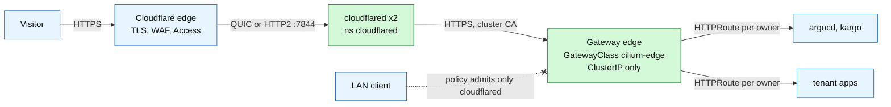

# RFC 0026: Expose each cluster through its own Cloudflare Tunnel

<!-- readability: allow-code R2 -->

## Summary

`cloudflared` sends every request
to an edge Gateway reachable only through the tunnel. Before, one dashboard-made tunnel serves olympus through one
connector; after, each Talos cluster has its own, created by OpenTofu with a
least-privileged token.

| Decision | Why | Cost | Reversible |
|---|---|---|---|
| One remotely-managed tunnel per Talos cluster, created without a secret, with its DNS records, by `clusters/<name>/` | A leaked connector token exposes one cluster's hostnames | Account-wide tunnel permission | yes: per hostname, revert the CNAME `content` to the olympus tunnel and apply (minutes); whole cluster, disable `cloudflared` and destroy the module's resources, olympus keeps serving until its tunnel is deleted |
| Every Access application in `landing-zone/cloudflare`; least-privileged cluster-root token | Its token cannot change Access | Landing zone applied before a new cluster | open: [undo steps](#open-questions) only, the decision is settled |
| Tenant `hostnames` feed DNS, Access and listeners | One list per tenant, no tunnel change | Hostnames go down with the cluster | open: [tenant hostnames](#open-questions) |
| A person-run task moves the connector token to the secrets backend | No secret in state | One run per creation or rotation | open: [token copy in the backend](#open-questions) |
| Explicit rules for JWT-validated platform hosts, then catch-all to an edge Gateway only `cloudflared` reaches, one listener per owner, HTTPS with the cluster CA | No path around Access, no claim on a foreign hostname | Pending LoadBalancer to verify | open: [undo of Gateway and listeners](#open-questions) |

## Context

- [ADR-0013](../adr/0013-public-exposure-via-cloudflare-tunnel.md) picks Cloudflare Tunnel via an opt-in `cloudflared`
  component; it defers who creates tunnels and DNS records, and the `cloudflared` egress rules.
- `landing-zone/cloudflare/` (provider 5.28.1) owns zones, the Zero Trust organization, [Access policies](../research/0026-cloudflare-tunnel-ownership.md#landing-zone-today)
  and a catch-all Access application on `*.<domain>`. Its rule: no secret value is created by a resource.
- `gsuquet/homelab` (frozen) runs olympus's dashboard-made [tunnel](../research/0026-cloudflare-tunnel-rollout.md#olympus-today), nothing in IaC.
- Settled: rendered manifests; ESO store `secrets` everywhere, backend open; kind offline; non-kind state in R2; plan
  stays local; OpenTofu; a `network-policy` component hosts platform policies; the least-privileged token
  ([RFC 0013 amendment](https://github.com/gsuquet/infra/pull/18)), so every Access application stays in the landing zone.
- Research 2026-11-18, 2026-11-19. **(verified)**: checked against the linked source or the 5.28.1 provider schema.
  **(unverified)**: prior knowledge or a source outside the allowed domains.
- Decision needed now: the Talos cluster root, the `cloudflared` component and the olympus migration wait on it.

## Goals and non-goals

Goals:

- Public HTTP services of every Talos cluster reachable through Cloudflare, with no inbound port and no public IP.
- No tunnel secret, connector token or other secret value in any OpenTofu state.
- A new tenant hostname needs a DNS record and an `HTTPRoute`, never a tunnel config change.
- No path around Access: the edge Gateway answers only `cloudflared`.
- A tenant cannot claim a platform or another tenant's hostname.
- The cluster-root Cloudflare token cannot change any Access application, policy or Zero Trust setting.
- Olympus hostnames move to Talos with no DNS gap and a one-apply rollback.

Non-goals:

- `cloudflared` on kind, and on GKE until its Gateway implementation is chosen
  ([limits](../research/0026-cloudflare-tunnel-component.md#gke-and-kind-limits)).
- The secrets backend and its write CLI ([RFC 0020](https://github.com/gsuquet/infra/pull/4)).
- A LAN Gateway, Git webhooks and CLI access through Access: opt-in, see [Open questions](#open-questions).
- Non-HTTP traffic and private-network routing through the tunnel (WARP).

## Decision drivers

- No secret in state, no DNS-write or Access-write credential in a cluster.
- Blast radius of a leaked credential limited to one cluster and no Access bypass.
- Cluster lifecycle (`cluster:up|down`) self-contained, with no landing-zone apply for tenant DNS.
- Few moving parts per new hostname.
- Fits the settled layout (`landing-zone/`, `modules/`, `clusters/<name>/`) and rendered manifests.

## Options considered

Detail: [options](../research/0026-cloudflare-tunnel-options.md).

### Remote-managed tunnel per cluster, owned by the cluster root

The cluster root creates the tunnel, its ingress config and its DNS records; the landing zone keeps Access.

- Good: a leaked connector token exposes one cluster's hostnames (blast radius).
- Bad: the cluster-root token's `cloudflared Write` is account-wide: one root's token can read the connector token
  of, or delete, every tunnel; per-root tokens isolate DNS by zone only, not tunnels (blast radius).

### Landing zone creates every cluster's tunnel

All tunnels, configs and records live in `landing-zone/cloudflare`.

- Good: one Cloudflare root and one Cloudflare token (layout).
- Bad: its token holds tunnel and DNS write for every cluster (blast radius).

### Tenant hostnames in a separate tenant root

A separate root owns the tenant CNAMEs.

- Good: clean split of platform and tenant ownership.
- Bad: its CNAMEs dangle (error 1016) when `cluster:down` deletes the tunnel (lifecycle).

### One shared tunnel in the landing zone

A single tunnel outlives clusters.

- Good: one Cloudflare root (layout).
- Bad: one token attaches connectors for every cluster's hostnames (blast radius).

### Locally-managed tunnel per cluster, ingress in Git

`config_src = "local"` and a `config.yaml` rendered into Git.

- Good: ingress is GitOps-native (layout), but the catch-all leaves almost nothing to version.
- Bad: the credentials JSON comes from `tunnel_secret` in state or from the account-wide `cert.pem` of
  `cloudflared tunnel login` **(unverified scope)** (no secret in state).

### external-dns in the cluster for tenant hostnames

external-dns writes CNAMEs from `HTTPRoute`s.

- Good: no OpenTofu for tenant hosts (few moving parts).
- Bad: a zone-wide DNS-write token in the cluster can repoint MX and every tunnel CNAME (no DNS-write in cluster).

### Do nothing

Keep olympus's dashboard tunnel and add the Talos tunnel by hand, one ingress rule per hostname to each Service.

- Good: no work now.
- Bad: nothing reproducible; each rule bypasses the Gateway, its policies and metrics; a single replica.

## Proposal

The edge Gateway has no address outside the cluster, so Access cannot be bypassed from the LAN; `cloudflared`
connects outbound.

Legend: green is new, blue is external.

The landing zone decides who passes Access, the cluster root which names reach the cluster, and the listeners who owns each name.

- [Ownership](../research/0026-cloudflare-tunnel-ownership.md): who creates what.
- [Tokens](../research/0026-cloudflare-tunnel-tokens.md): API permissions, connector token.
- [Edge Gateway](../research/0026-cloudflare-tunnel-edge-gateway.md): rules, listeners, TLS.
- [Access](../research/0026-cloudflare-tunnel-access.md): logins, hostnames.
- [Component](../research/0026-cloudflare-tunnel-component.md): Deployment, policies.
- [Rollout](../research/0026-cloudflare-tunnel-rollout.md): gates, migration.

## Operational impact

- Blast radius: one Talos cluster's public hostnames (platform UIs and tenants) per tunnel; the
  `clusters/<name>/terraform.tfstate` state in R2; the landing-zone Access applications shared by every cluster. A
  wrong edge-Gateway policy blocks all public traffic of that cluster; a wrong listener lets a tenant claim a host.
- Rollout: kind gates first, olympus hostnames last and one at a time, each step waits for the previous one;
  [seven steps](../research/0026-cloudflare-tunnel-rollout.md#rollout-steps).
- Rollback: per hostname, revert the CNAME `content` to the olympus tunnel and apply (minutes); whole cluster,
  disable `cloudflared` and destroy the module's resources, olympus keeps serving until its tunnel is deleted.
- Migration: dashboard-made CNAMEs imported into the Talos root state and repointed in place; olympus tunnel kept
  until the last host moves.
- Security: new least-privileged Cloudflare token per cluster root (tunnel, DNS, Access read); connector token in the
  secrets backend only; edge Gateway reachable only from `cloudflared`; no DNS-write or Access-write credential in
  any cluster; Access applications only in the landing zone.
- Cost: N/A: tunnels and Zero Trust Free within 50 seats are free **(unverified)**; no load balancer.
- Observability: `cloudflared` `/ready` probe; tunnel `status`; error 1016 at the edge when a tunnel is down; the
  first-run gates; [more signals](../research/0026-cloudflare-tunnel-component.md#observability).

## Drawbacks and risks

Severities are proposed by the author.

| Risk | Severity | Mitigation |
|---|---|---|
| `Cloudflare One Connector: cloudflared Write` is account-wide: one cluster root's token can read the connector token of, or delete, every tunnel in the account | high | The token lives only in Pass, is used only by the owner at plan, apply and token-task time, never in a cluster or CI |
| Edge Gateway with a pending LoadBalancer may not serve **(unverified)** | high | Kind gate; if it fails, the [fallback](../research/0026-cloudflare-tunnel-rollout.md#fallback-when-the-edge-gateway-gate-fails) is a decision needed before rollout |
| Remote rule model and `caPool` path resolution are **(unverified)** | medium | Plain HTTP first step; kind gate |
| A Bypass path is unlogged and widens Argo CD's API surface | medium | Webhooks off by default |
| `Access: Apps and Policies Read` lets the cluster root read every Access application and policy | medium | Read-only, no secret in `self_hosted` apps; [alternative](../research/0026-cloudflare-tunnel-tokens.md#cluster-root-cloudflare-token) |
| Public edge depends on Cloudflare (ADR-0013) | medium | Accepted |
| Landing zone applied before a new cluster or public tenant host | low | Both fail closed (plan error, catch-all login) |
| Person-run token step per tunnel creation and rotation | low | One task, piped end to end; [until](../research/0026-cloudflare-tunnel-tokens.md#connector-token-delivery) the provider changes |
| No drift on the tunnel resource after an API rotation is **(unverified)** | low | `tunnel_secret` is not computed and stays null; first-run gate |
| Per-owner listeners hit 64 per Gateway **(unverified)** | low | Second edge Gateway or `ListenerSet` **(unverified, experimental)** |

## Open questions

- Tenant hostnames: confirm DNS in the cluster root and Access in the landing zone, both from
  `gitops/tenants/<tenant>.yaml` `hostnames`, and that a tenant's public hostname goes down with `cluster:down`.
- Public tenant apps: a Bypass application per public hostname under the landing-zone catch-all, or public hosts on
  a separate domain without a catch-all?
- DNS-write tokens: if publicly trusted in-cluster certificates are needed later (LAN Gateway), which
  [route](../research/0026-cloudflare-tunnel-edge-gateway.md#public-certificates-later); revisit
  external-dns with the same answer. Accept plain HTTP to the Gateway until the CA issuer exists?
- GKE origin: which in-cluster Gateway implementation on GKE (Envoy Gateway or another catalog entry), and which
  `cloudflared` network-policy flavour ([RFC 0024](https://github.com/gsuquet/infra/pull/7) rules out a GKE Gateway controller)?
- CLI access to Argo CD and Kargo: through [Access](../research/0026-cloudflare-tunnel-access.md#access), or LAN and `kubectl port-forward` only?
- Free plan seats: confirm the 50-user limit against household and family use.
- Provider bumps: who watches for `tunnel_secret_wo` or an ephemeral token resource: a Renovate PR note or a TODO in
  the module?
- LAN access: is a `lan` Gateway wanted, and may platform UIs attach to it (skipping Access)?
- Git webhooks: which clusters, if any, opt in?
- Proposed by the author: what are the undo steps of each Reversible cell that says open? Access ownership and the
  least-privileged token stay settled.

## Decision

Pending.

## Implementation

N/A: not accepted yet.

## References

- [ADR-0010](../adr/0010-cluster-owned-default-deny-network-policy.md),
  [ADR-0016](../adr/0016-secret-store-named-secrets.md),
  [ADR-0018](../adr/0018-terraform-state-backends.md)
- [RFC 0022](https://github.com/gsuquet/infra/pull/11), [RFC 0024](https://github.com/gsuquet/infra/pull/7)
- [External sources](../research/0026-cloudflare-tunnel-options.md#references)

## Future work

- Landing-zone [README wording](../research/0026-cloudflare-tunnel-ownership.md#landing-zone-today).
- Runtime `ValidatingAdmissionPolicy` on tenant `HTTPRoute` hostnames.
- Per-token client IP filtering on the cluster-root token **(unverified)**.
