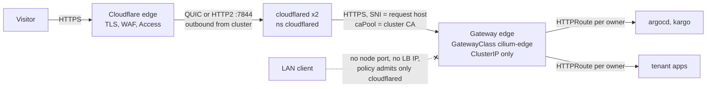
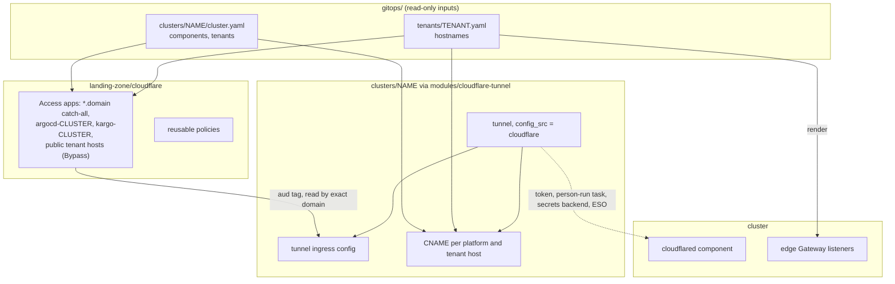
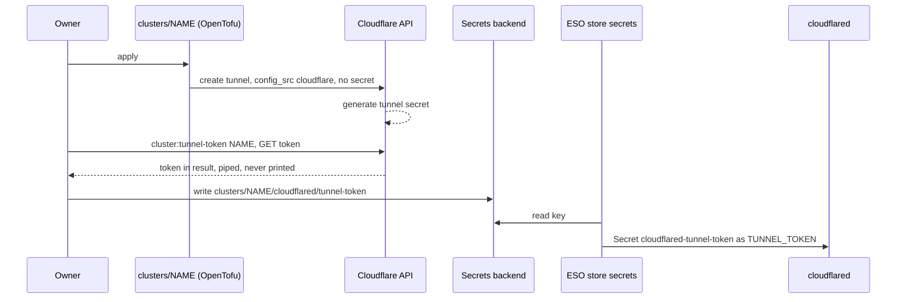
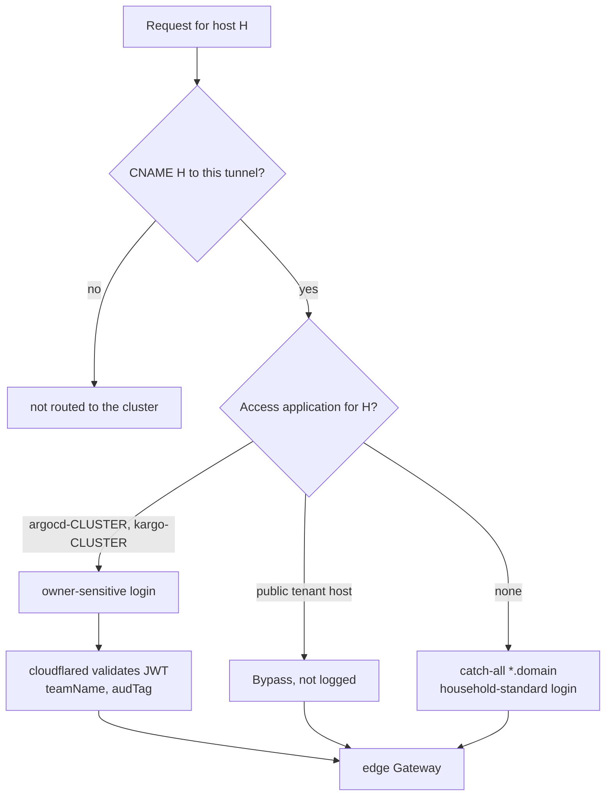
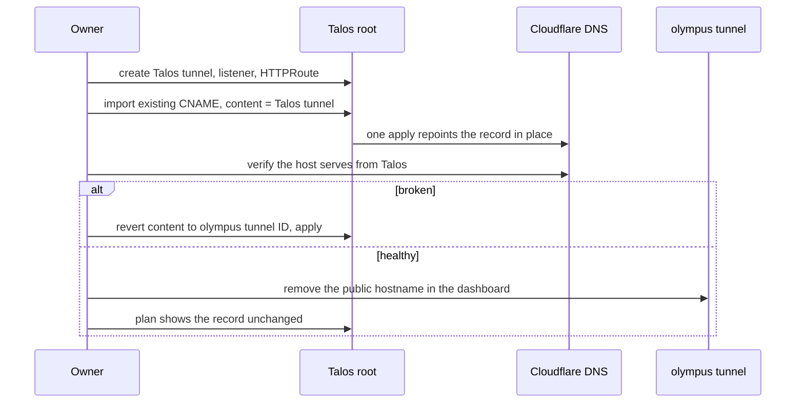

# RFC 0026: Expose each cluster through its own Cloudflare Tunnel

## Summary

Each Talos cluster gets one remotely-managed Cloudflare Tunnel, created without a secret by its OpenTofu root
`clusters/<name>/` with a least-privileged token. `cloudflared` sends every request to an edge Gateway reachable
only through the tunnel, where per-owner listeners bind hostnames to their owner. Every Access application,
account-wide and per cluster, stays in `landing-zone/cloudflare`; the connector token never enters state.

## Context

- ADR-0013 picks Cloudflare Tunnel via an opt-in `cloudflared` component; it defers who creates tunnels and DNS
  records, and the `cloudflared` egress rules.
- `landing-zone/cloudflare/` (provider 5.28.1) owns zones, the Zero Trust organization, Access groups, the reusable
  policies (`owner-sensitive`, `household-standard`, `family-sensitive`) and a catch-all Access application on
  `*.<domain>` (`household-standard`). Its rule: no secret value is created by a resource.
- `gsuquet/homelab` (frozen) runs one dashboard-made tunnel for olympus: one replica, token from a SealedSecret,
  hostnames and DNS records added in the dashboard, nothing in IaC.
- Settled: rendered manifests; ESO store `secrets` everywhere, backend open (RFC 0020); kind offline; non-kind state
  in R2; plan stays local. 2026-11-19: OpenTofu (RFC 0022); a `network-policy` component hosts platform policies;
  the cluster-root Cloudflare token is least-privileged, so every Access application stays in the landing zone.
- Research 2026-11-18, revised 2026-11-19. **(verified)**: checked against the linked source or the 5.28.1 provider
  schema. **(unverified)**: prior knowledge or a source outside the allowed domains.
- Decision needed now: the Talos cluster root, the `cloudflared` component and the olympus migration wait on it.

## Goals and non-goals

Goals:

- Public HTTP services of every Talos cluster reachable through Cloudflare, with no inbound port and no public IP.
- No tunnel secret, connector token or other secret value in any OpenTofu state.
- A new tenant hostname needs a DNS record and an `HTTPRoute`, never a tunnel config change.
- No path around Access: the edge Gateway answers only `cloudflared`.
- A tenant cannot claim a platform or another tenant's hostname.
- The cluster-root Cloudflare token cannot change any Access application, policy or Zero Trust setting.
- Olympus hostnames move to Talos with no DNS gap and a one-apply rollback.

Non-goals:

- `cloudflared` on kind (a dummy token only crash-loops) and on GKE until its Gateway implementation is settled.
- The secrets backend and its write CLI (RFC 0020).
- A LAN Gateway, Git webhooks and CLI access through Access: opt-in, see Open questions.
- Non-HTTP traffic and private-network routing through the tunnel (WARP).

## Decision drivers

- No secret in state, no DNS-write or Access-write credential in a cluster.
- Blast radius of a leaked credential limited to one cluster and no Access bypass.
- Cluster lifecycle (`cluster:up|down`) self-contained, with no landing-zone apply for tenant DNS.
- Few moving parts per new hostname.
- Fits the settled layout (`landing-zone/`, `modules/`, `clusters/<name>/`) and rendered manifests.

## Options considered

### Remote-managed tunnel per cluster, owned by the cluster root

`clusters/<name>/` creates the tunnel (`config_src = "cloudflare"`, no secret), its ingress config and the DNS
records; the landing zone keeps every Access application.

- Good: a leaked connector token exposes one cluster's hostnames (blast radius).
- Good: tunnel and records live and die with the cluster state, so a CNAME never dangles (lifecycle).
- Good: the catch-all rule makes the ingress static per cluster (few moving parts).
- Bad: one person-run step per tunnel creation or rotation to move the token into the backend (no secret in state).
- Bad: the landing zone must know every cluster's platform hostnames (lifecycle).

### One shared tunnel in the landing zone

A single tunnel outlives clusters; DNS decides nothing, Cloudflare picks any connected replica.

- Good: one Cloudflare root (layout).
- Bad: one token attaches connectors for every cluster's hostnames (blast radius).
- Bad: every cluster must serve every hostname; during the olympus move traffic splits unpredictably (lifecycle).
- Bad: health is mixed across clusters in one tunnel.

### Locally-managed tunnel per cluster, ingress in Git

`config_src = "local"`: a credentials JSON plus a `config.yaml` ConfigMap rendered into Git.

- Good: ingress is GitOps-native (layout), but the catch-all leaves almost nothing to version.
- Bad: the credentials JSON comes from `tunnel_secret` in state or from the account-wide `cert.pem` of
  `cloudflared tunnel login` **(unverified scope)** (no secret in state).
- Bad: config visible only on the host, not in the dashboard.

### external-dns in the cluster for tenant hostnames

external-dns writes CNAMEs from `HTTPRoute`s.

- Good: no OpenTofu for tenant hosts (few moving parts).
- Bad: a zone-wide DNS-write token in the cluster can repoint MX and every tunnel CNAME (no DNS-write in cluster).
- Bad: any tenant whose route attaches to the edge Gateway publishes a name; Access applications still need IaC.

### Do nothing

Keep olympus's dashboard tunnel and add the Talos tunnel by hand, one ingress rule per hostname to each Service.

- Good: no work now.
- Bad: nothing reproducible; each rule bypasses the Gateway, its policies and metrics; a single replica.

## Proposal

### Traffic path

The edge Gateway has no address outside the cluster, so Access cannot be bypassed from the LAN.

### Ownership

One list of hostnames per tenant feeds DNS, Access and the Gateway listeners.

| Owner | Resources | Inputs |
| --- | --- | --- |
| `landing-zone/cloudflare` | Every `cloudflare_zero_trust_access_application`: catch-all, `argocd-<cluster>` and `kargo-<cluster>` (`owner-sensitive`) per cluster that enables `cloudflared`, a Bypass application per public tenant hostname | `gitops/clusters/*/cluster.yaml`, `gitops/tenants/*.yaml`, read with `yamldecode(file(...))` |
| `modules/cloudflare-tunnel` in `clusters/<name>/` | `cloudflare_zero_trust_tunnel_cloudflared` (no `tunnel_secret`), `cloudflare_zero_trust_tunnel_cloudflared_config`, one `cloudflare_dns_record` per platform and tenant hostname (`CNAME`, `content = "${tunnel.id}.cfargotunnel.com"`, `proxied = true`, `ttl = 1`). Outputs: tunnel ID, hostnames | `tenants` of its `cluster.yaml`, `hostnames` of each tenant file, `var.tunnel_origin`, `var.zero_trust_team_name` |
| `gitops/components/cloudflared/` | Deployment, `ExternalSecret`, `PodDisruptionBudget`, CA bundle mount | opt-in in `cluster.yaml`; no value goes through the render step |
| `network-policy` component | `cloudflared` egress and the edge Gateway admission policy | network implementation of the cluster |

- The coupling of IaC roots to gitops files is deliberate and read-only: `tenants` of `cluster.yaml`, and a new
  `hostnames` field of the tenant schema (per hostname: `public: true` for a Bypass application, else the catch-all).
- Cluster roots never read the landing-zone state: `cloudflare_zone` by `filter` (name),
  `cloudflare_zero_trust_access_applications` by `domain` with `exact = true` for the `aud` tag **(verified, schema)**.
- `cloudflare_zero_trust_tunnel_cloudflared_config` owns the whole ingress list of one tunnel: two roots cannot
  share it (inferred from the resource shape).
- Apply order: landing zone, then cluster root. A cluster root whose Access application is missing fails at plan
  (data source empty); a tenant host without its Bypass application stays behind the catch-all. Both fail closed.
- Tenant CNAMEs share the cluster state: `cluster:down` takes a tenant's public hostname down with the cluster. A
  hostname listed by two clusters fails `manifests:check`.

### Cluster-root Cloudflare token

One Pass item per cluster root, used only by the person running `plan`/`apply` and the token task. Names from
[API token permissions](https://developers.cloudflare.com/fundamentals/api/reference/permissions/) and each endpoint's
"Accepted permissions" in the [API reference](https://developers.cloudflare.com/api/) **(verified)**.

| Scope | Permission | Needed by |
| --- | --- | --- |
| Account | `Cloudflare One Connector: cloudflared Write` | `POST /accounts/{account_id}/cfd_tunnel` (create), delete, `PUT .../cfd_tunnel/{tunnel_id}/configurations`, `GET .../token` and `PATCH` for the token task |
| Account | `Access: Apps and Policies Read` | `GET /accounts/{account_id}/access/apps?domain=` for the `aud` tag of `argocd-<cluster>` and `kargo-<cluster>` |
| Zone, each domain the cluster serves | `Zone Read` | `GET /zones` for the `cloudflare_zone` lookup by name |
| Zone, each domain the cluster serves | `DNS Write` | `cloudflare_dns_record` create, update, delete |

- Not granted: `Access: Apps and Policies Write` (account or zone), `Access: Organizations`, `Zero Trust`,
  `Zone Edit`, R2 (state uses its own R2 token), any other zone.
- `Cloudflare Tunnel Write` and `Cloudflare One Connectors Write` are accepted by the same endpoints; the latter also
  covers WARP connectors, so `cloudflared Write` is the narrowest.
- The Access team name comes from `var.zero_trust_team_name` (not secret), so no `Access: Organizations Read`.
- The `aud` lookup by exact domain returns `self_hosted` applications only; the SaaS `client_secret` in the data
  source schema is "only returned on POST request" **(verified, schema)**.

### Connector token delivery

The token goes from the API straight into the backend, never into state, a file or a terminal.

| Option | Secret in state | Person step | Verdict |
| --- | --- | --- | --- |
| `tunnel_secret` from `random_bytes` | Yes | None | Violates the repo rule |
| Token data source pushed by IaC into the backend | Yes: `token` is `computed` + `sensitive` **(verified, schema)** | None | Violates the repo rule |
| **IaC creates the tunnel without a secret; person-run task moves the token** | No | One run per creation or rotation | **Chosen**: same pattern as the OAuth identity providers kept out of IaC |
| Tunnel created in the dashboard, then imported | No | Click + import | More manual, no benefit |
| Wait for a write-only `tunnel_secret_wo` or an ephemeral token resource | No | None | Exists neither in 5.28.1 nor in 5.29.0 (2026-11-11) **(verified)**; revisit at each provider bump |

- Task `mise run cluster:tunnel-token <name> [--rotate]`: tunnel ID from `tofu output`, API token from
  `pass-cli run`, `result` piped into the backend CLI. Person-run only, like `cf:ids`. The write step waits for RFC
  0020.
- `--rotate`: generate the secret inside the task, `PATCH /accounts/{account_id}/cfd_tunnel/{tunnel_id}`, write the
  returned token, let ESO refresh, restart the Deployment. The old token opens no new connection; live connectors
  keep serving; two replicas roll half at a time. Compromise: also `DELETE .../cfd_tunnel/{tunnel_id}/connections`
  ([tunnel permissions](https://developers.cloudflare.com/cloudflare-one/networks/connectors/cloudflare-tunnel/configure-tunnels/remote-tunnel-permissions/),
  **verified**).
- Component side: an `ExternalSecret` (`external-secrets.io/v1`, store kind and key path per RFC 0020
  **(unverified)**) targets Secret `cloudflared-tunnel-token`, key `token`, read as `TUNNEL_TOKEN` via `secretKeyRef`.

### Ingress rules and the edge Gateway

| Option | Rules | Change per new hostname | Verdict |
| --- | --- | --- | --- |
| One rule per hostname to each backend Service (homelab) | Grow | Tunnel config + DNS; bypasses the Gateway | Rejected |
| One rule per hostname to the Gateway | Grow | Tunnel config + DNS + `HTTPRoute` | Rejected |
| **Explicit rules for JWT-validated platform hosts, then catch-all to the Gateway with `match_sn_ito_host`** | Static | DNS (+ Access) + `HTTPRoute` | **Chosen** |

- The catch-all replaces `http_status:404`: a host without route gets the Gateway's 404. Only names with a proxied
  CNAME to this tunnel reach it, so DNS exposure does not widen; route attachment becomes where names are claimed.
- Origin: `var.tunnel_origin`, default `https://cilium-gateway-edge.gateway.svc.cluster.local:443`, an IaC input
  (not rendered from `cluster.yaml`, which only enables the component).
- Edge Gateway on its own GatewayClass `cilium-edge` with a `CiliumGatewayClassConfig`. Its `service.type` accepts
  only `LoadBalancer` or `NodePort`, not `ClusterIP`
  ([parameterized GatewayClass](https://docs.cilium.io/en/stable/network/servicemesh/gateway-api/parameterized-gatewayclass/),
  **verified**), so:

| Control | Setting |
| --- | --- |
| No node port | `service.allocateLoadBalancerNodePorts: false` |
| No external IP | No `CiliumLoadBalancerIPPool` selects the Service (or `loadBalancerClass` names an unserved class); it stays `<pending>`, reachable by ClusterIP only **(unverified: Envoy listener with a pending LB)** |
| Only `cloudflared` gets in | `CiliumClusterwideNetworkPolicy` on the reserved `ingress` identity: from `cloudflared` endpoints, not `world` (identity **verified**, [Cilium Gateway API](https://docs.cilium.io/en/stable/network/servicemesh/gateway-api/gateway-api/); policy shape **unverified**) |
| Hostnames bound to owners | One `platform` listener per platform hostname, `allowedRoutes` selecting `argocd`, `kargo` by a label tenants cannot set; one listener per tenant hostname (exact, rendered from `gitops/tenants/<tenant>.yaml`) selecting that tenant's namespaces by the infra tenant label; no wildcard listener |

- Gateway API resolves conflicting `HTTPRoute`s by creation time and `allowedRoutes` filters only by namespace,
  hence per-owner listeners. Tenants cannot set the selecting label: infra creates their namespaces and the
  AppProject forbids cluster-scoped resources.
- 64 listeners per Gateway **(unverified)**; past that, a second edge Gateway or a `ListenerSet` **(unverified,
  experimental)**.
- Second layer: a `ValidatingAdmissionPolicy` on tenant `HTTPRoute.spec.hostnames` (tenant manifests live in
  `gsuquet/gitops`, outside this repository's Conftest).
- A LAN Gateway, if wanted, is a separate `lan` Gateway with its own GatewayClass and LB IPAM pool, outside Access.

### TLS from `cloudflared` to the Gateway

| Option | Verification | Credential | Verdict |
| --- | --- | --- | --- |
| Plain HTTP | None | None | Accepted as a first step until the CA issuer exists |
| HTTPS + `noTLSVerify: true` | None | None | Rejected |
| Cloudflare Origin CA certificate | Implicit trust **(unverified)** | Key from `tls_private_key` in state, or origin-ca-issuer with an Origin CA key in the cluster **(unverified)** | Rejected: secret, not browser-trusted |
| Let's Encrypt DNS-01, `matchSNItoHost` | Public roots | Zone-wide `DNS Write` token in the cluster | Rejected: same objection as external-dns |
| Let's Encrypt DNS-01 via a delegated challenge zone | Public roots | `DNS Write` on the challenge zone only; cert-manager follows CNAMEs **(unverified)** | Preferred route if a LAN Gateway needs public trust |
| **In-cluster cert-manager CA; `cloudflared` trusts it via `caPool`, checks names via `matchSNItoHost`** | Cluster CA | None outside the cluster | **Chosen** |

- `caPool` is a file path in the container (CA bundle mounted from a Secret or a trust-manager bundle); that a
  remote config's `caPool` resolves on the connector's filesystem is **unverified**. `noTLSVerify` stays `false`.
- The `ca_pool` registry text ("only if your certificate is not signed by Cloudflare") implies default trust of
  Origin CA **(unverified as a guarantee)**.

### Access

Every hostname falls under exactly one Access application; anything not listed fails closed to the catch-all.

- Argo CD and Kargo keep their own SSO behind Access. Access as OIDC provider (SaaS app) is out: its
  `saas_app.client_secret` is `computed` + `sensitive` in 5.28.1 **(verified, schema)**.
- Bypass "disables Access enforcement" and is "not logged"; Service Auth keeps logging
  ([policies](https://developers.cloudflare.com/cloudflare-one/access-controls/policies/), **verified**). A host-level
  application beating `*.<domain>` is **(unverified)**; the landing zone already relies on it.
- Git webhooks off by default: Argo CD polls every three minutes; its webhook secret is optional, the endpoint
  "lacks rate limiting protection" ([Argo CD webhooks](https://argo-cd.readthedocs.io/en/stable/operator-manual/webhook/),
  **verified**). Kargo warehouses poll.

| Webhook opt-in | Shape |
| --- | --- |
| Argo CD | Landing-zone Bypass application on `argocd-<cluster>` path `/api/webhook` (path-over-host precedence **unverified**), `webhook.github.secret` from ESO mandatory, `webhook.maxPayloadSizeMB` lowered |
| Kargo | External webhook server on its own Service **(unverified)**, own host `kargo-hooks-<cluster>`, own platform listener, host-level Bypass application, receiver secret from ESO |

- GitHub webhooks send no custom headers, so Service Auth cannot serve them **(unverified)**.

### Hostnames, DNS and limits

| Fact | Consequence | Source |
| --- | --- | --- |
| Universal SSL covers apex and first-level subdomains only | `<app>-<cluster>.gsuquet.com` for platform UIs, `<app>.gsuquet.com` for tenants; `*.olympus.gsuquet.com` would need Advanced Certificate Manager | [limitations](https://developers.cloudflare.com/ssl/edge-certificates/universal-ssl/limitations/) **(verified)** |
| CNAME to `<UUID>.cfargotunnel.com` proxies records of the same account only; a stopped tunnel leaves the record (error 1016) | Records in the tunnel's state | [DNS records](https://developers.cloudflare.com/cloudflare-one/networks/connectors/cloudflare-tunnel/routing-to-tunnel/dns/) **(verified)** |
| Wildcard records are proxied on every plan; an exact record wins | Exact records only | [wildcards](https://developers.cloudflare.com/dns/manage-dns-records/reference/wildcard-dns-records/) **(verified)** |
| Rules first to last, last is a catch-all, leading wildcard only, `path` is a Go regexp | Catch-all to the Gateway | [configuration file](https://developers.cloudflare.com/cloudflare-one/networks/connectors/cloudflare-tunnel/do-more-with-tunnels/local-management/configuration-file/) **(verified local; remote unverified)** |
| 1,000 tunnels, 25 replicas per tunnel, 1 MB config, 500 Access apps, 500 reusable policies, 50 domains per app | One tunnel and two replicas per cluster; three policies today | [account limits](https://developers.cloudflare.com/cloudflare-one/account-limits/) **(verified)** |
| Any Access login consumes a seat; Free plan 50 users **(unverified)**; Bypass visitors take none **(unverified)**; tunnels free **(unverified)** | Household and family logins count | [seats](https://developers.cloudflare.com/cloudflare-one/team-and-resources/users/seat-management/) |

### `cloudflared` component

- Deployment, 2 replicas (availability, not load-balancing; scaling down can break open connections), pinned
  digest, non-root, read-only root FS, `TUNNEL_TOKEN` from the Secret,
  `tunnel --no-autoupdate --loglevel info --output json --metrics 0.0.0.0:2000 run`, liveness `GET /ready` on 2000
  (200 only with an edge connection); `PodDisruptionBudget` `minAvailable: 1`; no ICMP sysctl (private networks only)
  ([Kubernetes guide](https://developers.cloudflare.com/cloudflare-one/networks/connectors/cloudflare-tunnel/deployment-guides/kubernetes/),
  **verified**).
- Egress ([tunnel with firewall](https://developers.cloudflare.com/cloudflare-one/networks/connectors/cloudflare-tunnel/configure-tunnels/tunnel-with-firewall/),
  **verified**): `region1|region2.v2.argotunnel.com` on 7844 TCP (`http2`) and UDP (`quic`); 443 to
  `<team>.cloudflareaccess.com` for JWT validation; `api.cloudflare.com` and `update.argotunnel.com` only for update
  checks (off); DNS TXT `cfd-features.argotunnel.com`.
- Policies, in the `network-policy` component:

| Cluster | Policy |
| --- | --- |
| Talos, kind (Cilium) | `CiliumNetworkPolicy`: egress `toEntities: [world]` on 7844 TCP/UDP (`toFQDNs` needs the DNS proxy), 443 to the team domain, egress to the `ingress` identity; the edge Gateway admission policy above, and `ingress` to backends |
| GKE (Dataplane V2) | Not offered: a Cilium CRD would fail the sync; Kubernetes `NetworkPolicy` by CIDR or `FQDNNetworkPolicy` **(unverified)** once open question 4 is settled |

- kind: not enabled. A demo tunnel `dev-<user>` can be made by hand, outside the platform.

### Olympus migration

Each hostname flips atomically and rolls back with one apply.

- Hostnames deeper than one level get new names under the scheme (no flip possible). When olympus is gone, delete
  its tunnel in the dashboard. A record later moved between clusters: the old root drops it with a `removed` block.
- Whether removing a dashboard public hostname deletes its record is **(unverified)**: Cloudflare only states that
  "The DNS record and the tunnel are independent".

## Operational impact

- Blast radius: one Talos cluster's public hostnames (platform UIs and tenants) per tunnel; the
  `clusters/<name>/terraform.tfstate` state in R2; the landing-zone Access applications shared by every cluster. A
  wrong edge-Gateway policy blocks all public traffic of that cluster; a wrong listener lets a tenant claim a host.
- Rollout: 1. run the kind checks below on a throwaway cluster; 2. add `hostnames` to the tenant schema and the
  listener render; 3. landing-zone Access applications for the Talos cluster; 4. `modules/cloudflare-tunnel` and the
  Talos root, with a new cluster-root token; 5. `cluster:tunnel-token` once RFC 0020 has a backend; 6. enable
  `cloudflared` and the policies; 7. olympus hostnames one at a time. Each step waits for the previous one.
- Rollback: per hostname, revert the CNAME `content` to the olympus tunnel and apply (minutes); whole cluster,
  disable `cloudflared` and destroy the module's resources, olympus keeps serving until its tunnel is deleted.
- Migration: dashboard-made CNAMEs imported into the Talos root state and repointed in place; olympus tunnel kept
  until the last host moves.
- Security: new least-privileged Cloudflare token per cluster root (tunnel, DNS, Access read); connector token in the
  secrets backend only; edge Gateway reachable only from `cloudflared`; no DNS-write or Access-write credential in
  any cluster; Access applications only in the landing zone.
- Cost: N/A: tunnels and Zero Trust Free within 50 seats are free **(unverified)**; no load balancer.
- Observability: `cloudflared` `/ready` probe and metrics on 2000; tunnel `status` and connector health in the
  dashboard; Gateway and Hubble metrics for routed and denied flows; Access logs (Bypass is not logged); error 1016
  at the edge when a tunnel is down.

## Drawbacks and risks

- `Cloudflare One Connector: cloudflared Write` is account-wide: one cluster root's token can read the connector
  token of, or delete, every tunnel in the account -> the token lives only in Pass, is used only by the owner at plan,
  apply and token-task time, never in a cluster or CI.
- `Access: Apps and Policies Read` lets the cluster root read every Access application and policy -> read-only, no
  secret in `self_hosted` apps; the alternative (copying `aud` by hand) breaks on every recreation.
- The landing zone must be applied before a new cluster or public tenant host -> both fail closed (plan error,
  catch-all login).
- Person-run token step per tunnel creation and rotation -> one task, piped end to end; drop it when the provider
  ships a write-only secret or an ephemeral token.
- Edge Gateway with a pending LoadBalancer may not serve **(unverified)** -> kind check before rollout; fallback a
  `NodePort` with a host firewall rule.
- No drift on the tunnel resource after an API rotation is **(unverified)**: `tunnel_secret` is not computed and
  stays null -> check after the first rotation.
- Per-owner listeners hit 64 per Gateway **(unverified)** -> second edge Gateway or `ListenerSet`.
- Remote rule model and `caPool` path resolution are **(unverified)** -> plain HTTP first step; kind check.
- A Bypass path is unlogged and widens Argo CD's API surface -> webhooks off by default.
- Public edge depends on Cloudflare (ADR-0013) -> accepted.

## Open questions

- Tenant hostnames: confirm DNS in the cluster root and Access in the landing zone, both from
  `gitops/tenants/<tenant>.yaml` `hostnames`, and that a tenant's public hostname goes down with `cluster:down`.
- Public tenant apps: a Bypass application per public hostname under the landing-zone catch-all, or public hosts on
  a separate domain without a catch-all?
- DNS-write tokens: if publicly trusted in-cluster certificates are needed later (LAN Gateway), delegated challenge
  zone, HTTP-01 through the tunnel (Bypass on `/.well-known/acme-challenge/` per host) or a zone-wide token; revisit
  external-dns with the same answer. Accept plain HTTP to the Gateway until the CA issuer exists?
- GKE origin: which in-cluster Gateway implementation on GKE (Envoy Gateway or another catalog entry), and which
  `cloudflared` network-policy flavour (RFC 0024 rules out a GKE Gateway controller)?
- CLI access to Argo CD and Kargo: through Access (`cloudflared access` login or a service token in headers, both
  **unverified** for these CLIs), or LAN and `kubectl port-forward` only?
- Free plan seats: confirm the 50-user limit against household and family use.
- Provider bumps: who watches for `tunnel_secret_wo` or an ephemeral token resource: a Renovate PR note or a TODO in
  the module?
- LAN access: is a `lan` Gateway wanted, and may platform UIs attach to it (skipping Access)?
- Git webhooks: which clusters, if any, opt in?

## Decision

Pending.

## Implementation

N/A: not accepted yet.

## References

- ADR-0010 default deny, ADR-0013 public exposure, ADR-0016 store `secrets`, ADR-0018 state backends
- RFC 0020 secrets backend, RFC 0022 IaC tool, RFC 0024 GKE
- [Terraform deployment guide (provider v5)](https://developers.cloudflare.com/cloudflare-one/networks/connectors/cloudflare-tunnel/deployment-guides/terraform/): reads the token with the data source, which the repo rule forbids
- [Create a tunnel with the API](https://developers.cloudflare.com/cloudflare-one/networks/connectors/cloudflare-tunnel/get-started/create-remote-tunnel-api/)
- [Useful terms](https://developers.cloudflare.com/cloudflare-one/networks/connectors/cloudflare-tunnel/get-started/tunnel-useful-terms/)
- [Origin parameters](https://developers.cloudflare.com/cloudflare-one/networks/connectors/cloudflare-tunnel/configure-tunnels/cloudflared-parameters/origin-parameters/)
- Registry, provider 5.28.1: [`zero_trust_tunnel_cloudflared`](https://registry.terraform.io/providers/cloudflare/cloudflare/5.28.1/docs/resources/zero_trust_tunnel_cloudflared), [`zero_trust_tunnel_cloudflared_config`](https://registry.terraform.io/providers/cloudflare/cloudflare/5.28.1/docs/resources/zero_trust_tunnel_cloudflared_config), [`zero_trust_tunnel_cloudflared_token`](https://registry.terraform.io/providers/cloudflare/cloudflare/5.28.1/docs/data-sources/zero_trust_tunnel_cloudflared_token)

## Future work

- Landing-zone README: replace "Access applications belong to the tenant layer" with "every Access application,
  account-wide and per cluster, lives in `landing-zone/cloudflare`; cluster roots only read them".
- Kind checks before implementation: edge Gateway on ClusterIP only, unreachable from the host; the policies for
  `cloudflared` to Gateway, `world` refused at `ingress`, `ingress` to backends; a tenant `HTTPRoute` on a foreign
  host gets `Accepted=False`; `caPool` reads a mounted file.
- First-run checks: no drift after an API rotation; import-and-flip of a dashboard CNAME; host-plus-path Access
  precedence (only with Argo CD webhooks); Kargo webhook Service and host; CLI behaviour behind Access.
- Runtime `ValidatingAdmissionPolicy` on tenant `HTTPRoute` hostnames.
- Per-token client IP filtering on the cluster-root token **(unverified)**.
