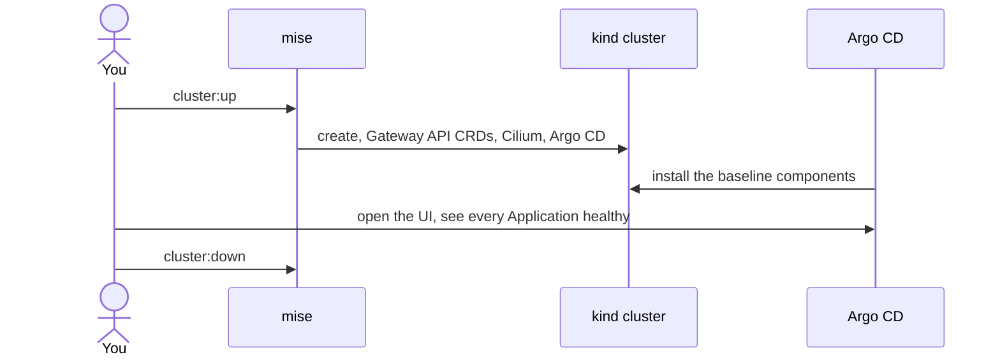

# Tutorial: run your first kind cluster

> **Planned.** This is an outline: `clusters/<name>/`, the `cluster-kind` and `bootstrap-*` modules and the
> `cluster:*` tasks do not exist yet. Each step below becomes a tested command once they do.

You will create a local kind cluster from this repository and watch Argo CD install the baseline components on it.
Afterwards you can change a component and see the change reach your cluster.

Time: not measured yet.

## What you need

- Docker, running.
- mise, then `mise install` from the repository root.
- No cloud account and no credentials: kind state is local and secrets are dummy values.

*The whole tutorial: one command up, one look, one command down.*

## Step 1: Create the cluster

(planned) `mise run cluster:up <name>`; the output shows the cluster, then the three bootstrap steps.

## Step 2: Watch Argo CD take over

(planned) Open the Argo CD UI through a port-forward; every baseline component reaches `Synced` and `Healthy`.

## Step 3: Change a component

(planned) Change one value in the cluster's `cluster.yaml`, render, then commit and push both to the branch the
kind cluster's root `Application` tracks (not decided yet): Argo CD syncs from the Git remote, never from your
working tree. See Argo CD apply the new manifests.

## Step 4: Delete the cluster

(planned) `mise run cluster:down <name>`; the kind cluster and its local state are gone.

## What you built

- A local cluster with the same dataplane as Talos: Cilium with kube-proxy replacement.
- A cluster run by its own Argo CD from rendered manifests.

## Next steps

- [How to add a component](../how-to/add-a-component.md)
- [Cluster lifecycle](../concepts/cluster-lifecycle.md)
