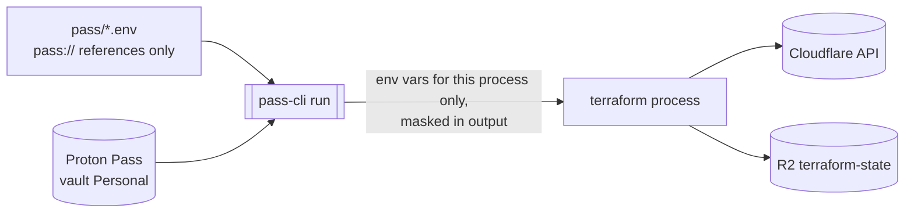
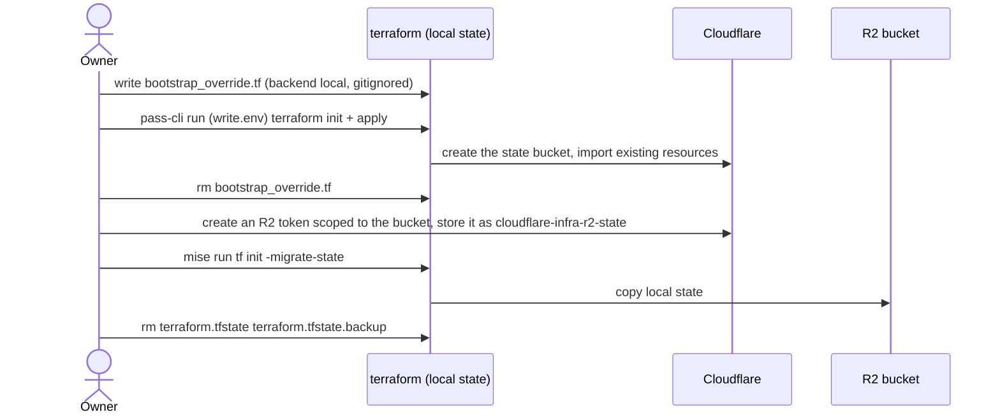

# Cloudflare landing zone

Terraform root for the foundation of the Cloudflare account: the R2 state bucket, the domains and the Zero Trust
foundation. Tenant Workers, R2 buckets and Access applications belong to the tenant layer.

| Managed here | Detail |
| --- | --- |
| R2 bucket | holds every Terraform state, this one included; `prevent_destroy` |
| Domains | one [`modules/cloudflare-domain`](../../modules/cloudflare-domain) instance per entry of `domains` in `terraform.tfvars`: zone, baseline settings, DNSSEC, CAA, Proton Mail records |
| Zero Trust | organization; identity providers without a secret (one-time PIN, passkeys, Cloudflare account); Access groups; reusable policies `<audience>-<tier>` |
| Access applications | account-wide and platform ones only: catch-all per domain, WARP login, App Launcher. Cluster roots use a least-privileged token with no account-wide Access edit |

No resource here creates a secret value: it would be stored in state.

## Quick start

Prerequisites: `mise install`, `pass-cli` logged in to Proton Pass, the [manual prerequisites](#manual-prerequisites)
done.

```sh
pass-cli login
mise run tf init
mise run tf:read plan -lock=false
```

A plan with no unexpected change.

## Usage



*Credentials never leave the Terraform process: `pass/*.env` holds references, `pass-cli run` resolves them.*

| Pass item | Fields | Used by |
| --- | --- | --- |
| `cloudflare-infra-write` | `password`: account API token (write); `account_id` | `mise run tf` (`pass/write.env`) |
| `cloudflare-infra-read` | `password`: read-only twin; `account_id` | `mise run tf:read` (`pass/read.env`) |
| `cloudflare-infra-r2-state` | `username`: R2 token ID; `password`: SHA-256 of the token value; `endpoint`: `https://<account_id>.r2.cloudflarestorage.com` | both (`pass/state.env`) |

| Task | Command |
| --- | --- |
| Plan, read-only (review, agents) | `mise run tf:read plan -lock=false` |
| Apply | `mise run tf apply` |
| List the IDs of a zone | `pass-cli run --env-file pass/read.env -- mise run cf:ids gsuquet.com` |
| Add a domain | add it to `domains` in `terraform.tfvars`, apply, set the `zone_name_servers` output at the registrar |
| Adopt a zone created by hand | `mise run cf:ids <domain>`, add the IDs to `imports.tf`, apply |

## Manual prerequisites

| # | What | Where | Note |
| --- | --- | --- | --- |
| 1 | Zero Trust onboarding: team name, Free plan (payment details required even on Free); set `zero_trust_team_name` in `terraform.tfvars` | dashboard | none |
| 2 | OAuth identity providers (GitHub, Google, LinkedIn): an OAuth app each, redirect URL `https://<team>.cloudflareaccess.com/cdn-cgi/access/callback`; LinkedIn also needs the "Sign In with LinkedIn using OpenID Connect" product. Add only those you use: each can sign the owner in | dashboard, Zero Trust → Settings → Authentication | `client_secret` is not write-only in provider 5.28.1: it would land in state |
| 3 | Access group members and notification recipients: `access_groups = { owner = { emails = [...] }, household = {...}, family = { emails = [...], includes = ["household"] } }`, `notification_emails = ["..."]` | `local.auto.tfvars` | gitignored |
| 4 | IDs of existing resources: `mise run cf:ids <domain>`, `mise run cf:zt-ids` | `imports.tf` | adopts resources that exist before the first apply |
| 5 | Budget alert: one email when the usage-based spend of the billing period crosses a dollar threshold (R2 beyond its free tier) | dashboard, Billing → Billable Usage → Create budget alert | provider 5.29.0 and earlier lack `billing_budget_alert` |

## Bootstrap (first apply only)

This root creates the bucket that stores its own state, so the first apply runs on local state, before the
`cloudflare-infra-r2-state` item exists.



*Local state first, then migrate into the bucket the first apply created.*

```sh
printf 'terraform {\n  backend "local" {}\n}\n' > bootstrap_override.tf   # gitignored
pass-cli run --env-file pass/write.env -- terraform init
pass-cli run --env-file pass/write.env -- terraform apply   # creates the state bucket, imports existing resources
rm bootstrap_override.tf
# Create an R2 API token scoped to the bucket in the dashboard, store it as cloudflare-infra-r2-state
mise run tf init -migrate-state       # copies local state into R2
rm terraform.tfstate terraform.tfstate.backup
```

| Guard rail | Effect |
| --- | --- |
| `prevent_destroy` on the bucket | Terraform refuses to destroy it |
| R2 refuses to delete a non-empty bucket | a second barrier |
| R2 has no object versioning | a corrupted state cannot be rolled back from the bucket |

## Owners

`gsuquet`; issues on this repository.
